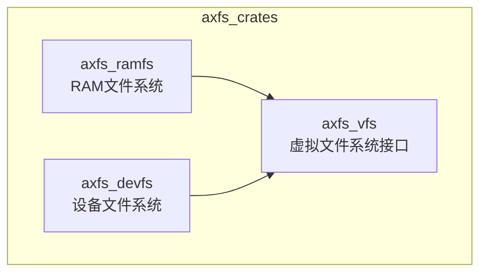
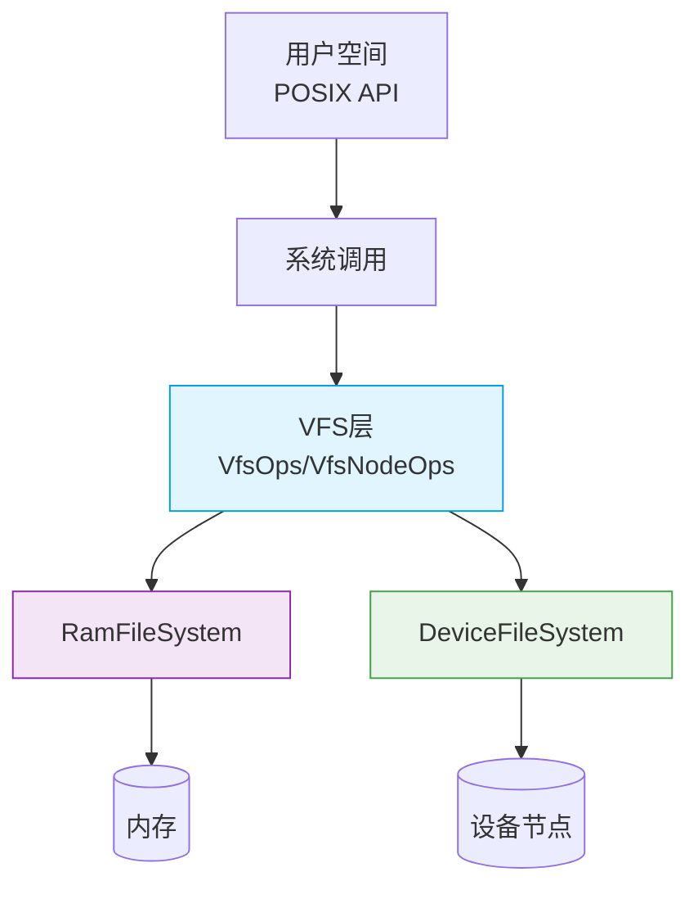
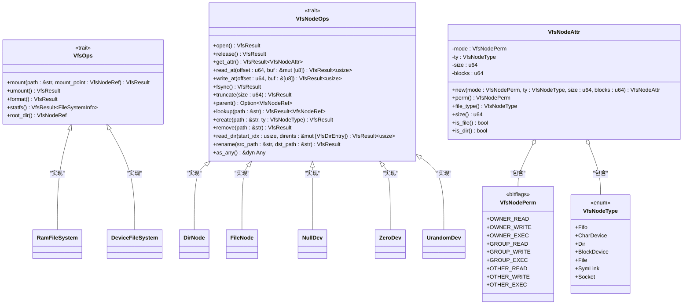

# 与其他系统的集成

<cite>
**本文档中引用的文件**  
- [README.md](file://README.md)
- [axfs_vfs/src/lib.rs](file://axfs_vfs/src/lib.rs)
- [axfs_vfs/src/structs.rs](file://axfs_vfs/src/structs.rs)
- [axfs_ramfs/src/lib.rs](file://axfs_ramfs/src/lib.rs)
- [axfs_ramfs/src/dir.rs](file://axfs_ramfs/src/dir.rs)
- [axfs_ramfs/src/file.rs](file://axfs_ramfs/src/file.rs)
- [axfs_devfs/src/lib.rs](file://axfs_devfs/src/lib.rs)
- [axfs_devfs/src/dir.rs](file://axfs_devfs/src/dir.rs)
- [axfs_devfs/src/null.rs](file://axfs_devfs/src/null.rs)
- [axfs_devfs/src/urandom.rs](file://axfs_devfs/src/urandom.rs)
- [axfs_devfs/src/zero.rs](file://axfs_devfs/src/zero.rs)
</cite>

## 目录
1. [简介](#简介)
2. [项目结构](#项目结构)
3. [核心组件](#核心组件)
4. [架构概述](#架构概述)
5. [详细组件分析](#详细组件分析)
6. [挂载机制与系统调用适配](#挂载机制与系统调用适配)
7. [VFS操作接口桥接原理](#vfs操作接口桥接原理)
8. [默认挂载点配置实践](#默认挂载点配置实践)
9. [外部存储与网络文件系统交互](#外部存储与网络文件系统交互)
10. [接口抽象与多文件系统共存](#接口抽象与多文件系统共存)
11. [客户端使用指南](#客户端使用指南)
12. [安全性考虑](#安全性考虑)
13. [结论](#结论)

## 简介
`axfs_crates` 是 ArceOS 操作系统中的关键文件系统模块集合，提供虚拟文件系统（VFS）接口、RAM 文件系统和设备文件系统实现。该文档详细说明这些组件如何与 ArceOS 集成，特别是通过 `VfsOps` 和 `VfsNodeOps` trait 实现用户空间与内核空间之间的文件操作请求桥接。文档涵盖从挂载机制到安全性的各个方面，旨在为开发者提供全面的技术参考。

## 项目结构
`axfs_crates` 仓库包含三个主要子模块：`axfs_vfs` 提供虚拟文件系统接口定义；`axfs_ramfs` 实现基于内存的 RAM 文件系统；`axfs_devfs` 实现设备文件系统，用于管理特殊设备节点如 `/dev/null`、`/dev/zero` 和 `/dev/urandom`。这种分层设计确保了接口与实现的分离，提高了代码的可维护性和可扩展性。

**图示来源**
- [README.md](file://README.md)

**本节来源**
- [README.md](file://README.md)

## 核心组件
`axfs_crates` 的核心由三大组件构成：`axfs_vfs` 定义了所有文件系统必须遵循的 `VfsOps` 和 `VfsNodeOps` 接口；`axfs_ramfs` 实现了一个完全驻留在内存中的文件系统，适用于临时数据存储；`axfs_devfs` 则实现了标准 Unix 设备文件，为操作系统提供必要的设备访问能力。这些组件共同构成了 ArceOS 文件系统的基础。

**本节来源**
- [axfs_vfs/src/lib.rs](file://axfs_vfs/src/lib.rs#L0-L24)
- [axfs_ramfs/src/lib.rs](file://axfs_ramfs/src/lib.rs#L0-L61)
- [axfs_devfs/src/lib.rs](file://axfs_devfs/src/lib.rs#L0-L72)

## 架构概述
整个 `axfs_crates` 的架构围绕虚拟文件系统（VFS）抽象层构建。`axfs_vfs` 提供统一的 `VfsOps` 和 `VfsNodeOps` 接口，使得上层应用无需关心底层具体文件系统类型。`RamFileSystem` 和 `DeviceFileSystem` 分别作为具体实现，通过实现这些接口接入 VFS 层。当用户发起文件操作时，请求经由 VFS 层路由至对应的文件系统实例进行处理。

**图示来源**
- [axfs_vfs/src/lib.rs](file://axfs_vfs/src/lib.rs#L0-L24)
- [axfs_ramfs/src/lib.rs](file://axfs_ramfs/src/lib.rs#L0-L61)
- [axfs_devfs/src/lib.rs](file://axfs_devfs/src/lib.rs#L0-L72)

## 详细组件分析

### axfs_vfs 组件分析
`axfs_vfs` 是整个文件系统架构的核心抽象层，定义了 `VfsOps` 和 `VfsNodeOps` 两大核心 trait。`VfsOps` 负责文件系统级别的操作，如挂载、卸载和获取文件系统信息；`VfsNodeOps` 则负责节点（文件或目录）级别的操作，包括读写、查找、创建等。该模块还定义了 `VfsNodeAttr`、`VfsDirEntry` 等数据结构，用于描述文件属性和目录条目。

#### 类图：axfs_vfs 核心接口

**图示来源**
- [axfs_vfs/src/lib.rs](file://axfs_vfs/src/lib.rs#L0-L177)
- [axfs_vfs/src/structs.rs](file://axfs_vfs/src/structs.rs#L0-L305)

**本节来源**
- [axfs_vfs/src/lib.rs](file://axfs_vfs/src/lib.rs#L0-L177)
- [axfs_vfs/src/structs.rs](file://axfs_vfs/src/structs.rs#L0-L305)

### axfs_ramfs 组件分析
`axfs_ramfs` 实现了一个简单的基于内存的文件系统，其根目录由 `DirNode` 表示，文件由 `FileNode` 表示。`RamFileSystem` 结构体实现了 `VfsOps` trait，管理着整个文件系统的生命周期。该文件系统将所有数据存储在内存中，因此具有极高的读写速度