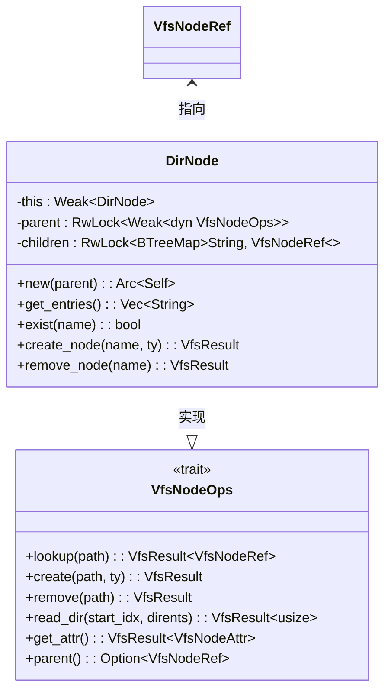
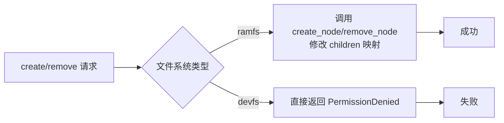

# DirNode 动态管理

<cite>
**本文档中引用的文件**
- [dir.rs](file://axfs_ramfs/src/dir.rs)
- [dir.rs](file://axfs_devfs/src/dir.rs)
- [lib.rs](file://axfs_vfs/src/lib.rs)
- [tests.rs](file://axfs_ramfs/src/tests.rs)
</cite>

## 目录
1. [引言](#引言)
2. [项目结构](#项目结构)
3. [核心组件](#核心组件)
4. [架构概述](#架构概述)
5. [详细组件分析](#详细组件分析)
6. [依赖分析](#依赖分析)
7. [性能考量](#性能考量)
8. [故障排除指南](#故障排除指南)
9. [结论](#结论)

## 引言
`DirNode` 是 ArceOS 虚拟文件系统（VFS）中用于实现动态目录管理的核心数据结构，主要应用于 `ramfs` 文件系统。它通过使用 `BTreeMap<String, Arc<dyn VfsNodeOps>>` 来维护子节点的映射关系，支持在运行时创建和删除文件与子目录。本文档将深入分析 `DirNode` 的实现机制，重点阐述其路径解析、动态修改、线程安全以及与只读文件系统的对比。

## 项目结构
项目包含三个主要 crate：`axfs_ramfs`（基于内存的可变文件系统）、`axfs_devfs`（设备文件系统，通常为只读）和 `axfs_vfs`（提供虚拟文件系统接口）。`DirNode` 在 `axfs_ramfs` 和 `axfs_devfs` 中均有实现，但功能上存在显著差异。

```mermaid
graph TB
subgraph "axfs_ramfs"
dir_rs[dir.rs]
file_rs[file.rs]
lib_rs[lib.rs]
end
subgraph "axfs_devfs"
dev_dir_rs[dir.rs]
null_rs[null.rs]
zero_rs[zero.rs]
lib_rs[lib.rs]
end
subgraph "axfs_vfs"
vfs_lib_rs[lib.rs]
structs_rs[structs.rs]
path_rs[path.rs]
end
dir_rs --> vfs_lib_rs : 实现 VfsNodeOps
dev_dir_rs --> vfs_lib_rs : 实现 VfsNodeOps
```

**图示来源**
- [dir.rs](file://axfs_ramfs/src/dir.rs)
- [dir.rs](file://axfs_devfs/src/dir.rs)
- [lib.rs](file://axfs_vfs/src/lib.rs)

**节来源**
- [dir.rs](file://axfs_ramfs/src/dir.rs)
- [dir.rs](file://axfs_devfs/src/dir.rs)

## 核心组件
`DirNode` 的核心在于其内部状态管理和对 `VfsNodeOps` 接口的实现。它利用 `RwLock<BTreeMap<String, VfsNodeRef>>` 来存储子节点，确保了并发读取的高效性和写入的安全性。

**节来源**
- [dir.rs](file://axfs_ramfs/src/dir.rs#L13-L40)

## 架构概述
`DirNode` 遵循 VFS 设计模式，作为目录节点统一处理文件操作请求。其架构围绕 `children` 映射表展开，所有查找、创建、删除操作都基于此结构进行。



**图示来源**
- [dir.rs](file://axfs_ramfs/src/dir.rs#L13-L176)
- [lib.rs](file://axfs_vfs/src/lib.rs#L100-L150)

## 详细组件分析

### DirNode 结构与初始化
`DirNode` 包含三个关键字段：`this`（指向自身的 `Weak` 引用，用于解决循环引用）、`parent`（父目录的弱引用）和 `children`（子节点的有序映射）。`new` 方法使用 `Arc::new_cyclic` 创建一个带有循环引用的 `Arc`，这是安全地持有自身弱引用的关键。

**节来源**
- [dir.rs](file://axfs_ramfs/src/dir.rs#L24-L35)

### lookup 方法的路径解析
`lookup` 方法负责解析相对或绝对路径，并返回对应的节点引用。其逻辑分为两步：
1.  **逐级匹配**：调用 `split_path` 函数将路径分解为首段名称 (`name`) 和剩余部分 (`rest`)。
2.  **递归查找**：根据 `name` 的值进行判断：
    *   `""` 或 `"."`：返回当前目录本身。
    *   `".."`：尝试获取并返回父目录。
    *   其他名称：在 `children` 映射中查找对应名称的节点。
    如果 `rest` 存在，则对找到的节点递归调用 `lookup(rest)`，从而实现多级路径的遍历。

```mermaid
flowchart TD
Start([开始 lookup]) --> Split["split_path(path)"]
Split --> Name{"name = ?"}
Name --> |"" or \".\"| ReturnSelf["返回 self.clone()"]
Name --> |"..\"| GetParent["parent().upgrade()"]
GetParent --> ParentValid{"成功?"}
ParentValid --> |是| ReturnParent["返回 parent"]
ParentValid --> |否| ErrorNotFound["返回 NotFound"]
Name --> |其他| FindChild["children.get(name)"]
FindChild --> ChildExists{"存在?"}
ChildExists --> |是| CheckRest{"rest 存在?"}
ChildExists --> |否| ErrorNotFound
CheckRest --> |是| Recurse["node.lookup(rest)"]
CheckRest --> |否| ReturnChild["返回 node"]
Recurse --> ReturnFinal["返回最终结果"]
ReturnSelf --> End([结束])
ReturnParent --> End
ReturnChild --> End
ReturnFinal --> End
ErrorNotFound --> End
```

**图示来源**
- [dir.rs](file://axfs_ramfs/src/dir.rs#L76-L95)
- [dir.rs](file://axfs_devfs/src/dir.rs#L50-L69)

**节来源**
- [dir.rs](file://axfs_ramfs/src/dir.rs#L76-L95)

### create 与 remove 操作的内部结构修改
`create` 和 `remove` 方法是 `DirNode` 动态性的体现。
*   **create 操作**：首先解析路径。如果 `rest` 存在，则递归进入下一级目录；否则，在当前目录调用 `create_node`。`create_node` 会检查名称是否已存在，然后根据类型创建新的 `FileNode` 或 `DirNode`，并通过 `children.write()` 获取写锁，将新节点插入 `BTreeMap`。
*   **remove 操作**：逻辑类似，先解析路径并递归定位。`remove_node` 会检查待删除节点是否存在，如果是非空目录，则拒绝删除以防止数据丢失，最后通过写锁从 `BTreeMap` 中移除条目。

**节来源**
- [dir.rs](file://axfs_ramfs/src/dir.rs#L42-L78)
- [dir.rs](file://axfs_ramfs/src/dir.rs#L119-L141)

### 线程安全保证
`DirNode` 通过以下机制保证线程安全：
1.  **`Arc` (原子引用计数)**：`VfsNodeRef` 类型即 `Arc<dyn VfsNodeOps>`，允许多个线程安全地共享对同一节点的所有权。
2.  **`RwLock` (读写锁)**：`parent` 和 `children` 字段均被 `RwLock` 保护。这允许多个线程同时进行读取操作（如 `lookup`），但在执行写入操作（如 `create`, `remove`）时，会独占写锁，阻止其他读写操作，从而避免数据竞争。

**节来源**
- [dir.rs](file://axfs_ramfs/src/dir.rs#L13-L176)

### 与 axfs_devfs 只读目录的对比
`axfs_devfs` 中的 `DirNode` 旨在表示静态的设备文件系统，因此其 `create` 和 `remove` 方法直接返回 `PermissionDenied` 错误，禁止任何动态修改。相比之下，`axfs_ramfs` 的 `DirNode` 完全可变，支持完整的 CRUD 操作，这使得 `ramfs` 更适合需要临时文件存储的应用场景。



**图示来源**
- [dir.rs](file://axfs_ramfs/src/dir.rs#L119-L141)
- [dir.rs](file://axfs_devfs/src/dir.rs#L90-L105)

**节来源**
- [dir.rs](file://axfs_ramfs/src/dir.rs#L119-L141)
- [dir.rs](file://axfs_devfs/src/dir.rs#L90-L105)

### 实际代码示例
以下代码展示了如何使用 `DirNode` 进行多级目录操作：

```rust
let ramfs = RamFileSystem::new();
let root = ramfs.root_dir();

// 创建文件和目录
root.create("f1", VfsNodeType::File).unwrap();
root.create("foo", VfsNodeType::Dir).unwrap();

let dir_foo = root.lookup("foo").unwrap();
dir_foo.create("f3", VfsNodeType::File).unwrap();
dir_foo.create("bar", VfsNodeType::Dir).unwrap();

let dir_bar = dir_f