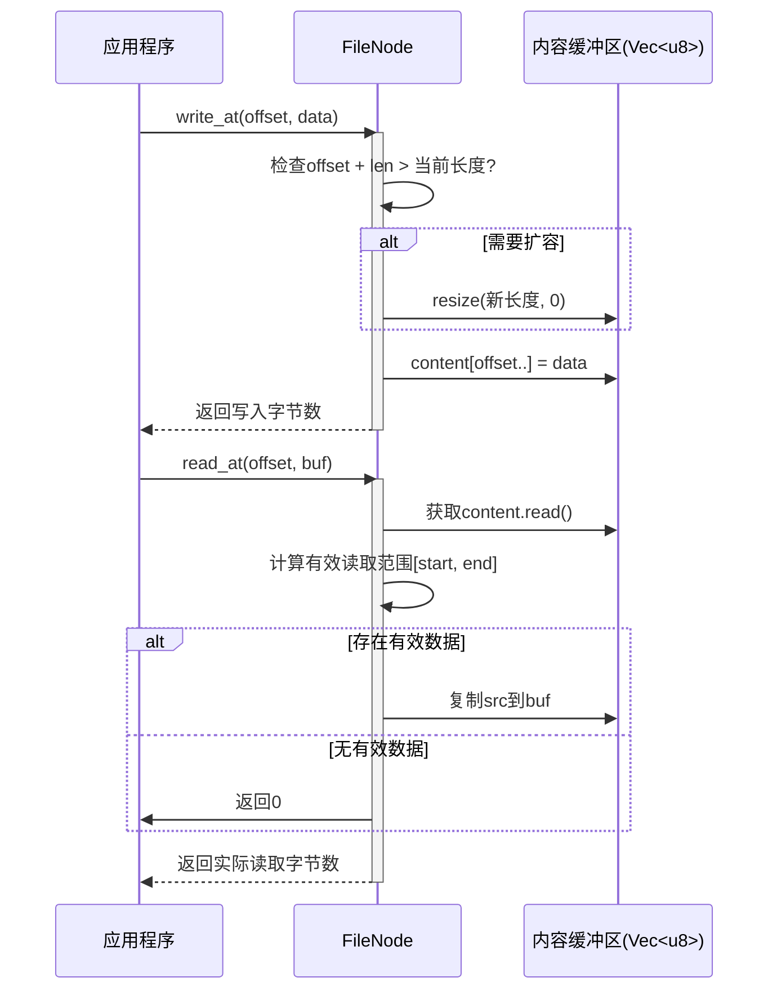

<cite>
**Referenced Files in This Document**   
- [file.rs](file://axfs_ramfs/src/file.rs)
- [lib.rs](file://axfs_vfs/src/lib.rs)
</cite>

## 目录
1. [引言](#引言)
2. [FileNode 数据结构与存储设计](#filenode-数据结构与存储设计)
3. `read_at` 与 `write_at` 方法详解  
4. `truncate` 方法行为分析  
5. 典型文件操作序列示例  
6. 性能特征与优化建议  
7. 符合 VfsNodeOps 接口规范的实现  
8. 结论

## 引言

本文档深入解析 ArceOS 操作系统中 RAM 文件系统（ramfs）的核心组件 `FileNode` 的数据存储与 I/O 操作机制。重点阐述其基于内存缓冲的设计原理，详细说明 `read_at` 和 `write_at` 如何支持任意偏移量的非连续读写，分析 `truncate` 方法在数据截断与扩展时的行为，并讨论该实现的性能特点及潜在优化方向。同时阐明 `FileNode` 如何通过实现 `VfsNodeOps` 接口来提供标准的虚拟文件系统操作能力。

## FileNode 数据结构与存储设计

`FileNode` 是 RAM 文件系统中的核心文件节点类型，其主要职责是管理文件内容并提供标准的文件操作接口。该结构体内部封装了一个由 `spin::RwLock` 保护的 `Vec<u8>` 向量，用于在内存中存储文件的原始字节数据。

这种设计使得所有文件操作都直接作用于内存，避免了磁盘 I/O 带来的延迟，从而实现了极高的读写性能。`RwLock` 提供了细粒度的并发控制：多个读取操作可以同时进行，而写入操作则需要独占访问权限，确保了数据一致性。

**Section sources**
- [file.rs](file://axfs_ramfs/src/file.rs#L6-L14)

## `read_at` 与 `write_at` 方法详解

### `read_at` 方法

`read_at` 方法允许从指定的字节偏移量开始读取数据到提供的缓冲区中。其实现具有以下关键特性：

- **边界安全处理**：方法首先获取当前内容长度，并将起始位置限制为 `offset` 与内容长度的较小值，防止越界访问。
- **部分读取支持**：当请求读取的数据超出文件末尾时，仅返回有效范围内的数据，不会报错。
- **零拷贝优化**：通过切片（slice）直接复制有效数据段，避免不必要的内存分配。

此设计确保了即使在偏移量超过文件大小的情况下也能安全执行，返回实际读取的字节数。

### `write_at` 方法

`write_at` 方法支持在任意偏移位置写入数据，其行为如下：

- **自动扩容**：若写入位置加数据长度超过了当前缓冲区容量，则自动调用 `resize` 将缓冲区扩展至所需大小，新增区域以零填充。
- **中间写入支持**：允许在文件中间插入或覆盖数据，不影响其他部分。
- **高效写入**：使用 `copy_from_slice` 进行块拷贝，保证写入效率。

这一机制使得 `FileNode` 能够模拟真实文件系统的随机写入能力。

**Section sources**
- [file.rs](file://axfs_ramfs/src/file.rs#L30-L54)

**Diagram sources**
- [file.rs](file://axfs_ramfs/src/file.rs#L30-L54)

## `truncate` 方法行为分析

`truncate` 方法用于将文件调整为指定大小，其逻辑根据目标大小与当前大小的关系分为两种情况：

- **截断（缩小文件）**：当目标大小小于当前大小时，调用 `Vec::truncate` 移除末尾多余的数据。
- **扩展（增大文件）**：当目标大小大于当前大小时，调用 `Vec::resize` 将缓冲区扩展至目标大小，新增部分以零字节填充。

该方法对内存容量有直接影响：扩展操作会增加堆内存占用，而截断操作可能释放部分内存（取决于 `Vec` 的内存管理策略）。此行为符合 POSIX 文件截断语义，确保了与其他系统的兼容性。

**Section sources**
- [file.rs](file://axfs_ramfs/src/file.rs#L24-L29)

## 典型文件操作序列示例

一个典型的文件操作流程可能包括以下步骤：

1. **初始化空文件**：创建一个新的 `FileNode`，其内部 `Vec<u8>` 初始为空。
2. **中间写入数据**：调用 `write_at(1024, data)` 在偏移 1KB 处写入一段数据，触发缓冲区自动扩容至至少 1024 + data.len() 字节。
3. **读取部分内容**：调用 `read_at(512, buffer)` 从半 KB 处读取数据，由于此前未写入，读取结果为零填充；随后调用 `read_at(1024, buffer)` 可成功读回之前写入的数据。
4. **调整文件大小**：调用 `truncate(2048)` 将文件扩展至 2KB，新增空间自动补零；或调用 `truncate(512)` 截断文件，丢弃 512 字节之后的所有数据。

这些操作展示了 `FileNode` 对稀疏文件和随机访问的良好支持。

**Section sources**
- [file.rs](file://axfs_ramfs/src/file.rs#L24-L54)

## 性能特征与优化建议

### 性能特征

- **优点**：
  - 内存直存，读写速度极快。
  - 支持任意偏移读写，灵活性高。
  - 边界处理安全，不易出错。

- **缺点**：
  - **频繁小写操作下的内存效率低下**：每次写入都可能导致 `Vec` 重新分配和复制，尤其在非顺序写入时更为明显。
  - **稀疏写入浪费内存**：在大偏移处写入少量数据会导致大量零填充，占用过多内存。

### 优化建议

1. **引入分块存储（Chunked Storage）**：将大文件划分为固定大小的块（如 4KB），仅分配已写入的块，显著提升稀疏文件的内存利用率。
2. **写时合并（Write Coalescing）**：缓存小写操作，批量提交以减少 `Vec` 重分配次数。
3. **预分配策略**：对于可预测大小的文件，在创建时预分配足够空间，避免运行时扩容开销。

**Section sources**
- [file.rs](file://axfs_ramfs/src/file.rs#L30-L54)

## 符合 VfsNodeOps 接口规范的实现

`FileNode` 通过实现 `axfs_vfs::VfsNodeOps` trait 来提供标准化的文件操作接口。该 trait 定义了虚拟文件系统中节点所需的基本能力，包括属性获取、读写、截断等。

`FileNode` 正确实现了所有必需的方法：
- `get_attr` 返回文件当前大小等元信息。
- `read_at` 和 `write_at` 提供核心 I/O 功能。
- `truncate` 支持动态调整文件大小。
- 使用宏 `impl_vfs_non_dir_default!` 自动实现目录相关方法的默认错误响应，表明其为非目录节点。

这使得 `FileNode` 能无缝集成到 ArceOS 的虚拟文件系统框架中，被上层应用以统一方式访问。

**Section sources**
- [file.rs](file://axfs_ramfs/src/file.rs#L16-L56)
- [lib.rs](file://axfs_vfs/src/lib.rs#L100-L130)

## 结论

`FileNode` 作为 ArceOS RAM 文件系统的核心组件，采用简洁高效的 `Vec<u8>` 缓冲设计，结合读写锁实现了线程安全的内存文件存储。其 `read_at`、`write_at` 和 `truncate` 方法完整支持了随机访问文件的所有基本操作，行为符合预期且边界处理稳健。尽管在极端场景下存在内存效率问题，但整体设计清晰、性能优越，充分体现了嵌入式系统中轻量级文件系统的典型实现模式。未来可通过引入更高级的存储结构进一步优化其资源利用效率。