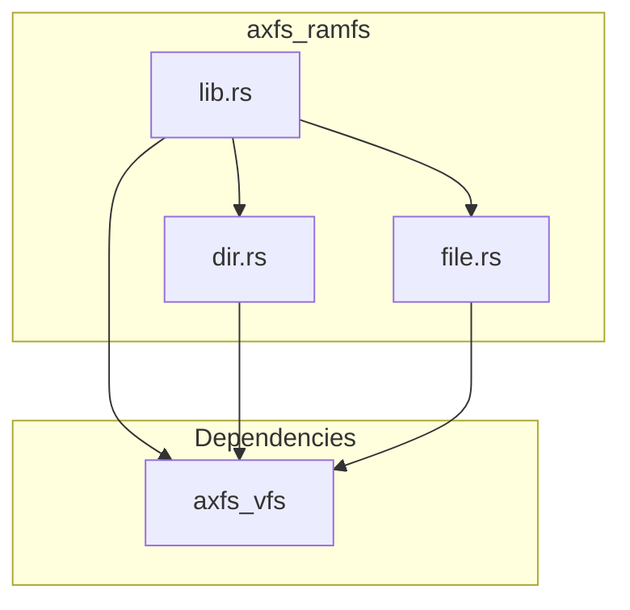
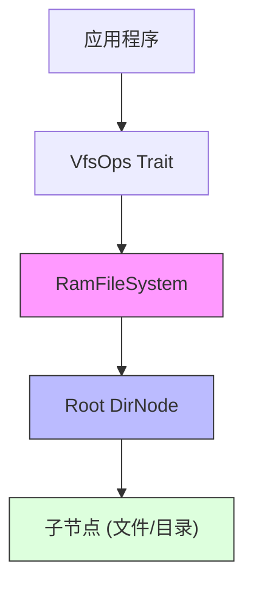
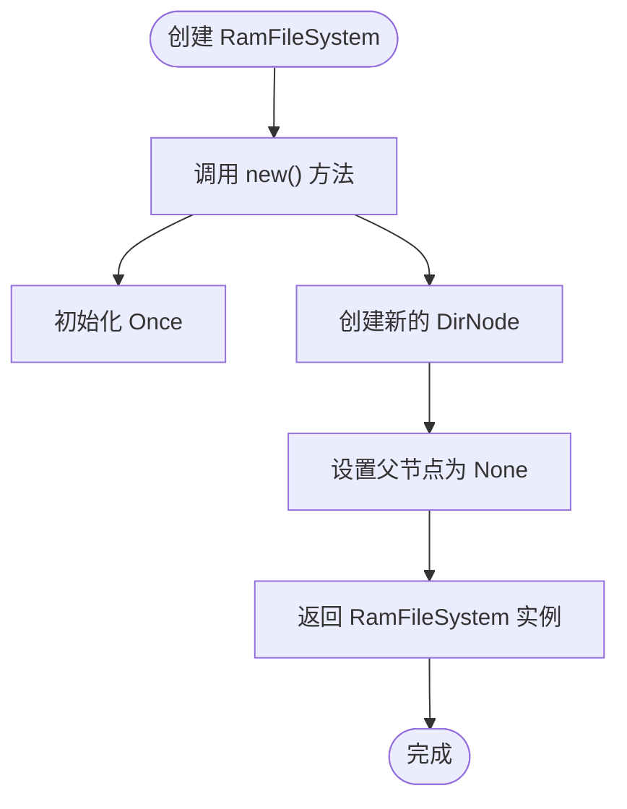
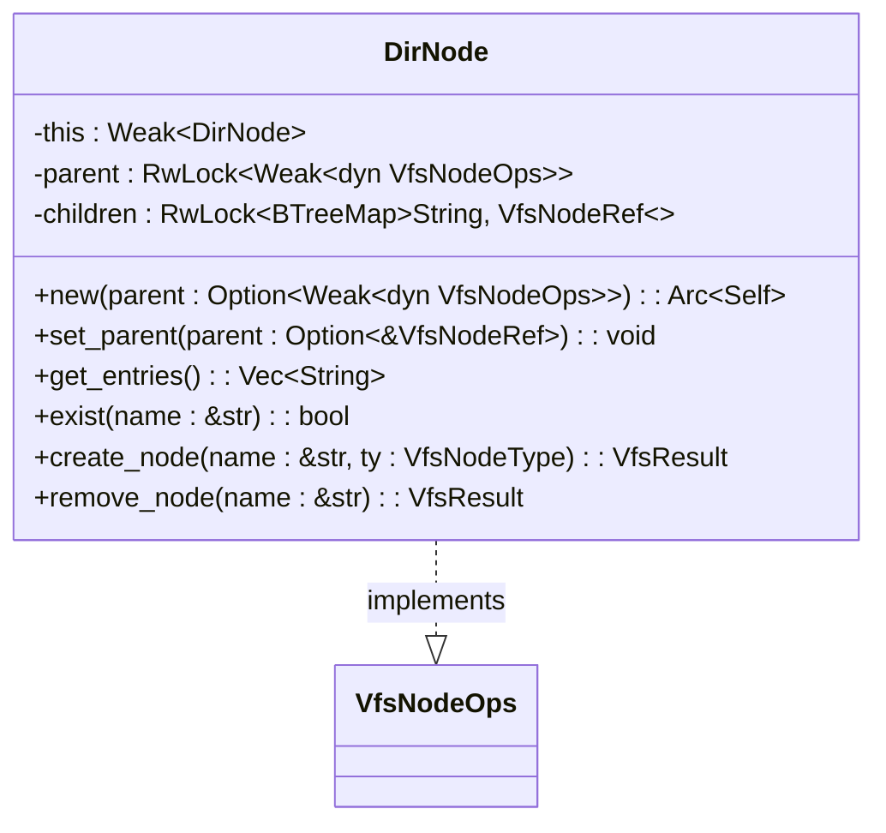
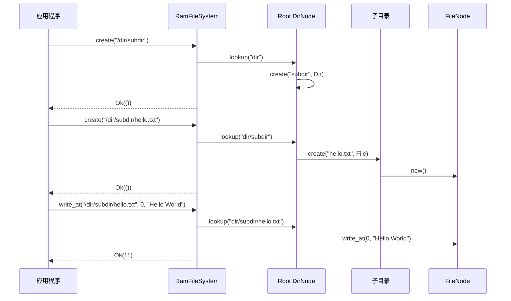

# RamFileSystem 初始化与使用

<cite>
**Referenced Files in This Document **   
- [lib.rs](file://axfs_ramfs/src/lib.rs)
- [dir.rs](file://axfs_ramfs/src/dir.rs)
- [file.rs](file://axfs_ramfs/src/file.rs)
- [vfs_lib.rs](file://axfs_vfs/src/lib.rs)
</cite>

## 目录
1. [简介](#简介)
2. [项目结构](#项目结构)
3. [核心组件](#核心组件)
4. [架构概述](#架构概述)
5. [详细组件分析](#详细组件分析)
6. [依赖关系分析](#依赖关系分析)
7. [性能考量](#性能考量)
8. [故障排除指南](#故障排除指南)
9. [结论](#结论)

## 简介
`RamFileSystem` 是 ArceOS 操作系统中实现的一个基于内存的虚拟文件系统，旨在提供高效的文件操作能力。该文件系统完全驻留在内存中，不依赖于任何持久化存储设备，因此具有极快的读写速度和低延迟特性。其设计遵循 `axfs_vfs` 抽象层定义的标准接口，实现了完整的 VFS（Virtual File System）功能集。

本文档将深入解析 `RamFileSystem` 的初始化机制、核心入口点以及与抽象层的交互方式。重点阐述 `new()` 方法如何创建根目录节点并返回符合 `VfsOps` trait 的文件系统实例，同时解释 `root_dir()` 函数在路径遍历中的关键作用。通过代码示例展示从创建到挂载使用的完整流程，并为不同层次的用户提供相应的使用指导和设计分析。

## 项目结构
`RamFileSystem` 的实现位于 `axfs_ramfs` crate 中，采用模块化设计，主要由以下几个部分组成：

- **lib.rs**: 定义了 `RamFileSystem` 结构体及其核心方法，是整个文件系统的入口点。
- **dir.rs**: 实现了目录节点 `DirNode`，负责管理子节点的增删查改及路径查找逻辑。
- **file.rs**: 实现了文件节点 `FileNode`，提供对内存缓冲区的读写、截断等基本文件操作。
- **tests.rs**: 包含单元测试用例，验证各项功能的正确性。

该实现依赖于 `axfs_vfs` crate 提供的通用虚拟文件系统接口，确保与其他文件系统组件的兼容性和可扩展性。



**Diagram sources **
- [lib.rs](file://axfs_ramfs/src/lib.rs)
- [dir.rs](file://axfs_ramfs/src/dir.rs)
- [file.rs](file://axfs_ramfs/src/file.rs)
- [vfs_lib.rs](file://axfs_vfs/src/lib.rs)

**Section sources**
- [lib.rs](file://axfs_ramfs/src/lib.rs)
- [dir.rs](file://axfs_ramfs/src/dir.rs)
- [file.rs](file://axfs_ramfs/src/file.rs)

## 核心组件
`RamFileSystem` 的核心在于其初始化过程和与 `axfs_vfs` 抽象层的集成。当调用 `new()` 方法时，系统会创建一个全新的内存文件系统实例，其中包含一个作为根节点的 `DirNode`。这个根节点是所有后续文件和目录操作的基础，它通过 `Arc<DirNode>` 类型被安全地共享和引用。

文件系统通过实现 `VfsOps` trait 来满足抽象层的要求，特别是 `root_dir()` 方法，它返回一个 `VfsNodeRef` 类型的对象，即 `Arc<dyn VfsNodeOps>`，这使得外部组件能够通过统一的接口访问根目录，进而进行路径遍历和各种文件操作。

**Section sources**
- [lib.rs](file://axfs_ramfs/src/lib.rs#L20-L60)
- [dir.rs](file://axfs_ramfs/src/dir.rs#L10-L30)

## 架构概述
`RamFileSystem` 的整体架构建立在 `axfs_vfs` 提供的虚拟文件系统框架之上，形成了清晰的分层结构。上层应用通过 `VfsOps` 接口与 `RamFileSystem` 交互，而 `RamFileSystem` 内部则通过 `DirNode` 和 `FileNode` 两个核心数据结构来管理文件系统的状态。



**Diagram sources **
- [lib.rs](file://axfs_ramfs/src/lib.rs#L1-L60)
- [dir.rs](file://axfs_ramfs/src/dir.rs#L1-L177)

## 详细组件分析

### RamFileSystem 分析
`RamFileSystem` 结构体是内存文件系统的顶层容器，它持有一个 `Once<VfsNodeRef>` 类型的 `parent` 字段和一个 `Arc<DirNode>` 类型的 `root` 字段。`parent` 字段用于在文件系统被挂载时记录其父节点，而 `root` 字段则始终指向根目录节点。

#### 初始化机制


**Diagram sources **
- [lib.rs](file://axfs_ramfs/src/lib.rs#L20-L30)

`new()` 方法是 `RamFileSystem` 的核心入口点。它通过调用 `DirNode::new(None)` 创建一个新的根目录节点，并将其封装在 `Arc` 中以支持多所有权和线程安全的共享。此方法确保每次调用都会生成一个独立且隔离的文件系统实例，非常适合用于需要临时或沙箱环境的场景。

**Section sources**
- [lib.rs](file://axfs_ramfs/src/lib.rs#L20-L30)

#### 根目录访问
`root_dir_node()` 方法提供了直接访问底层 `DirNode` 的途径，返回一个 `Arc<DirNode>` 类型的引用。这对于需要直接操作目录内部状态的高级用例非常有用。然而，对外部接口而言，`VfsOps` trait 中定义的 `root_dir()` 方法才是标准的访问方式，它返回一个更通用的 `VfsNodeRef` 类型，从而保持了接口的抽象性和一致性。

### DirNode 分析
`DirNode` 是 `RamFileSystem` 中表示目录的核心数据结构，它不仅实现了 `VfsNodeOps` trait，还负责管理其子节点的集合。

#### 数据结构与状态管理
`DirNode` 使用 `RwLock<BTreeMap<String, VfsNodeRef>>` 来存储子节点，这种选择保证了键的有序性和高效的并发读取性能。`parent` 字段同样使用 `RwLock` 包装一个 `Weak<dyn VfsNodeOps>`，以避免循环引用导致的内存泄漏问题。`this` 字段是一个 `Weak<DirNode>`，利用 `Arc::new_cyclic` 创建循环引用，这是实现 `parent()` 方法的关键。



**Diagram sources **
- [dir.rs](file://axfs_ramfs/src/dir.rs#L10-L50)

**Section sources**
- [dir.rs](file://axfs_ramfs/src/dir.rs#L10-L177)

#### 路径遍历与查找
`lookup()` 方法是路径遍历的核心。它首先将输入路径分割成名称和剩余部分，然后根据名称进行匹配：空字符串或 "." 返回当前目录；".." 返回父目录；其他名称则在 `children` 映射中查找对应的节点。如果存在剩余路径，则递归地在找到的子节点上调用 `lookup()`，直到解析完整个路径。

### FileNode 分析
`FileNode` 代表文件系统中的一个文件，其内部状态由一个 `RwLock<Vec<u8>>` 组成，用于存储文件的实际内容。

#### 文件操作实现
`FileNode` 正确实现了 `VfsNodeOps` 中与文件相关的所有方法。`read_at()` 和 `write_at()` 方法允许在指定偏移量处进行读写操作，自动处理缓冲区的边界检查和扩容。`truncate()` 方法可以调整文件大小，不足时填充零，超出时则截断。



**Diagram sources **
- [lib.rs](file://axfs_ramfs/src/lib.rs#L40-L60)
- [dir.rs](file://axfs_ramfs/src/dir.rs#L100-L150)
- [file.rs](file://axfs_ramfs/src/file.rs#L30-L50)

**Section sources**
- [file.rs](file://axfs_ramfs/src/file.rs#L1-L57)

## 依赖关系分析
`RamFileSystem` 的实现紧密依赖于多个外部库和内部模块。它通过 `axfs_vfs` crate 获取 `VfsOps` 和 `VfsNodeOps` trait 的定义，确保了与操作系统其他部分的无缝集成。`spin` crate 提供的 `Once` 和 `RwLock` 原语对于实现线程安全的延迟初始化和并发控制至关重要。`alloc` crate 则提供了 `Arc`、`Vec`、`BTreeMap` 等必要的集合类型和智能指针。

```mermaid
graph LR
    RamFS["axfs_ramfs"] --> Vfs["axfs_vfs