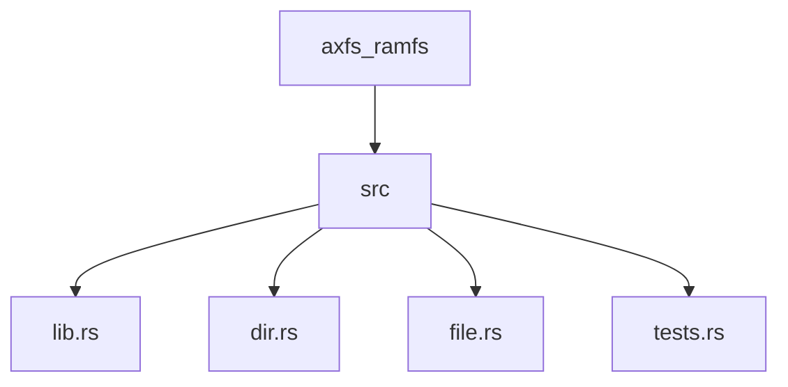
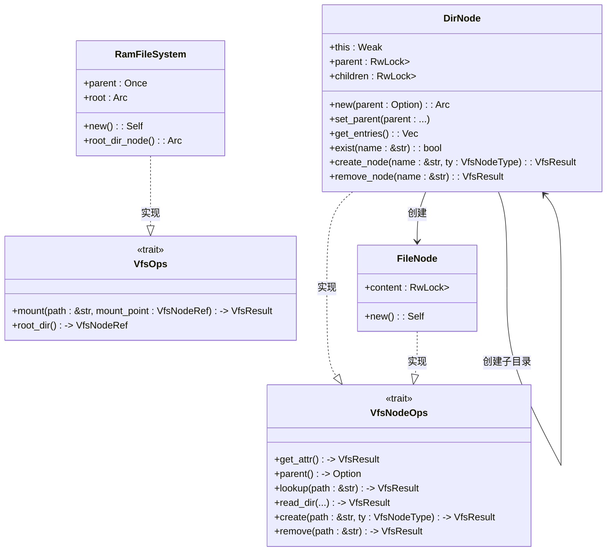
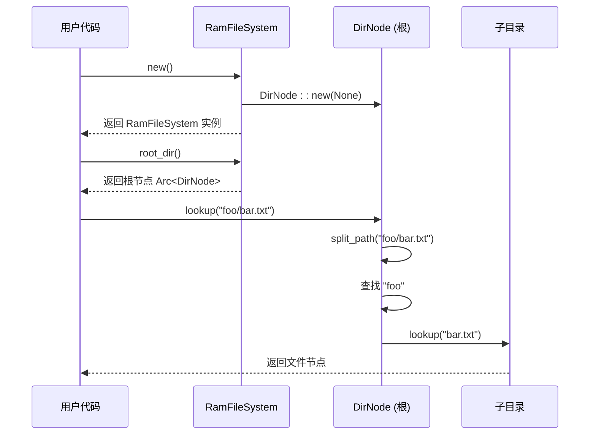
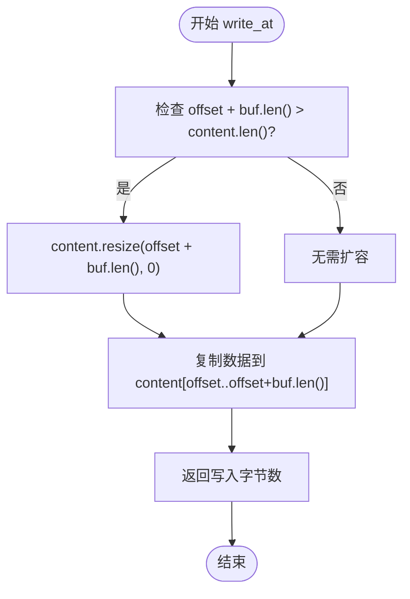

# 内存文件系统（axfs_ramfs）

<cite>
**本文档引用的文件**
- [lib.rs](file://axfs_ramfs/src/lib.rs)
- [file.rs](file://axfs_ramfs/src/file.rs)
- [dir.rs](file://axfs_ramfs/src/dir.rs)
- [tests.rs](file://axfs_ramfs/src/tests.rs)
- [axfs_devfs/src/lib.rs](file://axfs_devfs/src/lib.rs)
- [axfs_devfs/src/dir.rs](file://axfs_devfs/src/dir.rs)
</cite>

## 目录
1. [简介](#简介)
2. [项目结构](#项目结构)
3. [核心组件](#核心组件)
4. [架构概述](#架构概述)
5. [详细组件分析](#详细组件分析)
6. [依赖分析](#依赖分析)
7. [性能考量](#性能考量)
8. [故障排除指南](#故障排除指南)
9. [结论](#结论)

## 简介
`axfs_ramfs` 是 ArceOS 操作系统中用于实现可变内存文件系统的 Rust crate。该文件系统完全驻留在 RAM 中，支持动态创建、修改和删除文件与目录，适用于需要高性能临时存储的场景。它基于 `axfs_vfs` 虚拟文件系统接口构建，并实现了完整的 `VfsOps` trait。

与只读的 `axfs_devfs` 不同，`axfs_ramfs` 提供了完整的写入能力，允许在运行时动态构建文件系统层次结构。其设计重点在于灵活性和内存效率，通过使用 `Vec<u8>` 存储文件内容和 `BTreeMap` 维护目录结构，实现了对任意偏移量的高效读写与截断操作。

本技术文档将深入解析 `RamFileSystem` 的实现机制，包括 `FileNode` 和 `DirNode` 的内部数据结构、API 调用链以及典型使用模式，并结合测试用例说明其行为特征。

## 项目结构



**图示来源**
- [lib.rs](file://axfs_ramfs/src/lib.rs#L1-L61)
- [dir.rs](file://axfs_ramfs/src/dir.rs#L1-L175)
- [file.rs](file://axfs_ramfs/src/file.rs#L1-L55)

**本节来源**
- [lib.rs](file://axfs_ramfs/src/lib.rs#L1-L61)
- [dir.rs](file://axfs_ramfs/src/dir.rs#L1-L175)

## 核心组件

`axfs_ramfs` 的核心由三个主要模块构成：`lib.rs` 定义了顶层文件系统结构，`file.rs` 实现了文件节点逻辑，`dir.rs` 处理目录节点及其子节点管理。`RamFileSystem` 结构体作为入口点，持有一个根目录节点的引用并实现 `VfsOps` 接口，从而能够挂载到虚拟文件系统树中。

`FileNode` 使用 `RwLock<Vec<u8>>` 来安全地并发访问文件内容，支持从任意偏移位置进行读写和截断操作。`DirNode` 则利用 `RwLock<BTreeMap<String, VfsNodeRef>>` 维护有序的子节点映射，确保路径查找和遍历的高效性。

**本节来源**
- [lib.rs](file://axfs_ramfs/src/lib.rs#L1-L61)
- [file.rs](file://axfs_ramfs/src/file.rs#L1-L55)
- [dir.rs](file://axfs_ramfs/src/dir.rs#L1-L175)

## 架构概述



**图示来源**
- [lib.rs](file://axfs_ramfs/src/lib.rs#L1-L61)
- [dir.rs](file://axfs_ramfs/src/dir.rs#L1-L175)
- [file.rs](file://axfs_ramfs/src/file.rs#L1-L55)

**本节来源**
- [lib.rs](file://axfs_ramfs/src/lib.rs#L1-L61)
- [dir.rs](file://axfs_ramfs/src/dir.rs#L1-L175)
- [file.rs](file://axfs_ramfs/src/file.rs#L1-L55)

## 详细组件分析

### RamFileSystem 分析

`RamFileSystem` 是内存文件系统的主结构体，负责初始化根目录并实现 `VfsOps` 接口以支持挂载操作。其构造函数 `new()` 创建一个新的空根目录，而 `root_dir()` 方法返回根节点的共享引用，供外部进行路径查找和操作。



**图示来源**
- [lib.rs](file://axfs_ramfs/src/lib.rs#L1-L61)
- [dir.rs](file://axfs_ramfs/src/dir.rs#L1-L175)

**本节来源**
- [lib.rs](file://axfs_ramfs/src/lib.rs#L1-L61)

### FileNode 分析

`FileNode` 是内存文件系统中的文件节点实现，使用 `RwLock<Vec<u8>>` 作为底层存储，允许多个读取者或单个写入者安全访问文件内容。这种设计使得它可以高效支持随机读写和动态大小调整。

#### 功能特性
- **任意偏移读写**：`read_at` 和 `write_at` 方法接受偏移参数，允许从文件任意位置进行 I/O 操作。
- **动态截断**：`truncate` 方法可根据指定大小调整文件长度，若新大小小于当前长度则截断，否则用零填充扩展。
- **属性获取**：`get_attr` 返回包含文件类型和大小的元数据。



**图示来源**
- [file.rs](file://axfs_ramfs/src/file.rs#L1-L55)

**本节来源**
- [file.rs](file://axfs_ramfs/src/file.rs#L1-L55)

### DirNode 分析

`DirNode` 实现了目录节点的功能，通过 `BTreeMap<String, VfsNodeRef>` 维护子节点的有序映射，保证按键名排序的遍历一致性。它支持创建和删除文件/子目录，并处理路径解析和层级遍历。

#### 关键方法解析
- **路径分割**：`split_path` 函数去除前导斜杠并按第一个 `/` 分割路径，为递归查找提供基础。
- **递归查找**：`lookup` 方法解析路径分量，逐级向下查找目标节点。
- **动态创建**：`create` 方法支持多级路径创建，自动创建中间目录。
- **安全删除**：`remove` 方法禁止删除非空目录，防止数据丢失。

```mermaid
flowchart TD
    A[调用 create("foo/bar/baz")] --> B{路径有剩余部分?}
    B -->|是| C["提取 name='foo', rest='