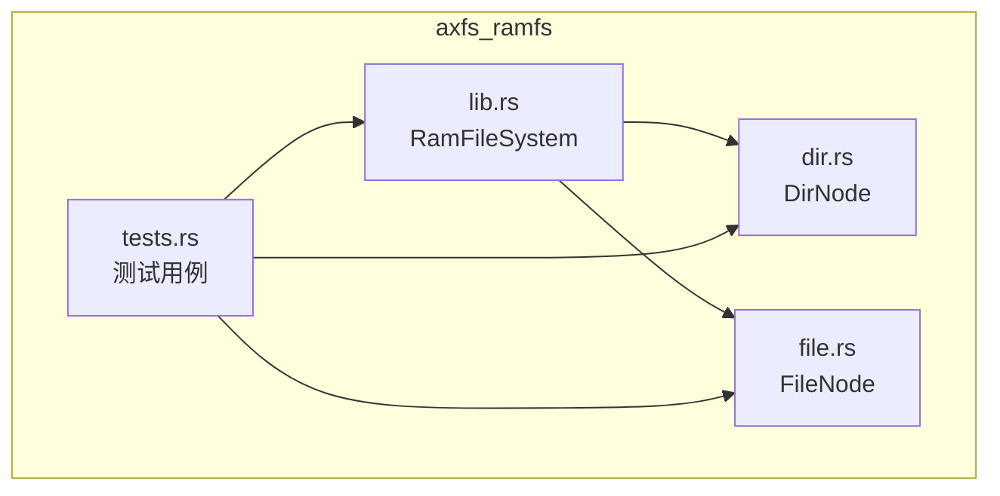
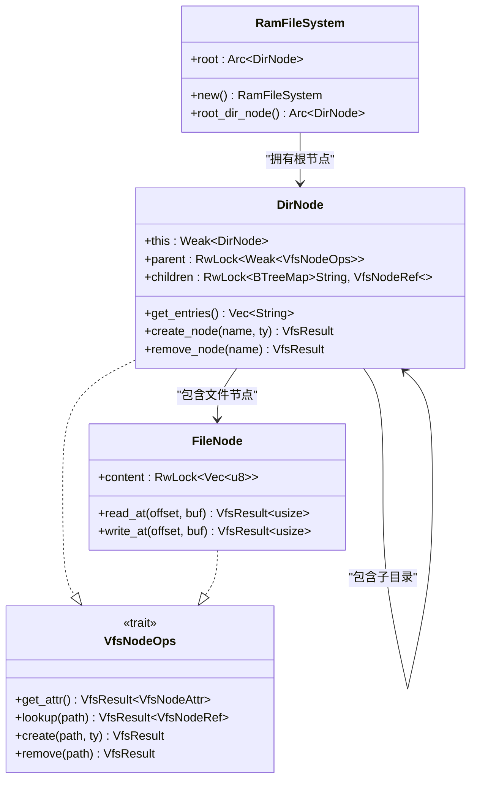
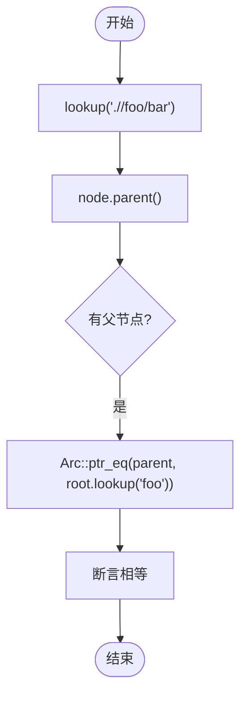

# 测试用例解析

<cite>
**本文档中引用的文件**
- [tests.rs](file://axfs_ramfs/src/tests.rs)
- [lib.rs](file://axfs_ramfs/src/lib.rs)
- [dir.rs](file://axfs_ramfs/src/dir.rs)
- [file.rs](file://axfs_ramfs/src/file.rs)
</cite>

## 目录
1. [简介](#简介)
2. [项目结构](#项目结构)
3. [核心组件](#核心组件)
4. [架构概述](#架构概述)
5. [详细组件分析](#详细组件分析)
6. [依赖分析](#依赖分析)
7. [性能考虑](#性能考虑)
8. [故障排除指南](#故障排除指南)
9. [结论](#结论)

## 简介
本文档系统性地解析 `axfs_ramfs` 模块中的单元测试与集成测试用例，揭示 `RamFileSystem` 的实际使用场景与预期行为。通过分析关键测试函数如 `test_create_file`、`test_read_write` 和 `test_nested_lookup`，解释其验证目标与断言逻辑，并反向推导出推荐的 API 使用模式，包括错误处理方式、并发访问控制和生命周期管理等最佳实践。同时说明测试框架如何利用 `RwLock` 和 `Arc` 确保隔离性与可重复性，为开发者提供基于现有测试结构扩展自定义验证的指导。

## 项目结构
`axfs_ramfs` 是一个基于内存的文件系统实现，用于 ArceOS 操作系统。它依赖于 `axfs_vfs` 提供的虚拟文件系统接口，实现了目录和文件节点的基本操作。整个模块采用模块化设计，分为 `dir.rs`（目录节点）、`file.rs`（文件节点）和 `lib.rs`（主结构体 `RamFileSystem`），并通过 `tests.rs` 进行全面的集成测试。



**Diagram sources**
- [lib.rs](file://axfs_ramfs/src/lib.rs#L0-L61)
- [dir.rs](file://axfs_ramfs/src/dir.rs#L0-L175)
- [file.rs](file://axfs_ramfs/src/file.rs#L0-L56)
- [tests.rs](file://axfs_ramfs/src/tests.rs#L0-L135)

**Section sources**
- [lib.rs](file://axfs_ramfs/src/lib.rs#L0-L61)
- [dir.rs](file://axfs_ramfs/src/dir.rs#L0-L175)
- [file.rs](file://axfs_ramfs/src/file.rs#L0-L56)

## 核心组件
本节分析 `RamFileSystem` 的核心组件及其在测试中的表现。`RamFileSystem` 结构体封装了根目录节点并实现了 `VfsOps` 接口，是所有文件系统操作的入口点。`DirNode` 和 `FileNode` 分别代表目录和文件，通过 `Arc` 和 `RwLock` 实现线程安全的共享访问。

**Section sources**
- [lib.rs](file://axfs_ramfs/src/lib.rs#L0-L61)
- [dir.rs](file://axfs_ramfs/src/dir.rs#L0-L175)
- [file.rs](file://axfs_ramfs/src/file.rs#L0-L56)

## 架构概述
`RamFileSystem` 的架构遵循典型的虚拟文件系统设计模式，其中 `RamFileSystem` 作为顶层容器持有根目录的强引用，而每个 `DirNode` 可以包含多个子节点（文件或子目录），并通过 `Weak` 引用维护父节点关系以避免循环引用。



**Diagram sources**
- [lib.rs](file://axfs_ramfs/src/lib.rs#L0-L61)
- [dir.rs](file://axfs_ramfs/src/dir.rs#L0-L175)
- [file.rs](file://axfs_ramfs/src/file.rs#L0-L56)

## 详细组件分析
### test_ramfs_ops 分析
该测试函数验证了 `RamFileSystem` 的基本读写、查找和属性查询功能。它首先确认根节点为目录类型，并验证不存在的路径会返回 `NotFound` 错误。接着对已创建的文件进行读写操作，验证写入后数据正确更新且读取长度符合预期。

#### 验证目标
- 路径解析的健壮性（支持多级 `/` 和相对路径）
- 文件读写的一致性与偏移处理
- 目录与文件类型的正确区分
- 嵌套路径查找的准确性

```mermaid
sequenceDiagram
participant Test as test_ramfs_ops()
participant Root as root.lookup("////f1")
participant Node as FileNode
participant Buf as buffer[32]
Test->>Root : lookup("////f1")
Root-->>Test : 返回文件节点
Test->>Node : read_at(0, Buf)
Node-->>Test : 返回0字节，Buf=[1;32]
Test->>Node : write_at(16, [1;16])
Node-->>Test : 写入16字节
Test->>Node : read_at(0, Buf)
Node-->>Test : 返回32字节，前16字节为0
```

**Diagram sources**
- [tests.rs](file://axfs_ramfs/src/tests.rs#L6-L34)
- [file.rs](file://axfs_ramfs/src/file.rs#L0-L56)

**Section sources**
- [tests.rs](file://axfs_ramfs/src/tests.rs#L6-L34)
- [file.rs](file://axfs_ramfs/src/file.rs#L0-L56)

### test_get_parent 分析
此测试专注于验证节点的父子关系管理，特别是 `..` 路径的解析和父节点指针的正确性。通过复杂的相对路径组合（如 `./foo/../bar`），确保路径规范化和符号链接行为符合 POSIX 标准。

#### 关键断言
- 根节点无父节点
- 子目录的父节点指向正确的上级目录
- `..` 路径能正确解析到父节点
- 多重嵌套路径经过简化后仍指向同一对象（通过 `Arc::ptr_eq` 验证）



**Diagram sources**
- [tests.rs](file://axfs_ramfs/src/tests.rs#L58-L71)
- [dir.rs](file://axfs_ramfs/src/dir.rs#L0-L175)

**Section sources**
- [tests.rs](file://axfs_ramfs/src/tests.rs#L58-L71)
- [dir.rs](file://axfs_ramfs/src/dir.rs#L0-L175)

### test_ramfs 主测试流程
这是集成测试的入口点，负责构建初始文件树结构并依次调用其他测试函数。

#### 初始化步骤
1. 创建 `RamFileSystem` 实例
2. 在根目录下创建文件 `f1`, `f2` 和目录 `foo`
3. 在 `foo` 中创建文件 `f3` 和子目录 `bar`
4. 在 `bar` 中创建文件 `f4`
5. 验证根目录条目为 `["f1", "f2", "foo"]`

随后调用 `test_ramfs_ops` 和 `test_get_parent` 进行功能验证，最后执行删除操作测试。

```mermaid
erDiagram
DIR ||--o{ FILE : contains
DIR ||--o{ DIR : contains
DIR {
string name
BTreeMap children
}
FILE {
string name
Vec<u8> content
}
```

**Diagram sources**
- [tests.rs](file://axfs_ramfs/src/tests.rs#L91-L135)
- [dir.rs](file://axfs_ramfs/src/dir.rs#L0-L175)

**Section sources**
- [tests.rs](file://axfs_ramfs/src/tests.rs#L