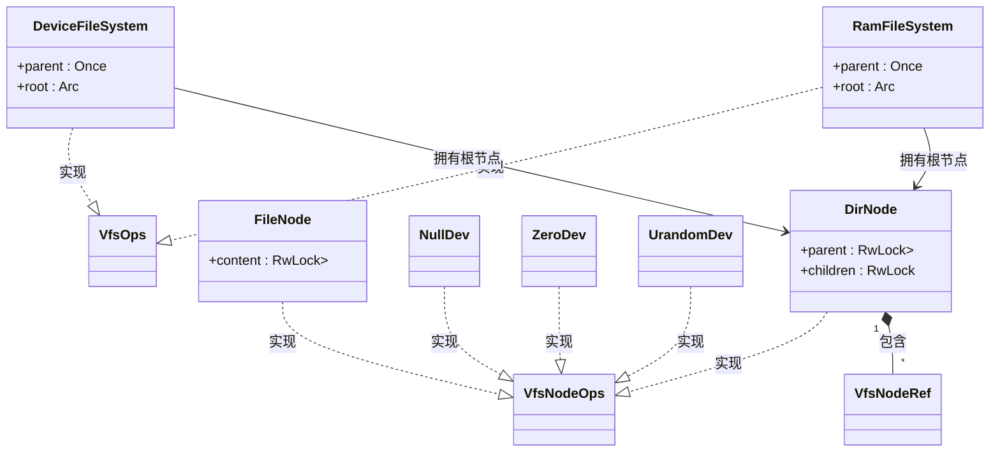

# 实现自定义文件系统

<cite>
**本文档中引用的文件**  
- [lib.rs](file://axfs_vfs/src/lib.rs)
- [dir.rs](file://axfs_devfs/src/dir.rs)
- [lib.rs](file://axfs_devfs/src/lib.rs)
- [dir.rs](file://axfs_ramfs/src/dir.rs)
- [file.rs](file://axfs_ramfs/src/file.rs)
- [lib.rs](file://axfs_ramfs/src/lib.rs)
</cite>

## 目录
1. [引言](#引言)
2. [核心trait解析：VfsOps与VfsNodeOps](#核心trait解析vfsops与vfsnodeops)
3. [实现自定义文件系统结构体](#实现自定义文件系统结构体)
4. [根节点初始化与父节点循环管理](#根节点初始化与父节点循环管理)
5. [线程安全设计：Arc<RwLock<T>>的应用](#线程安全设计arcrwlockt的应用)
6. [只读设备文件系统 vs 可变内存文件系统对比](#只读设备文件系统-vs-可变内存文件系统对比)
7. [完整示例代码与测试挂载流程](#完整示例代码与测试挂载流程)
8. [常见错误场景与调试建议](#常见错误场景与调试建议)
9. [结论](#结论)

## 引言
在ArceOS操作系统中，`axfs_vfs`框架为开发者提供了构建虚拟文件系统的统一接口。通过实现`VfsOps`和`VfsNodeOps`两个核心trait，可以创建全新的文件系统类型，如设备文件系统（devfs）或内存文件系统（ramfs）。本文将详细说明如何基于该框架实现一个完整的自定义文件系统，涵盖从结构定义、关键方法实现到实际注册与测试的全过程，并结合现有实现分析差异与最佳实践。

## 核心trait解析：VfsOps与VfsNodeOps

### VfsOps：文件系统级操作
`VfsOps` trait 定义了作用于整个文件系统实例的操作，是每个文件系统必须实现的核心接口。

#### 必须实现的关键方法：
- `root_dir(&self) -> VfsNodeRef`：返回文件系统的根目录节点引用，是文件系统挂载后路径解析的起点。
- `mount(&self, _path: &str, mount_point: VfsNodeRef) -> VfsResult`：当文件系统被挂载时调用，用于设置根节点的父节点引用。
- `umount(&self) -> VfsResult`：卸载时执行清理工作（默认为空实现）。
- `statfs(&self) -> VfsResult<FileSystemInfo>`：获取文件系统属性（可选实现）。
- `format(&self) -> VfsResult`：格式化文件系统（可选实现）。

[VfsOps](file://axfs_vfs/src/lib.rs#L59-L83)

### VfsNodeOps：节点级操作
`VfsNodeOps` trait 定义了对单个文件或目录节点的操作，所有文件系统中的节点（包括目录和文件）都必须实现此接口。

#### 关键方法分类：
| 操作 | 方法 | 适用对象 |
|------|------|--------|
| 通用操作 | `get_attr`, `open`, `release` | 文件/目录 |
| 文件操作 | `read_at`, `write_at`, `truncate`, `fsync` | 文件 |
| 目录操作 | `lookup`, `create`, `remove`, `read_dir`, `parent` | 目录 |

其中，`lookup`用于路径查找，`create`和`remove`用于动态增删节点，`parent`用于维护层级关系。

[VfsNodeOps](file://axfs_vfs/src/lib.rs#L85-L170)

### 两者区别总结
- **作用范围不同**：`VfsOps` 针对整个文件系统实例；`VfsNodeOps` 针对单个节点。
- **生命周期不同**：`VfsOps` 实例通常伴随文件系统存在；`VfsNodeOps` 实例随节点创建/销毁。
- **功能定位不同**：`VfsOps` 管理全局状态（如挂载点）；`VfsNodeOps` 处理具体I/O和元数据操作。

**Section sources**
- [lib.rs](file://axfs_vfs/src/lib.rs#L59-L170)

## 实现自定义文件系统结构体

要实现一个新的文件系统，首先需要定义其结构体并为其实现`VfsOps` trait。

### 结构体定义
以`DeviceFileSystem`为例：

```rust
pub struct DeviceFileSystem {
    parent: Once<VfsNodeRef>, // 延迟初始化父节点引用
    root: Arc<DirNode>,       // 根目录节点
}
```

- 使用`Once<VfsNodeRef>`确保父节点仅初始化一次，避免竞态。
- 根节点使用`Arc<DirNode>`保证多线程共享下的所有权安全。

### 实现VfsOps
```rust
impl VfsOps for DeviceFileSystem {
    fn mount(&self, _path: &str, mount_point: VfsNodeRef) -> VfsResult {
        if let Some(parent) = mount_point.parent() {
            self.root.set_parent(Some(self.parent.call_once(|| parent)));
        } else {
            self.root.set_parent(None);
        }
        Ok(())
    }

    fn root_dir(&self) -> VfsNodeRef {
        self.root.clone()
    }
}
```

`mount`方法接收挂载点节点，从中提取父节点信息并传递给根目录，建立层级连接。

[DeviceFileSystem](file://axfs_devfs/src/lib.rs#L25-L55)

## 根节点初始化与父节点循环管理

### 初始化过程
根节点在文件系统构造时即创建：
```rust
impl DeviceFileSystem {
    pub fn new() -> Self {
        Self {
            parent: Once::new(),
            root: DirNode::new(None), // 初始无父节点
        }
    }
}
```
此时根节点的父节点为空，待`mount`时再根据挂载位置动态设置。

### 循环引用问题
目录节点持有其子节点的强引用（`Arc`），同时子节点需能访问父节点。若父节点也持强引用回子节点，则形成循环引用导致内存泄漏。

### 解决方案：Weak + Once
- 子节点通过`Weak<dyn VfsNodeOps>`存储对父节点的弱引用。
- 使用`spin::once::Once`确保父节点引用只被设置一次，防止重复赋值。

```rust
pub struct DirNode {
    parent: RwLock<Weak<dyn VfsNodeOps>>,
    children: RwLock<BTreeMap<&'static str, VfsNodeRef>>,
}
```

`set_parent`方法将传入的`VfsNodeRef`降级为`Weak`后存入`parent`字段。

[dir.rs (devfs)](file://axfs_devfs/src/dir.rs#L10-L15)

## 线程安全设计：Arc<RwLock<T>>的应用

### 并发访问需求
文件系统常被多个线程并发访问（如读写、查找、创建），必须保证数据一致性。

### 关键组件选择
- `Arc<T>`：允许多个所有者共享同一数据，适用于跨线程传递节点引用。
- `RwLock<T>`：读写锁，在读多写少场景下性能优于互斥锁（Mutex）。
- `BTreeMap`：有序映射，适合存储目录项。

### 具体应用
```rust
pub struct DirNode {
    parent: RwLock<Weak<dyn VfsNodeOps>>,
    children: RwLock<BTreeMap<String, VfsNodeRef>>,
}
```

- 访问`children`时，读操作加读锁，写操作（如`create`）加写锁。
- `RwLock`确保同一时间最多只有一个写操作，但允许多个读操作并发执行。

[dir.rs (ramfs)](file://axfs_ramfs/src/dir.rs#L10-L15)

## 只读设备文件系统 vs 可变内存文件系统对比

| 特性 | axfs_devfs（设备文件系统） | axfs_ramfs（内存文件系统） |
|------|--------------------------|--------------------------|
| 节点动态性 | 静态预定义，不可修改 | 支持运行时`create`/`remove` |
| 节点名称类型 | `&'static str`（静态字符串） | `String`（堆分配字符串） |
| 创建方式 | 启动时由`add`/`mkdir`添加 | 运行时调用`create_node` |
| 删除支持 | 不支持（`remove`返回PermissionDenied） | 支持，检查空目录 |
| 典型用途 | `/dev/null`, `/dev/zero`等特殊设备 | 临时文件存储、缓存 |

### 代码体现差异
- **devfs** 中 `create` 和 `remove` 返回 `PermissionDenied`，表示不允许动态变更。
- **ramfs** 中 `create` 调用 `create_node` 动态生成 `FileNode` 或新 `DirNode`。



**Diagram sources**
- [lib.rs](file://axfs_devfs/src/lib.rs#L25-L55)
- [lib.rs](file://axfs_ramfs/src/lib.rs#L25-L55)
- [dir.rs](file://axfs_ramfs/src/dir.rs#L10-L15)
- [file.rs](file://axfs_ramfs/src/file.rs#L10-L15)

**Section sources**
- [lib.rs](file://axfs_devfs/src/lib.rs#L25-L55)
- [lib.rs](file://axfs_ramfs/src/lib.rs#