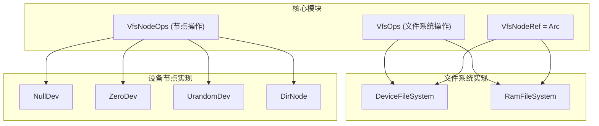
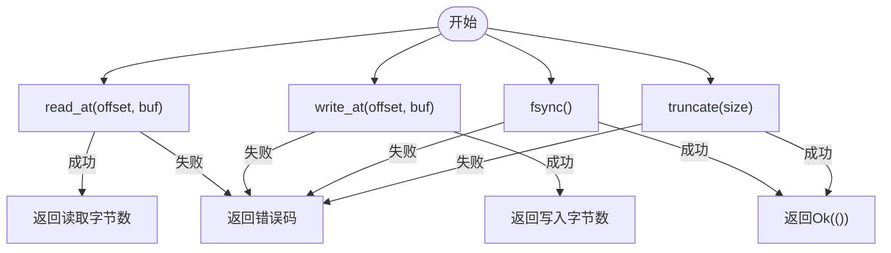
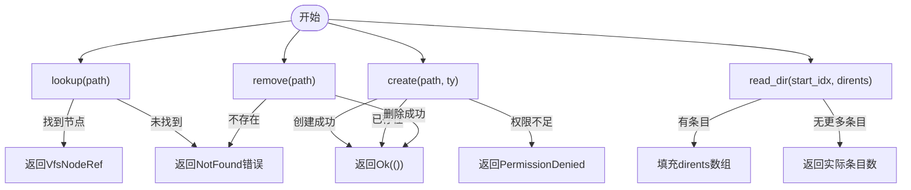
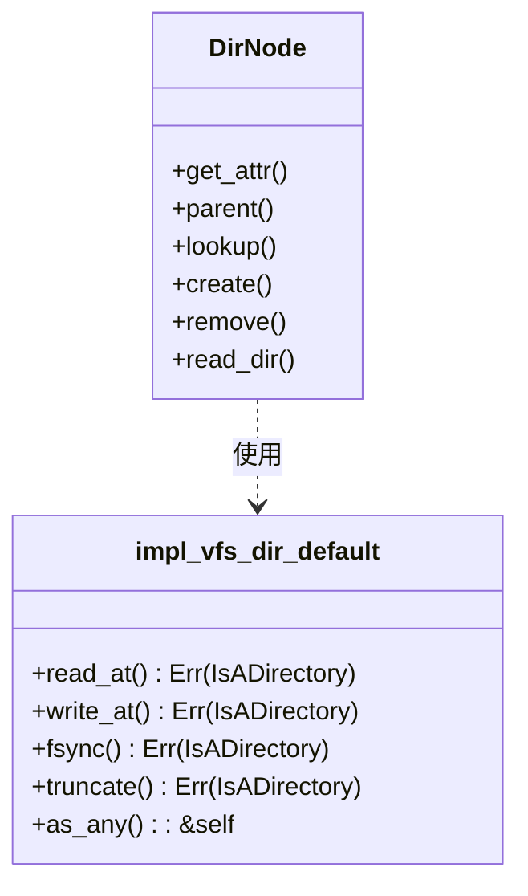
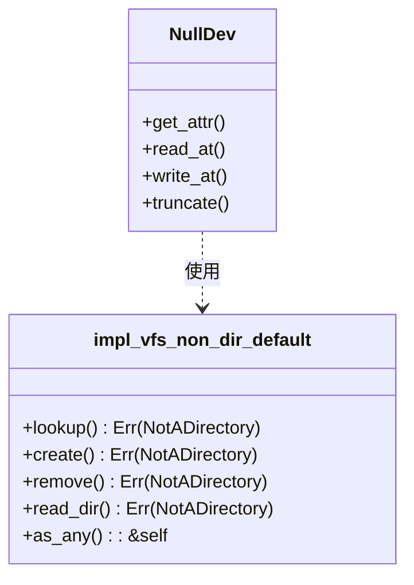
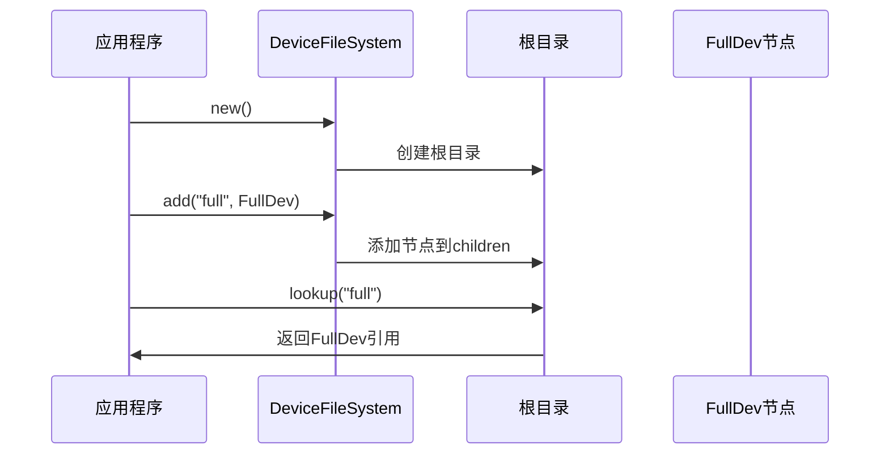
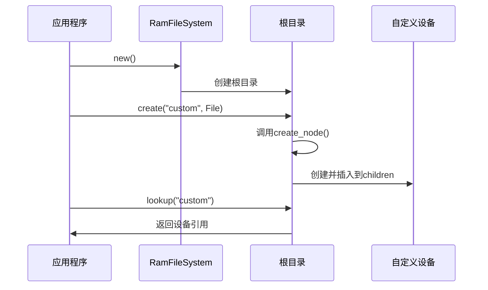
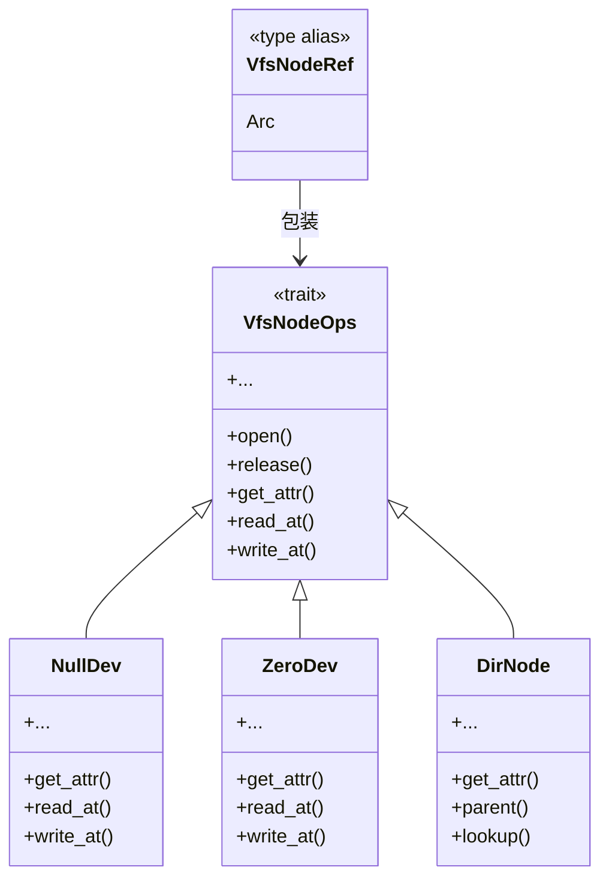
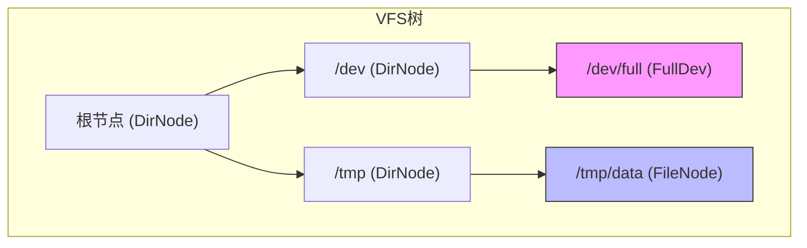

# 扩展开发指南

<cite>
**本文档中引用的文件**  
- [lib.rs](file://axfs_vfs/src/lib.rs)
- [macros.rs](file://axfs_vfs/src/macros.rs)
- [dir.rs](file://axfs_devfs/src/dir.rs)
- [null.rs](file://axfs_devfs/src/null.rs)
- [zero.rs](file://axfs_devfs/src/zero.rs)
- [urandom.rs](file://axfs_devfs/src/urandom.rs)
- [lib.rs](file://axfs_devfs/src/lib.rs)
- [lib.rs](file://axfs_ramfs/src/lib.rs)
</cite>

## 目录
1. [简介](#简介)
2. [VFS框架核心结构](#vfs框架核心结构)
3. [实现VfsNodeOps Trait](#实现vfsnodeops-trait)
4. [使用宏简化默认方法实现](#使用宏简化默认方法实现)
5. [创建自定义设备节点示例](#创建自定义设备节点示例)
6. [挂载到devfs或ramfs](#挂载到devfs或ramfs)
7. [Arc<dyn VfsNodeOps>动态分发机制](#arcdyn-vfsnodeops动态分发机制)
8. [常见问题解决方案](#常见问题解决方案)
9. [性能调优建议](#性能调优建议)

## 简介
本文档为开发者提供基于ArceOS VFS框架进行扩展开发的完整指南。文档详细说明了如何实现自定义文件系统和注册新设备节点，涵盖从基础接口实现到高级性能优化的各个方面。

## VFS框架核心结构



**图源**
- [lib.rs](file://axfs_vfs/src/lib.rs#L36-L95)
- [lib.rs](file://axfs_devfs/src/lib.rs#L40-L72)
- [lib.rs](file://axfs_ramfs/src/lib.rs#L40-L62)

**本节来源**
- [lib.rs](file://axfs_vfs/src/lib.rs#L1-L177)

## 实现VfsNodeOps Trait

`VfsNodeOps` trait定义了文件系统节点（文件或目录）的所有操作接口。开发者需要根据具体需求重写相应的方法。

### 必须重写的方法

#### 文件操作方法


**图源**
- [lib.rs](file://axfs_vfs/src/lib.rs#L108-L121)

#### 目录操作方法


**图源**
- [lib.rs](file://axfs_vfs/src/lib.rs#L123-L145)

### 可继承的默认方法
`VfsNodeOps` trait提供了多个可选的默认实现方法，包括：
- `open()`：节点打开时调用，默认返回成功
- `release()`：节点关闭时调用，默认返回成功
- `get_attr()`：获取节点属性，必须重写
- `parent()`：获取父目录，目录节点必须重写
- `as_any()`：用于类型转换，必须重写

**本节来源**
- [lib.rs](file://axfs_vfs/src/lib.rs#L92-L145)

## 使用宏简化默认方法实现

VFS框架提供了两个关键宏来减少样板代码：

### impl_vfs_dir_default! 宏
当实现目录节点时，该宏自动为文件操作方法生成返回"IsADirectory"错误的实现。



**图源**
- [macros.rs](file://axfs_vfs/src/macros.rs#L1-L23)

### impl_vfs_non_dir_default! 宏
当实现非目录节点时，该宏自动为目录操作方法生成返回"NotADirectory"错误的实现。



**图源**
- [macros.rs](file://axfs_vfs/src/macros.rs#L25-L46)

**本节来源**
- [macros.rs](file://axfs_vfs/src/macros.rs#L1-L46)

## 创建自定义设备节点示例

以下示例展示如何创建一个写入失败返回ENOSPC的FullDev设备。

### FullDev结构体定义
```rust
[SPEC SYMBOL](file://axfs_devfs/src/null.rs#L3)
```

### VfsNodeOps实现
```rust
[SPEC SYMBOL](file://axfs_devfs/src/null.rs#L5-L30)
```

该实现的关键特性：
1. `get_attr()`返回设备的基本属性
2. `read_at()`始终返回0字节（不可读）
3. `write_at()`始终返回ENOSPC错误（磁盘空间不足）
4. 使用`impl_vfs_non_dir_default!`宏处理其他目录操作

**本节来源**
- [null.rs](file://axfs_devfs/src/null.rs#L1-L30)
- [zero.rs](file://axfs_devfs/src/zero.rs#L1-L31)

## 挂载到devfs或ramfs

### devfs中的挂载
`DeviceFileSystem`允许将自定义设备节点添加到设备文件系统中。



**图源**
- [lib.rs](file://axfs_devfs/src/lib.rs#L40-L72)

### ramfs中的挂载
类似地，`RamFileSystem`也支持动态添加节点。



**图源**
- [lib.rs](file://axfs_ramfs/src/lib.rs#L40-L62)

**本节来源**
- [lib.rs](file://axfs_devfs/src/lib.rs#L40-L72)
- [lib.rs](file://axfs_ramfs/src/lib.rs#L40-L62)

## Arc<dyn VfsNodeOps>动态分发机制

### 接口设计原理
`VfsNodeRef`类型定义为`Arc<dyn VfsNodeOps>`，实现了对象的安全共享和动态分发。



### 多文件系统共存
通过动态分发机制，不同文件系统的节点可以在同一VFS树中无缝集成。



**图源**
- [lib.rs](file://axfs_vfs/src/lib.rs#L50-L51)
- [dir.rs](file://axfs_devfs/src/dir.rs#L41-L87)

**本节来源**
- [lib.rs](file://axfs_vfs/src/lib.rs#L50-L51)

## 常见问题解决方案

### 循环引用管理
使用`Weak`指针避免父子节点间的循环引用。

```rust
[SPEC SYMBOL](file://axfs_devfs/src/dir.rs#L10-L15)
```

`DirNode`使用`RwLock<Weak<dyn VfsNodeOps>>`存储父节点引用，确保即使父节点持有子节点的强引用，也不会形成内存泄漏。

### 线程安全保证
所有状态都通过`RwLock`保护，确保多线程环境下的安全性。

```rust
[SPEC SYMBOL](file://axfs_devfs/src/dir.rs#L10-L15)
```

`children`映射表被`RwLock`保护，允许多个读取者同时访问，但写入时独占。

### 错误码封装
使用`axerrno`库统一错误处理。

```rust
[SPEC SYMBOL](file://axfs_vfs/src/lib.rs#L7-L9)
```

定义了`VfsError`作为`AxError`的别名，以及`VfsResult<T>`作为结果类型的别名。

**本节来源**
- [dir.rs](file://axfs_devfs/src/dir.rs#L10-L15)
- [lib.rs](file://axfs_vfs/src/lib.rs#L7-L9)

## 性能调优建议

### 避免不必要的锁竞争
- 对于只读操作，尽量减少锁的持有时间
- 考虑使用更细粒度的锁分区
- 在可能的情况下，使用无锁数据结构

### 减少内存拷贝
- 使用引用传递而非值传递
- 预分配缓冲区以避免频繁分配
- 利用零拷贝技术处理大文件操作

### 其他优化策略
- 缓存频繁访问的节点属性
- 批量处理连续的读写请求
- 优化路径解析算法
- 使用高效的数据结构存储目录条目

**本节来源**
- [dir.rs](file://axfs_devfs/src/dir.rs#L10-L15)
- [lib.rs](file://axfs_vfs/src/lib.rs#L92-L145)