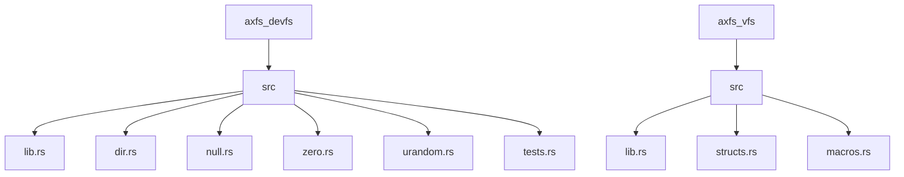
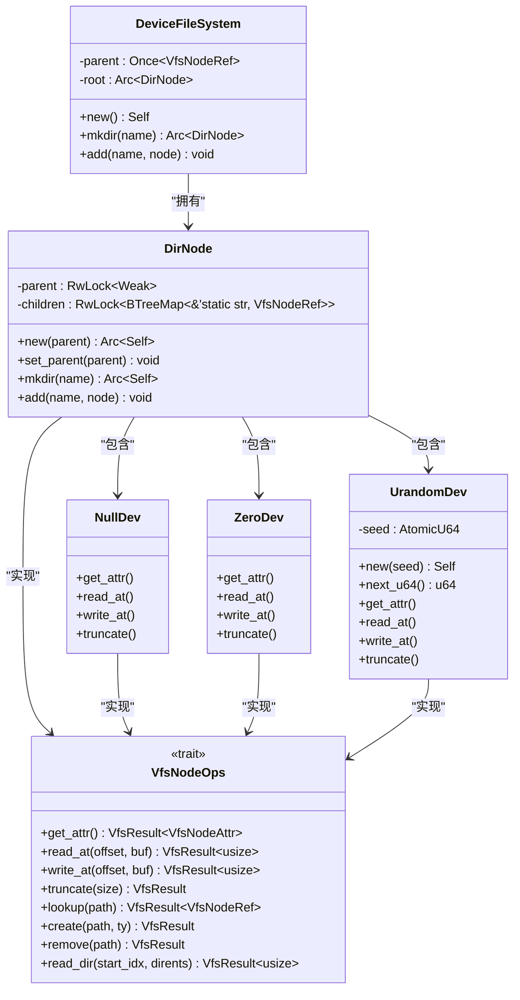
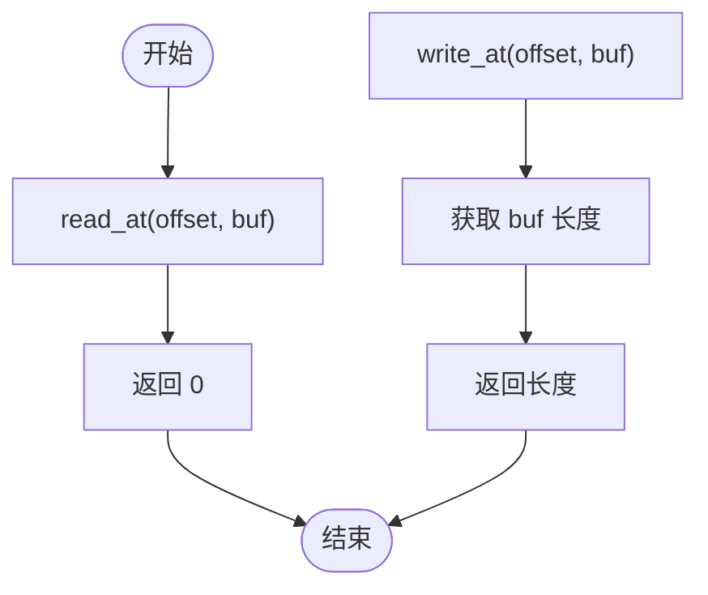
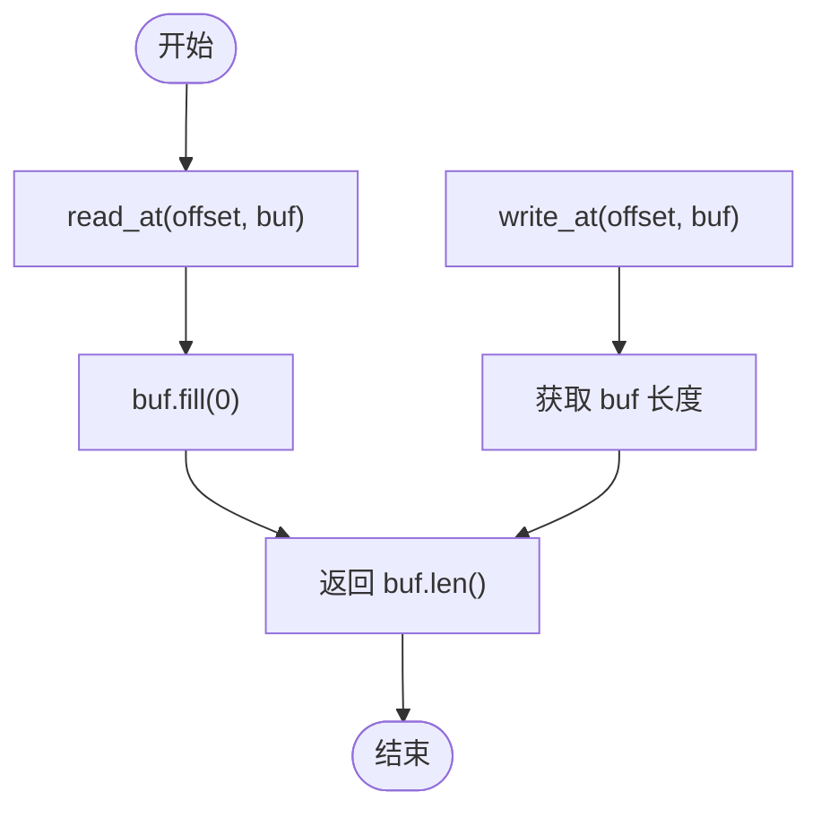
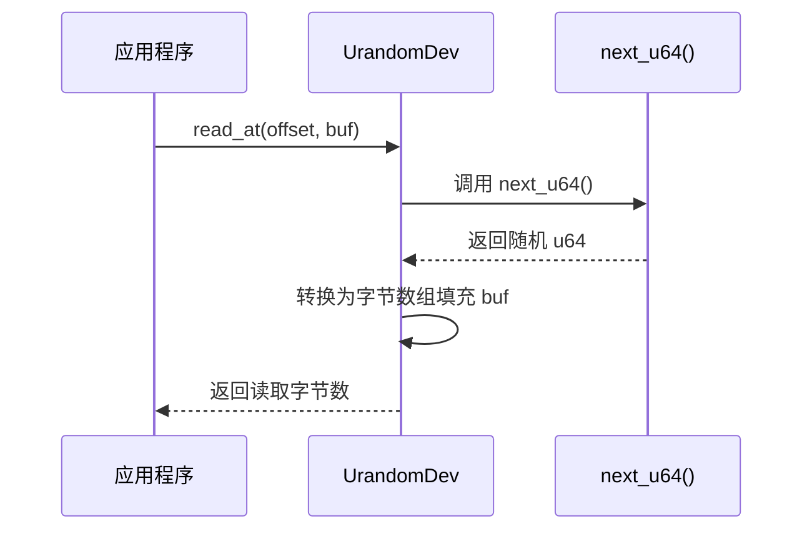
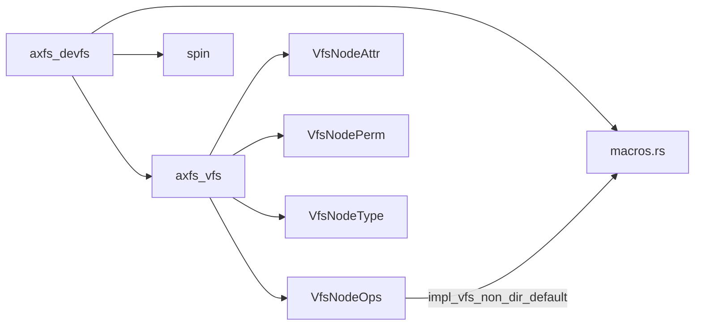

# 注册新设备节点

<cite>
**本文档中引用的文件**
- [lib.rs](file://axfs_devfs/src/lib.rs)
- [null.rs](file://axfs_devfs/src/null.rs)
- [zero.rs](file://axfs_devfs/src/zero.rs)
- [urandom.rs](file://axfs_devfs/src/urandom.rs)
- [dir.rs](file://axfs_devfs/src/dir.rs)
- [structs.rs](file://axfs_vfs/src/structs.rs)
- [macros.rs](file://axfs_vfs/src/macros.rs)
</cite>

## 目录
1. [简介](#简介)
2. [项目结构](#项目结构)
3. [核心组件](#核心组件)
4. [架构概述](#架构概述)
5. [详细组件分析](#详细组件分析)
6. [依赖分析](#依赖分析)
7. [性能考虑](#性能考虑)
8. [故障排除指南](#故障排除指南)
9. [结论](#结论)

## 简介
本文档深入讲解如何在 `axfs_devfs` 中注册新的设备节点类型（如 FullDev、RandomDev 等）。通过分析 NullDev、ZeroDev 和 UrandomDev 的实现，阐述设备节点的行为模式与接口契约。文档将演示如何定义一个新的设备结构体并实现 `VfsNodeOps` trait，特别关注 `read_at` 和 `write_at` 方法的语义定制（例如 FullDev 在写入时始终返回 ENOSPC 错误）。同时说明如何通过 `DeviceFileSystem` 的 `add` 或 `mkdir` 方法将新设备挂载到指定路径下，并强调设备节点的只读特性与不可动态删除的限制。

## 项目结构

**图示来源**
- [lib.rs](file://axfs_devfs/src/lib.rs#L1-L73)
- [structs.rs](file://axfs_vfs/src/structs.rs#L1-L306)

**本节来源**
- [lib.rs](file://axfs_devfs/src/lib.rs#L1-L73)
- [dir.rs](file://axfs_devfs/src/dir.rs#L1-L139)

## 核心组件

本文档的核心组件包括 `NullDev`、`ZeroDev` 和 `UrandomDev`，它们均实现了 `VfsNodeOps` trait 并作为字符设备暴露在虚拟文件系统中。这些设备分别模拟了 `/dev/null`、`/dev/zero` 和 `/dev/urandom` 的行为。`DeviceFileSystem` 提供了根目录管理和节点添加机制，而 `DirNode` 则实现了目录操作的基本功能。

**本节来源**
- [null.rs](file://axfs_devfs/src/null.rs#L1-L32)
- [zero.rs](file://axfs_devfs/src/zero.rs#L1-L33)
- [urandom.rs](file://axfs_devfs/src/urandom.rs#L1-L75)

## 架构概述

**图示来源**
- [lib.rs](file://axfs_devfs/src/lib.rs#L1-L73)
- [dir.rs](file://axfs_devfs/src/dir.rs#L1-L139)
- [null.rs](file://axfs_devfs/src/null.rs#L1-L32)
- [zero.rs](file://axfs_devfs/src/zero.rs#L1-L33)
- [urandom.rs](file://axfs_devfs/src/urandom.rs#L1-L75)

## 详细组件分析

### 设备节点行为模式分析

#### NullDev 分析
`NullDev` 模拟空设备行为：读取时返回 0 字节，写入时丢弃所有数据但返回成功。

**图示来源**
- [null.rs](file://axfs_devfs/src/null.rs#L1-L32)

#### ZeroDev 分析
`ZeroDev` 模拟零设备行为：读取时填充 `\0` 字节，写入时丢弃数据。

**图示来源**
- [zero.rs](file://axfs_devfs/src/zero.rs#L1-L33)

#### UrandomDev 分析
`UrandomDev` 使用线性同余生成器产生伪随机数，支持可配置种子。

**图示来源**
- [urandom.rs](file://axfs_devfs/src/urandom.rs#L1-L75)

**本节来源**
- [null.rs](file://axfs_devfs/src/null.rs#L1-L32)
- [zero.rs](file://axfs_devfs/src/zero.rs#L1-L33)
- [urandom.rs](file://axfs_devfs/src/urandom.rs#L1-L75)

### 新设备注册流程

要注册新设备节点，需遵循以下步骤：

1. 定义设备结构体
2. 实现 `VfsNodeOps` trait
3. 设置权限和属性
4. 通过 `DeviceFileSystem` 添加到文件系统

**本节来源**
- [lib.rs](file://axfs_devfs/src/lib.rs#L1-L73)
- [macros.rs](file://axfs_vfs/src/macros.rs#L1-L67)

## 依赖分析

**图示来源**
- [lib.rs](file://axfs_devfs/src/lib.rs#L1-L73)
- [structs.rs](file://axfs_vfs/src/structs.rs#L1-L306)
- [macros.rs](file://axfs_vfs/src/macros.rs#L1-L67)

**本节来源**
- [lib.rs](file://axfs_devfs/src/lib.rs#L1-L73)
- [structs.rs](file://axfs_vfs/src/structs.rs#L1-L306)

## 性能考虑
设备节点的操作均为内存操作，具有恒定时间复杂度 O(1)。`read_at` 和 `write_at` 方法不涉及实际 I/O，因此性能开销极小。原子操作仅在 `UrandomDev` 中用于种子更新，使用顺序一致性保证线程安全。

## 故障排除指南

常见陷阱及解决方案：

- **忘记实现 lookup 导致查找失败**：使用 `axfs_vfs::impl_vfs_non_dir_default! {}` 宏自动实现非目录默认方法
- **未正确处理偏移量越界**：当前实现忽略偏移量参数，符合设备文件语义
- **日志输出缺失**：在 `create` 和 `remove` 方法中已有 `log::debug!` 输出，可用于调试
- **动态创建/删除被拒绝**：这是预期行为，设备文件系统不支持运行时动态修改节点

**本节来源**
- [dir.rs](file://axfs_devfs/src/dir.rs#L89-L137)
- [macros.rs](file://axfs_vfs/src/macros.rs#L1-L67)

## 结论
在 `axfs_devfs` 中注册新设备节点需要定义结构体并实现 `VfsNodeOps` trait，重点关注 `read_at` 和 `write_at` 的语义定制。通过继承 `impl_vfs_non_dir_default!` 宏可避免遗漏必要方法。设备节点一旦注册便不可动态删除，体现了设备文件系统的静态特性。测试用例验证了路径解析、属性查询和读写行为的正确性。