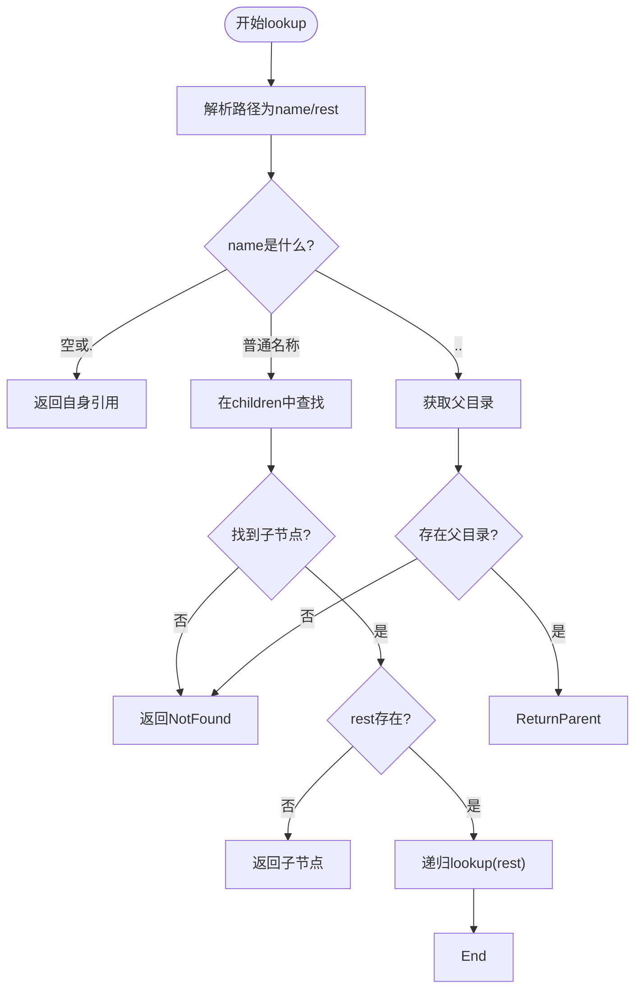

# VfsNodeOps接口详解

<cite>
**本文档引用的文件**
- [lib.rs](file://axfs_vfs/src/lib.rs#L1-L177)
- [dir.rs](file://axfs_ramfs/src/dir.rs#L1-L176)
- [file.rs](file://axfs_ramfs/src/file.rs#L1-L56)
- [lib.rs](file://axfs_ramfs/src/lib.rs#L1-L62)
</cite>

## 目录
1. [引言](#引言)
2. [VfsNodeOps核心方法解析](#vfsnodeops核心方法解析)
3. [文件操作实现分析](#文件操作实现分析)
4. [目录操作与路径遍历](#目录操作与路径遍历)
5. [open/release生命周期管理](#openrelease生命周期管理)
6. [parent()设计意图与循环引用处理](#parent设计意图与循环引用处理)
7. [downcast_ref类型转换使用范例](#downcast_ref类型转换使用范例)
8. [自定义节点类型实现指南](#自定义节点类型实现指南)
9. [总结](#总结)

## 引言
`VfsNodeOps`是ArceOS虚拟文件系统中的核心trait，为文件和目录节点提供统一的操作接口。该接口设计遵循资源抽象原则，通过标准化的方法签名支持多种文件系统实现。本文档深入解析其接口规范、默认行为及在ramfs中的具体实现。

**Section sources**
- [lib.rs](file://axfs_vfs/src/lib.rs#L1-L177)

## VfsNodeOps核心方法解析
`VfsNodeOps` trait定义了两类操作：通用节点操作（适用于文件和目录）与特定类型操作（仅适用于文件或目录）。所有方法均返回`VfsResult<T>`类型，便于统一错误处理。

### 通用节点操作
包含`open()`、`release()`和`get_attr()`三个基础方法：
- `open()`：节点打开时调用，用于初始化资源
- `release()`：节点关闭时调用，用于清理资源
- `get_attr()`：获取节点元数据，如大小、类型等

### 文件专有操作
针对文件节点提供读写控制：
- `read_at()`：从指定偏移量读取数据
- `write_at()`：向指定偏移量写入数据
- `truncate()`：调整文件大小
- `fsync()`：同步数据到存储介质

### 目录专有操作
支持目录结构管理：
- `lookup()`：根据路径查找子节点
- `create()`：创建新节点
- `remove()`：删除子节点
- `read_dir()`：枚举目录条目
- `parent()`：获取父目录引用

**Section sources**
- [lib.rs](file://axfs_vfs/src/lib.rs#L100-L150)

## 文件操作实现分析
以`FileNode`为例，展示文件操作的具体实现机制。

### read_at/write_at实现逻辑
`read_at`方法确保读取范围不超出缓冲区边界，采用最小值计算有效读取长度。`write_at`则动态扩展内部Vec容量以容纳新数据，保证写入位置的连续性。

### truncate行为规范
当目标尺寸小于当前大小时执行截断；否则填充零值扩展至目标尺寸。此设计保持了POSIX兼容性。

### 默认错误约定
未实现的方法默认返回`InvalidInput`（读写类）或`Unsupported`（属性类），明确区分接口支持状态与参数合法性。

**Section sources**
- [file.rs](file://axfs_ramfs/src/file.rs#L1-L56)

## 目录操作与路径遍历
`DirNode`实现了完整的目录语义，支持层级化路径解析。

### lookup路径解析流程


**Diagram sources**
- [dir.rs](file://axfs_ramfs/src/dir.rs#L100-L120)

**Section sources**
- [dir.rs](file://axfs_ramfs/src/dir.rs#L100-L130)

## open/release生命周期管理
`open()`和`release()`构成节点的生命周期钩子函数，在ramfs中虽为空实现，但为其他文件系统提供了资源管理入口点。典型应用场景包括：
- 打开时增加引用计数
- 关闭时释放缓存数据
- 实现文件锁机制

这种设计解耦了核心操作与资源管理，提升系统可扩展性。

**Section sources**
- [lib.rs](file://axfs_vfs/src/lib.rs#L105-L110)

## parent()设计意图与循环引用处理
`parent()`返回`Option<VfsNodeRef>`的设计具有重要安全意义：

### 循环引用预防
通过弱引用（Weak）管理父子关系，避免强引用循环导致内存泄漏。`DirNode`内部使用`RwLock<Weak<dyn VfsNodeOps>>`存储父节点，升级为强引用时需显式调用`upgrade()`。

### 根目录特殊处理
根目录的`parent()`返回`None`，作为路径遍历终止条件，防止无限向上查询。

### 安全性保障
弱引用机制允许父节点被正常释放，即使子节点仍存在引用，不会阻碍垃圾回收。

**Section sources**
- [dir.rs](file://axfs_ramfs/src/dir.rs#L30-L40)

## downcast_ref类型转换使用范例
`as_any()`配合`downcast_ref`实现安全的运行时类型检查：

```rust
if let Some(file_node) = node.as_any().downcast_ref::<FileNode>() {
    // 安全地访问FileNode特有方法
    println!("文件大小: {}", file_node.content.read().len());
} else if let Some(dir_node) = node.as_any().downcast_ref::<DirNode>() {
    // 安全地访问DirNode特有方法
    println!("子项数量: {}", dir_node.children.read().len());
}
```

此模式优于直接类型转换，具备以下优势：
- 编译时类型安全
- 运行时检查失败返回None而非panic
- 支持复杂继承结构的精确匹配

**Section sources**
- [dir.rs](file://axfs_ramfs/src/dir.rs#L80-L85)

## 自定义节点类型实现指南
实现自定义节点需遵循以下步骤：

### 基础结构定义
```rust
struct CustomNode {
    data: RwLock<Vec<u8>>,
    metadata: VfsNodeAttr,
}
```

### 必须重写的方法
至少实现`get_attr()`以提供基本元数据，根据节点类型选择实现读写或目录操作。

### 路径遍历重写要点
若支持嵌套结构，必须正确实现`lookup()`：
1. 解析路径分段
2. 处理`.`和`..`特殊符号
3. 递归查询子节点
4. 验证访问权限

### 推荐实践
- 使用`impl_vfs_non_dir_default!{}`宏简化非目录节点实现
- 在`create()`中验证名称合法性
- `remove()`前检查目录非空状态

**Section sources**
- [dir.rs](file://axfs_ramfs/src/dir.rs#L120-L150)

## 总结
`VfsNodeOps`通过精巧的trait设计实现了文件系统的抽象化。其方法划分清晰，错误处理一致，配合Arc+Weak的引用机制有效解决了循环引用问题。`downcast_ref`模式提供了安全的类型转换方案，而模块化的默认实现降低了新文件系统的开发门槛。理解这些设计原理对于构建高效可靠的存储系统至关重要。