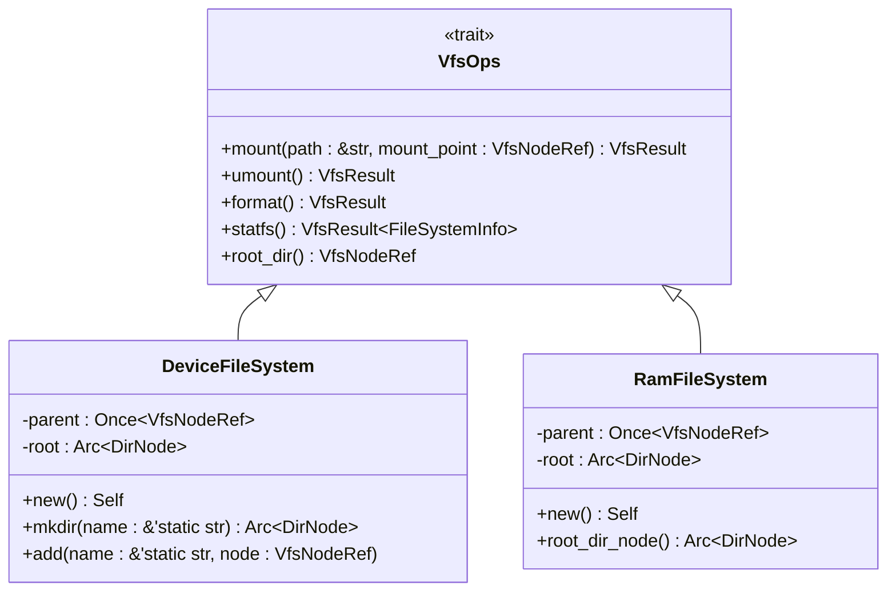

# VfsOps接口详解

<cite>
**本文档引用的文件**
- [lib.rs](file://axfs_vfs/src/lib.rs)
- [lib.rs](file://axfs_devfs/src/lib.rs)
- [lib.rs](file://axfs_ramfs/src/lib.rs)
</cite>

## 目录
1. [引言](#引言)
2. [VfsOps核心语义与方法解析](#vfsops核心语义与方法解析)
3. [默认实现机制与可选操作支持](#默认实现机制与可选操作支持)
4. [多态挂载与统一访问：axfs_devfs与axfs_ramfs实例分析](#多态挂载与统一访问axfs_devfs与axfs_ramfs实例分析)
5. [根节点获取与文件系统初始化示例](#根节点获取与文件系统初始化示例)
6. [sync_all方法的行为分析与自定义同步策略指导](#sync_all方法的行为分析与自定义同步策略指导)
7. [扩展性设计考量：预留字段与版本兼容性](#扩展性设计考量预留字段与版本兼容性)
8. [结论](#结论)

## 引言
`VfsOps` 是 ArceOS 操作系统中虚拟文件系统（Virtual File System, VFS）的核心抽象接口，定义了文件系统级别的通用操作。该 trait 为不同类型的文件系统（如设备文件系统 `axfs_devfs` 和内存文件系统 `axfs_ramfs`）提供了统一的操作契约，实现了多态挂载和统一访问机制。通过提供默认实现，`VfsOps` 允许具体文件系统选择性地重写所需方法，从而在保证接口一致性的同时保持实现灵活性。

**Section sources**
- [lib.rs](file://axfs_vfs/src/lib.rs#L59-L83)

## VfsOps核心语义与方法解析
`VfsOps` trait 定义了文件系统在其生命周期内关键阶段应执行的操作，其核心方法包括：

- **mount**: 当文件系统被挂载到指定路径时调用。此方法接收挂载点路径 `_path` 和对应的节点引用 `_mount_point`，允许文件系统在挂载时进行必要的初始化或建立父子关系。
- **umount**: 当文件系统被卸载时调用。此方法用于执行清理工作，释放资源。
- **format**: 用于格式化文件系统。默认返回 `Unsupported` 错误，表明并非所有文件系统都支持此操作。
- **statfs**: 获取文件系统的属性信息（如总空间、可用空间等）。默认同样返回 `Unsupported`，由具体实现决定是否提供。
- **root_dir**: 必须由实现者重写的抽象方法，用于返回文件系统的根目录节点引用（`VfsNodeRef`），是访问整个文件系统层次结构的入口。

这些方法的语义清晰地划分了文件系统的管理边界，使得上层系统可以以一致的方式与任何实现了 `VfsOps` 的文件系统交互。

**Section sources**
- [lib.rs](file://axfs_vfs/src/lib.rs#L59-L83)

## 默认实现机制与可选操作支持
`VfsOps` 的一个关键设计特点是大量使用默认实现来支持可选操作。例如：
- `mount` 和 `umount` 方法的默认实现直接返回 `Ok(())`，表示挂载和卸载操作是成功的，且无需额外处理。这适用于那些无状态或不需要特殊清理过程的文件系统。
- `format` 和 `statfs` 方法的默认实现返回 `ax_err!(Unsupported)`，明确告知调用者该功能未被当前文件系统支持。

这种设计模式极大地提升了接口的灵活性和易用性。开发者在实现新的文件系统时，只需关注并重写那些对其有意义的方法，而无需为不支持的功能编写冗余的错误返回代码，从而降低了实现复杂度。

**Section sources**
- [lib.rs](file://axfs_vfs/src/lib.rs#L59-L83)

## 多态挂载与统一访问：axfs_devfs与axfs_ramfs实例分析
`VfsOps` 是实现多态挂载和统一访问的基础。`axfs_devfs` 和 `axfs_ramfs` 两个具体的文件系统都实现了 `VfsOps` trait，展示了这一机制的实际应用。

在 `axfs_devfs` 中，`DeviceFileSystem` 结构体实现了 `VfsOps`。其 `mount` 方法会检查挂载点的父节点，并通过 `Once` 机制将自身的根目录与挂载点建立链接，确保了文件系统树的完整性。`root_dir` 方法则简单地返回其内部的 `Arc<DirNode>` 根节点。

**Diagram sources**
- [lib.rs](file://axfs_devfs/src/lib.rs#L25-L29)
- [lib.rs](file://axfs_ramfs/src/lib.rs#L21-L25)
- [lib.rs](file://axfs_vfs/src/lib.rs#L59-L83)

`axfs_ramfs` 的实现与 `axfs_devfs` 高度相似，同样在 `mount` 方法中处理父节点链接，并在 `root_dir` 中返回其根节点。这种一致性证明了 `VfsOps` 接口的有效性——尽管 `devfs` 和 `ramfs` 的底层数据存储和用途完全不同（前者用于设备节点，后者用于内存中的临时文件），但它们遵循相同的接口规范，因此可以在系统中被同等对待，实现了真正的多态性。

**Section sources**
- [lib.rs](file://axfs_devfs/src/lib.rs#L25-L29)
- [lib.rs](file://axfs_ramfs/src/lib.rs#L21-L25)

## 根节点获取与文件系统初始化示例
要初始化一个文件系统并获取其根节点，通常遵循以下步骤：

1.  创建文件系统实例：调用 `DeviceFileSystem::new()` 或 `RamFileSystem::new()` 来创建一个新的文件系统对象。
2.  （可选）向根目录添加内容：对于 `DeviceFileSystem`，可以使用 `add` 方法将设备节点（如 `/dev/null`, `/dev/zero`）添加到根目录。
3.  获取根节点：通过调用 `VfsOps` trait 的 `root_dir` 方法来获取根节点的引用。这个引用可以用来进行后续的查找、读取等操作。

例如，初始化一个 `DeviceFileSystem` 并获取其根节点的代码路径如下所示：
[SPEC SYMBOL](file://axfs_devfs/src/lib.rs#L30-L38)

**Section sources**
- [lib.rs](file://axfs_devfs/src/lib.rs#L30-L38)
- [lib.rs](file://axfs_ramfs/src/lib.rs#L27-L32)

## sync_all方法的行为分析与自定义同步策略指导
虽然 `VfsOps` 本身没有直接定义 `sync_all` 方法，但其子 trait 或相关设计中涉及数据同步的概念。在 `VfsNodeOps` 中，有针对单个文件的 `fsync` 方法。对于整个文件系统的同步，在无持久化需求的场景下（如纯内存的 `ramfs` 或虚拟的 `devfs`），合理的默认行为就是“什么都不做”，即成功返回。

这与 `mount` 和 `umount` 返回 `Ok(())` 的哲学一致。因为这些文件系统中的数据本就不是为了持久化存储，强制同步到磁盘既不可能也无意义。因此，一个合理的 `sync_all` 实现应当：
- 对于基于内存或虚拟的文件系统，直接返回成功。
- 对于基于真实存储设备的文件系统，则需要遍历所有脏节点并调用其 `fsync` 方法，确保数据落盘。

开发者在实现自定义文件系统时，应根据其后端存储的性质来决定同步策略。如果后端是易失性存储，则同步操作可以是空操作；如果是持久性存储，则必须实现有效的刷新逻辑以保证数据一致性。

**Section sources**
- [lib.rs](file://axfs_vfs/src/lib.rs#L114-L115)

## 扩展性设计考量：预留字段与版本兼容性
`VfsOps` 及其相关 trait 的设计体现了良好的扩展性考量。虽然当前代码中未显式包含未来预留字段（future-proofing fields），但其通过以下方式保障了版本兼容性：
- **默认实现**：为非核心方法提供默认实现，允许在未来版本中安全地添加新方法，而不会破坏现有实现。旧的文件系统实现会自动继承新方法的默认行为。
- **Trait 组合**：通过将文件系统操作 (`VfsOps`) 和节点操作 (`VfsNodeOps`) 分离，形成了清晰的职责划分。未来可以通过引入新的 trait 来扩展功能，而不是修改现有接口，从而保持向后兼容。
- **宏的使用**：代码中存在 `macros.rs` 文件，暗示可能使用宏来自动生成某些重复代码或实现，这也是一种提高代码可维护性和一致性的扩展性手段。

这种模块化和渐进式的设计，使得 `axfs_vfs` 框架能够适应未来可能出现的新文件系统类型和新操作需求。

**Section sources**
- [lib.rs](file://axfs_vfs/src/lib.rs#L59-L83)
- [lib.rs](file://axfs_vfs/src/lib.rs#L85-L170)

## 结论
`VfsOps` trait 是 ArceOS 虚拟文件系统架构的基石，它通过精确定义文件系统的核心操作，并利用 Rust 的 trait 默认实现机制，成功地在接口的严格性与实现的灵活性之间取得了平衡。通过对 `axfs_devfs` 和 `axfs_ramfs` 的分析，我们看到了 `VfsOps` 如何支撑多态挂载和统一访问，使得异构的文件系统能够无缝集成到同一个系统中。其对可选操作的支持、对无持久化场景的合理处理以及内在的扩展性设计，共同构成了一个健壮、灵活且易于使用的文件系统抽象层。