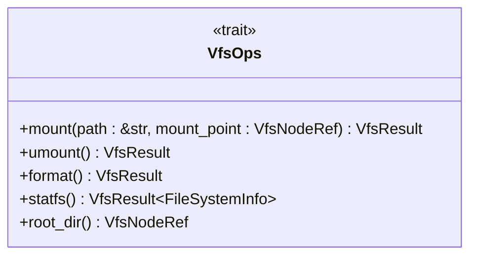
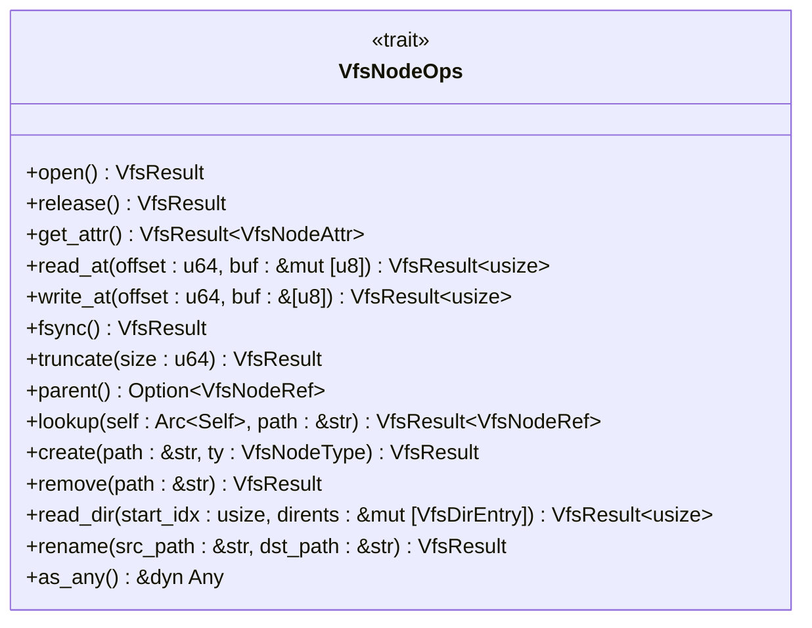

# 核心抽象层（axfs_vfs）

<cite>
**本文档引用的文件**   
- [lib.rs](file://axfs_vfs/src/lib.rs)
- [structs.rs](file://axfs_vfs/src/structs.rs)
- [path.rs](file://axfs_vfs/src/path.rs)
- [macros.rs](file://axfs_vfs/src/macros.rs)
</cite>

## 目录
1. [引言](#引言)
2. [核心Trait定义与多态机制](#核心trait定义与多态机制)
3. [核心数据结构详解](#核心数据结构详解)
4. [路径规范化工具](#路径规范化工具)
5. [默认实现宏机制](#默认实现宏机制)
6. [组件协同工作示例](#组件协同工作示例)
7. [线程安全与动态分发](#线程安全与动态分发)
8. [学习引导与性能建议](#学习引导与性能建议)

## 引言

`axfs_vfs` 模块为 ArceOS 操作系统提供了一个虚拟文件系统（VFS）的抽象接口层。该模块通过定义一组核心 trait 和数据结构，实现了对不同具体文件系统（如 `axfs_devfs`, `axfs_ramfs`）的统一访问和管理。其设计目标是提供一个灵活、可扩展且类型安全的文件系统操作框架，使得上层应用和内核组件无需关心底层文件系统的具体实现细节。

本技术文档将深入解析该模块的核心组件，包括关键 trait 的设计哲学、核心数据结构的语义、路径处理工具的实现逻辑以及代码生成宏的简化机制，旨在为开发者提供一份全面的理解指南。

## 核心Trait定义与多态机制

`axfs_vfs` 模块的核心在于两个精心设计的 trait：`VfsOps` 和 `VfsNodeOps`。它们共同构成了文件系统及其节点（文件或目录）的操作契约。

### VfsOps: 文件系统级操作

`VfsOps` trait 定义了针对整个文件系统实例的操作。它要求实现者必须提供获取根目录的方法 `root_dir()`，而其他方法如 `mount()`、`umount()`、`format()` 和 `statfs()` 都提供了默认实现。这种设计模式极大地降低了新文件系统实现的负担。例如，`mount()` 和 `umount()` 的默认行为是“什么都不做”并返回成功，这适用于许多简单的内存文件系统；而 `format()` 和 `statfs()` 的默认实现则返回 `Unsupported` 错误，强制要求需要这些功能的文件系统必须显式重写。



**Diagram sources**
- [lib.rs](file://axfs_vfs/src/lib.rs#L59-L83)

**Section sources**
- [lib.rs](file://axfs_vfs/src/lib.rs#L59-L83)

### VfsNodeOps: 节点级操作

`VfsNodeOps` trait 定义了对单个文件或目录节点的所有可能操作。这是一个更为复杂的 trait，其设计巧妙地利用了 Rust 的 trait 默认实现和泛型来支持多态行为。

该 trait 将操作分为三类：
1.  **通用操作**：如 `open()` 和 `release()`，所有节点都应支持。
2.  **文件专属操作**：如 `read_at()`、`write_at()` 等，仅对文件有意义。
3.  **目录专属操作**：如 `lookup()`、`create()`、`read_dir()` 等，仅对目录有意义。

为了减少实现者的样板代码，所有方法都提供了默认实现。对于不适用的操作，默认实现会返回相应的错误码（如 `InvalidInput` 或 `Unsupported`）。例如，一个文件类型的节点在被调用 `read_dir()` 时，会直接返回 `NotADirectory` 错误。这种设计允许开发者只关注其实现类型真正需要支持的操作，从而实现了高度的灵活性和低实现成本。



**Diagram sources**
- [lib.rs](file://axfs_vfs/src/lib.rs#L85-L170)

**Section sources**
- [lib.rs](file://axfs_vfs/src/lib.rs#L85-L170)

## 核心数据结构详解

模块中的核心数据结构用于描述文件系统和节点的元信息。

### VfsNodeAttr (节点属性)

`VfsNodeAttr` 结构体封装了一个文件或目录节点的关键属性，包括权限模式 (`mode`)、节点类型 (`ty`)、大小 (`size`) 和占用的块数 (`blocks`)。它提供了一系列构造函数（如 `new_file()` 和 `new_dir()`）来方便地创建具有默认权限的文件或目录属性，并提供了 `is_file()` 和 `is_dir()` 等便捷方法来快速判断节点类型。

**Section sources**
- [structs.rs](file://axfs_vfs/src/structs.rs#L6-L18)

### VfsNodePerm (权限标志)

`VfsNodePerm` 是一个使用 `bitflags` 宏生成的位标志结构体，用于表示 Unix 风格的文件权限。它清晰地定义了所有者、组和其他用户的读、写、执行权限。该结构体还提供了 `default_file()` 和 `default_dir()` 等常量方法来获取标准的默认权限（分别为 `0o666` 和 `0o755`），以及 `rwx_buf()` 方法来生成类似 `rwxr-xr-x` 的字符串表示。

**Section sources**
- [structs.rs](file://axfs_vfs/src/structs.rs#L20-L50)

### FileSystemInfo (文件系统信息)

目前，`FileSystemInfo` 结构体是一个占位符，尚未包含任何字段。它的存在为未来扩展以报告文件系统级别的统计信息（如总空间、可用空间等）预留了接口。

**Section sources**
- [structs.rs](file://axfs_vfs/src/structs.rs#L0-L4)

## 路径规范化工具

`path` 模块提供的 `canonicalize()` 函数是处理文件路径的核心工具。它负责将任意格式的路径（可能包含 `.`、`..` 或多余的 `/`）转换为其规范形式。

该函数的工作原理如下：
1.  首先检查路径是否为绝对路径（以 `/` 开头）。
2.  然后按 `/` 分割路径字符串，遍历每个部分。
3.  对于空字符串或 `.`，直接忽略。
4.  对于 `..`，从结果缓冲区中删除最后一个路径组件（如果存在）。
5.  对于普通路径名，则将其追加到结果缓冲区中，并确保组件之间有且仅有一个 `/`。
6.  最后，如果原始路径是绝对路径但结果为空，则返回 `/`。

这个函数对于防止路径遍历攻击和确保路径一致性至关重要。

```mermaid
flowchart TD
Start([开始]) --> Split["按 '/' 分割路径"]
Split --> Loop{遍历每个部分}
Loop --> |"" or "."| Continue["跳过"]
Loop --> |".."| Remove["移除最后一个组件"]
Loop --> |普通名称| Append["追加到结果"]
Continue --> Loop
Remove --> Loop
Append --> Loop
Loop --> |完成| CheckEmpty{"结果为空？"}
CheckEmpty --> |是| IsAbsolute{"原路径绝对？"}
CheckEmpty --> |否| ReturnResult["返回结果"]
IsAbsolute --> |是| ReturnRoot["返回 '/'"]
IsAbsolute --> |否| ReturnEmpty["返回 ''"]
ReturnRoot --> End([结束])
ReturnEmpty --> End
ReturnResult --> End
```

**Diagram sources**
- [path.rs](file://axfs_vfs/src/path.rs#L4-L51)

**Section sources**
- [path.rs](file://axfs_vfs/src/path.rs#L4-L51)

## 默认实现宏机制

为了进一步简化 `VfsNodeOps` 的实现，`axfs_vfs` 提供了两个强大的宏：`impl_vfs_dir_default!` 和 `impl_vfs_non_dir_default!`。

*   **`impl_vfs_dir_default!`**: 当在一个目录节点上实现 `VfsNodeOps` 时，可以调用此宏。它会自动为所有文件专属操作（如 `read_at`）生成返回 `IsADirectory` 错误的实现，因为目录不能像文件一样被读取。同时，它也提供了 `as_any()` 的默认实现。
*   **`impl_vfs_non_dir_default!`**: 当在一个非目录节点（即文件）上实现 `VfsNodeOps` 时，可以调用此宏。它会自动为所有目录专属操作（如 `lookup`、`read_dir`）生成返回 `NotADirectory` 错误的实现，因为文件不能包含子项。

这两个宏通过代码生成的方式，消除了大量重复的错误返回代码，使实现者能够专注于核心业务逻辑，显著提高了代码的可读性和开发效率。

**Section sources**
- [macros.rs](file://axfs_vfs/src/macros.rs#L0-L66)

## 组件协同工作示例

这些组件通过以下方式协同构建一个可扩展的 VFS 接口：
1.  一个具体的文件系统（如 `ramfs`）实现 `VfsOps` trait，并在其 `root_dir()` 方法中返回一个实现了 `VfsNodeOps` 的根目录节点。
2.  该根目录节点使用 `impl_vfs_dir_default!` 宏来填充其 `VfsNodeOps` 实现，然后专门实现 `lookup()`、`create()` 等目录操作。
3.  当用户请求打开一个文件时，VFS 层会调用根目录的 `lookup()` 方法进行路径解析。
4.  `lookup()` 内部可能会使用 `canonicalize()` 来规范化路径。
5.  找到目标文件节点后，对该文件的读写操作将直接调用其 `VfsNodeOps` 中的 `read_at()` 或 `write_at()` 方法。
6.  整个过程中，`VfsNodeAttr` 用于存储和查询文件的元数据。

## 线程安全与动态分发

`axfs_vfs` 广泛使用了 `Arc<RwLock<T>>`