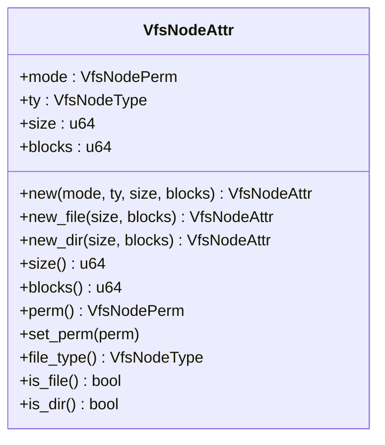
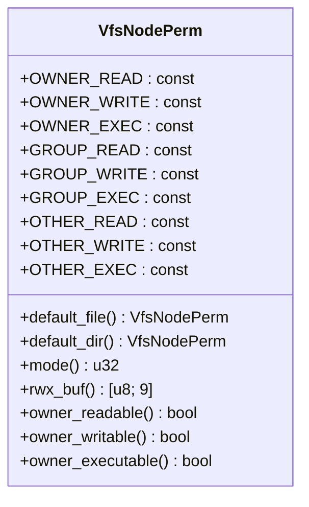

<cite>
**本文档中引用的文件**
- [structs.rs](file://axfs_vfs/src/structs.rs)
- [lib.rs](file://axfs_vfs/src/lib.rs)
- [macros.rs](file://axfs_vfs/src/macros.rs)
- [dir.rs](file://axfs_ramfs/src/dir.rs)
- [file.rs](file://axfs_ramfs/src/file.rs)
- [lib.rs](file://axfs_ramfs/src/lib.rs)
</cite>

## 目录
1. [引言](#引言)
2. [核心数据结构概览](#核心数据结构概览)
3. [VfsNodeAttr 节点属性详解](#vfsnodeattr-节点属性详解)
4. [VfsNodePerm 权限标志位解析](#vfsnodeperm-权限标志位解析)
5. [VfsNodeType 节点类型枚举](#vfsnodetype-节点类型枚举)
6. [FileSystemInfo 文件系统信息占位符](#filesysteminfo-文件系统信息占位符)
7. [VfsDirEntry 目录条目与遍历机制](#vfsdirent-目录条目与遍历机制)
8. [RamFileSystem 中的运行时协同工作](#ramfilesystem-中的运行时协同工作)
9. [总结](#总结)

## 引言

本文档旨在系统性地文档化 ArceOS 项目中虚拟文件系统（VFS）层的核心数据结构。这些结构构成了文件系统抽象的基础，为上层应用和内核组件提供了统一的文件操作接口。通过深入分析 `VfsNodeAttr`、`VfsNodePerm`、`VfsNodeType` 和 `FileSystemInfo` 等关键结构，以及它们在 `RamFileSystem` 实现中的协同工作机制，可以全面理解该 VFS 层的设计理念和实现细节。

**Section sources**
- [lib.rs](file://axfs_vfs/src/lib.rs#L1-L177)

## 核心数据结构概览

VFS 层的核心数据结构定义于 `axfs_vfs` crate 的 `src/structs.rs` 文件中，主要包括：

- **`VfsNodeAttr`**: 表示文件或目录节点的元数据属性，如大小、权限、类型和时间戳。
- **`VfsNodePerm`**: 使用位标志（bitflags）表示的节点权限模式，支持按位组合操作。
- **`VfsNodeType`**: 枚举类型，定义了文件系统中所有可能的节点类型，如普通文件、目录、设备文件等。
- **`VfsDirEntry`**: 表示目录中的一个条目，包含条目名称和类型。
- **`FileSystemInfo`**: 一个占位符结构，用于未来扩展以获取文件系统的整体信息。

这些结构共同构成了 VFS 层对文件系统状态的抽象模型。

**Section sources**
- [structs.rs](file://axfs_vfs/src/structs.rs#L1-L306)

## VfsNodeAttr 节点属性详解

`VfsNodeAttr` 结构体是文件系统节点的核心元数据容器，它封装了节点的关键属性。

### 结构组成与用途

`VfsNodeAttr` 包含以下字段：
- **`mode` (`VfsNodePerm`)**: 存储节点的权限模式，决定了谁可以读取、写入或执行该节点。
- **`ty` (`VfsNodeType`)**: 指明节点的具体类型，例如是普通文件还是目录。
- **`size` (`u64`)**: 记录节点内容的总大小，以字节为单位。对于文件，这通常是其内容长度；对于目录，通常是一个固定的元数据大小。
- **`blocks` (`u64`)**: 记录节点在存储介质上占用的512字节块的数量，用于空间统计。

### 创建与更新策略

`VfsNodeAttr` 提供了多种创建方法：
- `new()`: 通用构造函数，允许指定所有属性。
- `new_file()`: 专门用于创建文件属性，自动设置默认文件权限（`0o666`）和文件类型。
- `new_dir()`: 专门用于创建目录属性，自动设置默认目录权限（`0o755`）和目录类型。

当节点内容发生变化时，其属性会动态更新。例如，在 `RamFileSystem` 中，`FileNode` 在每次调用 `get_attr()` 时都会重新计算其大小，确保返回的是最新的内容长度。



**Diagram sources**
- [structs.rs](file://axfs_vfs/src/structs.rs#L15-L50)

**Section sources**
- [structs.rs](file://axfs_vfs/src/structs.rs#L15-L50)
- [file.rs](file://axfs_ramfs/src/file.rs#L25-L30)

## VfsNodePerm 权限标志位解析

`VfsNodePerm` 是一个使用 `bitflags!` 宏生成的位标志结构，用于高效地表示和操作 Unix 风格的文件权限。

### bitflags! 宏的作用

`bitflags!` 宏将一组常量定义转换为一个功能完整的结构体。它自动生成了进行按位操作所需的所有方法，使得权限的组合、检查和修改变得直观且安全。开发者可以直接使用 `|` (OR) 运算符来组合多个权限，使用 `&` (AND) 运算符来检查特定权限，而无需手动处理底层的位运算。

### 典型权限设置示例

`VfsNodePerm` 定义了九种基本权限，分为三组：所有者（owner）、所属组（group）和其他人（others），每组包含读（read）、写（write）和执行（execute）权限。

- **读权限**: `OWNER_READ`, `GROUP_READ`, `OTHER_READ`
- **写权限**: `OWNER_WRITE`, `GROUP_WRITE`, `OTHER_WRITE`
- **执行权限**: `OWNER_EXEC`, `GROUP_EXEC`, `OTHER_EXEC`

典型的权限设置示例如下：
- **默认文件权限 (`0o666`)**: 所有者、组和其他人都可读写，但不可执行。通过 `VfsNodePerm::default_file()` 获取。
- **默认目录权限 (`0o755`)**: 所有者可读、写、执行；组和其他人可读、执行。通过 `VfsNodePerm::default_dir()` 获取。

此外，`VfsNodePerm` 还提供了 `rwx_buf()` 方法，可以将权限位转换为人类可读的字符串形式（如 `rwxr-xr-x`），以及 `owner_readable()` 等便捷方法来快速检查特定权限。



**Diagram sources**
- [structs.rs](file://axfs_vfs/src/structs.rs#L25-L50)

**Section sources**
- [structs.rs](file://axfs_vfs/src/structs.rs#L25-L50)

## VfsNodeType 节点类型枚举

`VfsNodeType` 是一个 C 风格的枚举（`repr(u8)`），用于标识文件系统中不同类型的节点。

### 类型定义

该枚举定义了以下几种标准的 Unix 节点类型：
- **`Fifo`**: 命名管道。
- **`CharDevice`**: 字符设备。
- **`Dir`**: 目录。
- **`BlockDevice`**: 块设备。
- **`File`**: 普通文件。
- **`SymLink`**: 符号链接。
- **`Socket`**: 套接字。

每个类型都关联了一个八进制值，这与传统的 Unix `st_mode` 位兼容。

### 类型检查与字符表示

`VfsNodeType` 提供了一系列 `const fn` 方法来方便地检查节点类型，例如 `is_file()`、`is_dir()` 和 `is_symlink()`。这些方法在编译时即可求值，性能开销极低。

此外，`as_char()` 方法可以将节点类型转换为一个单字符的符号表示，这在格式化输出（如 `ls -l` 命令）时非常有用。例如，目录显示为 `'d'`，普通文件显示为 `'-'`。

```mermaid
classDiagram
    class VfsNodeType {
        +Fifo: enum
        +CharDevice: enum
        +Dir: enum
        +BlockDevice: enum
        +File: enum
        +SymLink: enum
        +Socket: enum
        +is_file() bool
        +is_dir() bool
        +is_symlink() bool
        +is_block_device() bool
        +is_char_device() bool
        +is_fifo