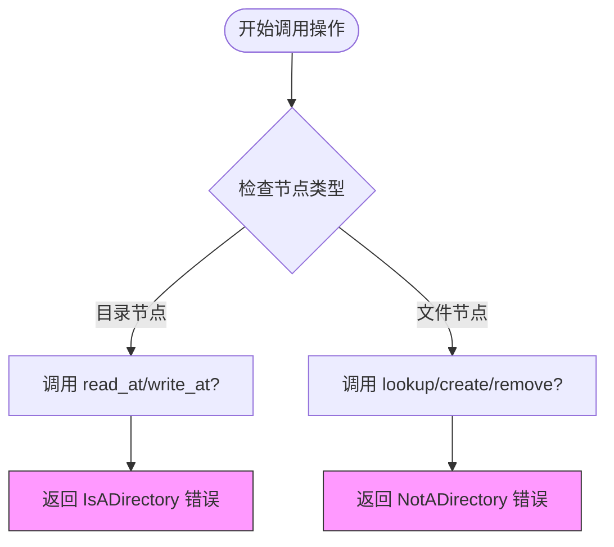

# 路径与宏工具函数

<cite>
**本文档引用的文件**  
- [path.rs](file://axfs_vfs/src/path.rs)
- [macros.rs](file://axfs_vfs/src/macros.rs)
- [dir.rs](file://axfs_devfs/src/dir.rs)
- [null.rs](file://axfs_devfs/src/null.rs)
- [file.rs](file://axfs_ramfs/src/file.rs)
</cite>

## 目录
1. [路径规范化函数 canonicalize()](#路径规范化函数-canonicalize)
2. [宏工具 impl_vfs_dir_default! 与 impl_vfs_non_dir_default!](#宏工具-impl_vfs_dir_default-与-impl_vfs_non_dir_default)
3. [应用场景与设计优势](#应用场景与设计优势)
4. [开发建议](#开发建议)

## 路径规范化函数 canonicalize()

`canonicalize()` 函数用于将包含 `.` 和 `..` 的相对或冗余路径转换为标准化形式，去除多余的分隔符和中间符号链接，从而确保路径的一致性和可预测性。该函数不会强制将路径转为绝对路径，而是根据输入是否以 `/` 开头保留其绝对/相对属性。

### 实现原理
函数通过逐段解析输入路径（以 `/` 分割），并维护一个输出缓冲区来构建规范路径：
- 忽略空字符串和 `.` 段（当前目录）
- 遇到 `..` 时，从缓冲区回退至上一级目录（删除最后一个 `/` 及之后内容）
- 其他有效段则追加到缓冲区，并确保路径分隔符正确插入

此过程避免了实际文件系统访问，仅进行字符串处理，因此高效且安全。

### 输入输出示例
以下是一些典型的路径规范化结果：

| 输入路径 | 输出路径 |
|--------|--------|
| `/foo/../bar` | `/bar` |
| `/path/./to//foo` | `/path/to/foo` |
| `/./path/to/../bar.rs` | `/path/bar.rs` |
| `./foo/./bar` | `foo/bar` |
| `/a/../..///` | `/` |

这些示例展示了如何消除冗余组件并正确处理层级跳转。

在调用 `lookup()` 进行路径查找前，必须先对路径进行规范化，否则可能导致错误的节点匹配或遍历失败。例如，`/dev/../null` 应被解析为 `/null`，而不是尝试访问不存在的 `/dev/null` 子路径。

**Section sources**
- [path.rs](file://axfs_vfs/src/path.rs#L18-L56)
- [path.rs](file://axfs_vfs/src/path.rs#L59-L77)

## 宏工具 impl_vfs_dir_default! 与 impl_vfs_non_dir_default!

这两个声明式宏基于 Rust 的 `macro_rules!` 机制实现，旨在减少重复代码并防止接口实现遗漏，特别适用于虚拟文件系统中不同类型节点的操作约束。

### impl_vfs_dir_default!：为目录节点生成非目录操作的默认错误响应

当实现 `VfsNodeOps` trait 的结构体是目录类型时，应使用此宏自动填充不适用于目录的文件操作方法。这些方法包括：
- `read_at`：读取数据 → 返回 `IsADirectory`
- `write_at`：写入数据 → 返回 `IsADirectory`
- `fsync`：同步数据 → 返回 `IsADirectory`
- `truncate`：截断文件 → 返回 `IsADirectory`

此外，还提供 `as_any()` 的默认实现以支持运行时类型转换。

#### 使用示例
```rust
impl VfsNodeOps for DirNode {
    // ... 实现目录特有方法如 lookup, read_dir 等 ...

    axfs_vfs::impl_vfs_dir_default! {}
}
```

该宏确保任何试图对目录执行文件操作的行为都会立即返回语义明确的错误，提升系统健壮性。

**Section sources**
- [macros.rs](file://axfs_vfs/src/macros.rs#L5-L33)
- [dir.rs](file://axfs_devfs/src/dir.rs#L129)

### impl_vfs_non_dir_default!：为非目录节点生成目录操作的默认错误响应

对于普通文件、设备等非目录节点，此宏自动生成目录专属操作的错误返回，包括：
- `lookup`：路径查找 → 返回 `NotADirectory`
- `create`：创建子节点 → 返回 `NotADirectory`
- `remove`：删除子节点 → 返回 `NotADirectory`
- `read_dir`：读取目录项 → 返回 `NotADirectory`

同样包含 `as_any()` 的内联实现。

#### 使用示例
```rust
impl VfsNodeOps for NullDev {
    // ... 实现文件特有方法如 read_at, write_at ...

    axfs_vfs::impl_vfs_non_dir_default! {}
}
```

这保证了文件节点无法被误用作容器，符合 POSIX 文件系统语义。

**Section sources**
- [macros.rs](file://axfs_vfs/src/macros.rs#L35-L65)
- [null.rs](file://axfs_devfs/src/null.rs#L29)
- [file.rs](file://axfs_ramfs/src/file.rs#L54)

## 应用场景与设计优势

### 减少样板代码
在多个文件系统实现（如 `axfs_devfs` 和 `axfs_ramfs`）中，大量节点需分别实现 `VfsNodeOps`。若无宏辅助，开发者需手动为每个节点补全所有非法操作的错误返回，极易出错或遗漏。

通过宏展开，编译器自动生成一致的错误处理逻辑，显著降低维护成本。

### 防止接口实现遗漏
Rust trait 要求所有方法都被实现。若忘记实现某个操作（如 `truncate` 对目录），会导致编译错误。而使用宏后，所有“非法”方法均由宏统一提供，确保接口完整性。

### 提升一致性与可读性
所有目录和非目录节点的行为保持统一：非法操作即刻返回预定义错误，无需额外判断逻辑。代码更清晰，行为更可预测。



**Diagram sources**
- [macros.rs](file://axfs_vfs/src/macros.rs#L5-L65)

## 开发建议

在扩展新的节点类型时，请遵循以下最佳实践：

1. **识别节点类别**：明确新节点是目录还是非目录。
2. **选择合适宏**：
   - 若为目录，使用 `impl_vfs_dir_default!{}`
   - 若为文件或其他非目录节点，使用 `impl_vfs_non_dir_default!{}`
3. **仅实现合法操作**：只编写该节点类型允许的方法（如目录实现 `lookup`，文件实现 `read_at`）。
4. **避免手动重复错误返回**：不要自行编写 `ax_err!(IsADirectory)` 等重复代码，交由宏处理。

此举不仅能加快开发速度，还能确保整个文件系统生态的行为一致性与高可靠性。

**Section sources**
- [dir.rs](file://axfs_devfs/src/dir.rs#L129)
- [null.rs](file://axfs_devfs/src/null.rs#L29)
- [file.rs](file://axfs_ramfs/src/file.rs#L54)