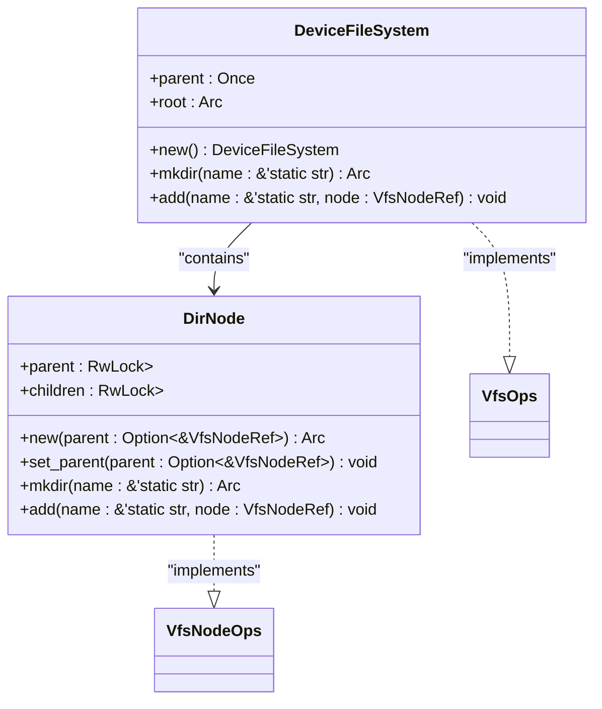
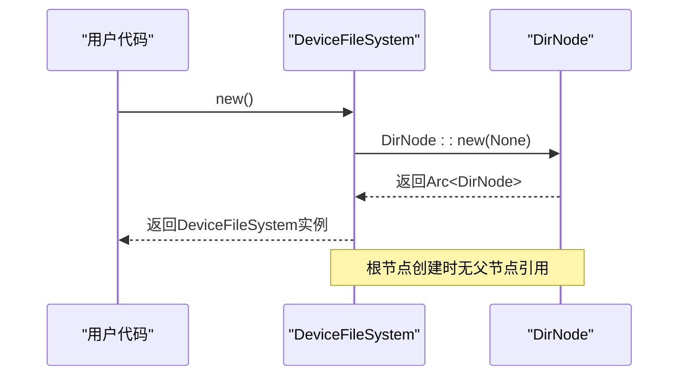
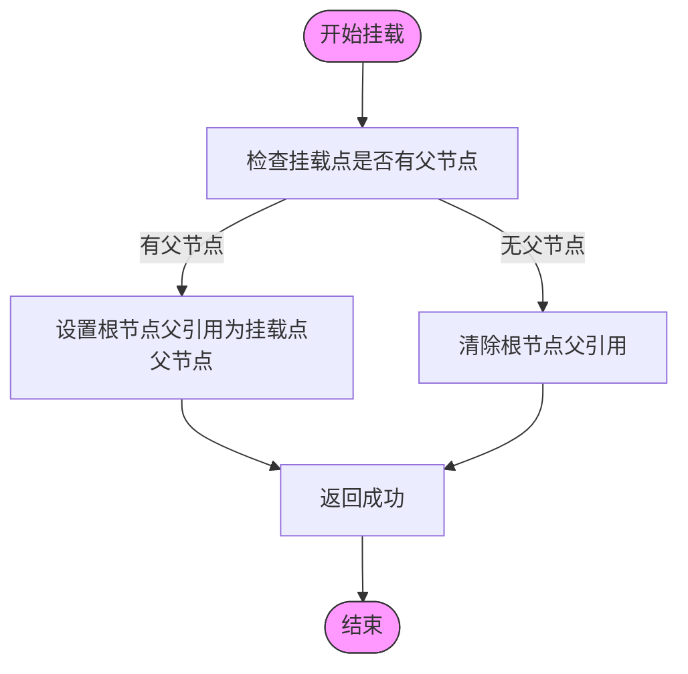
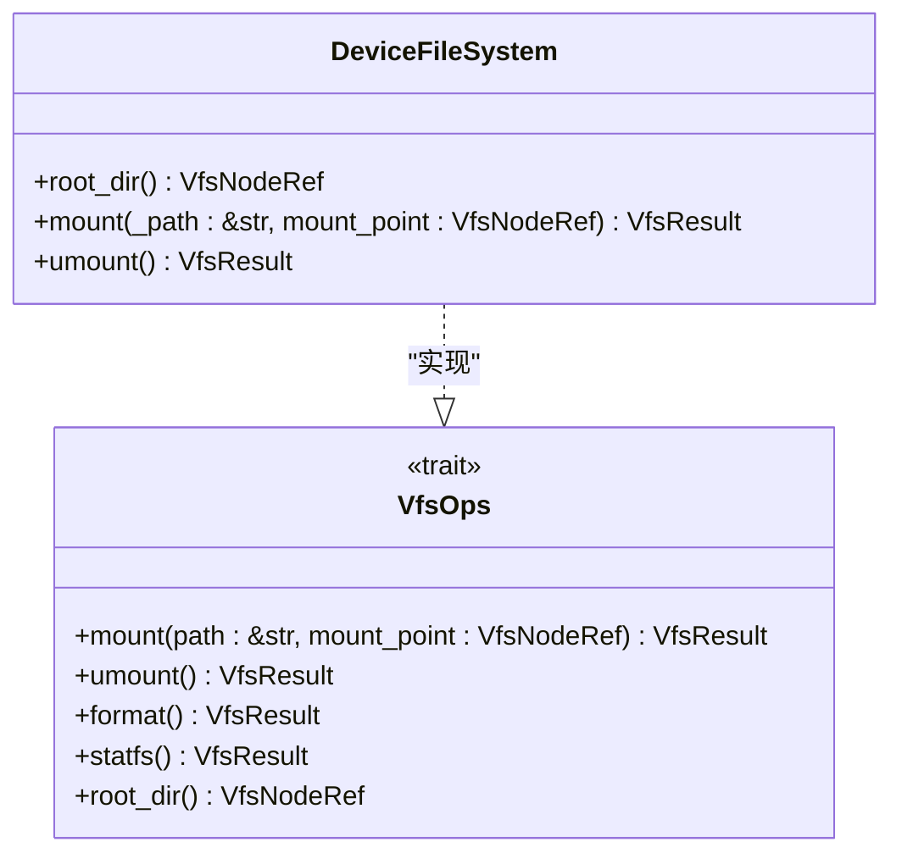
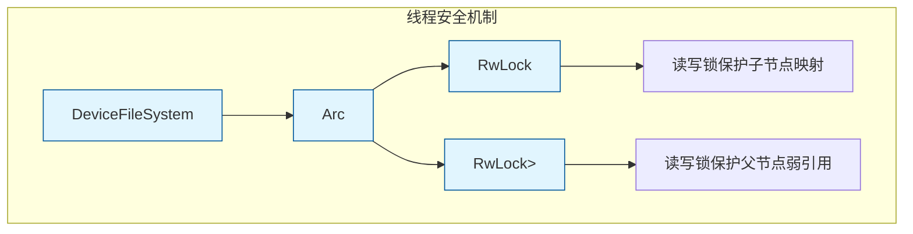
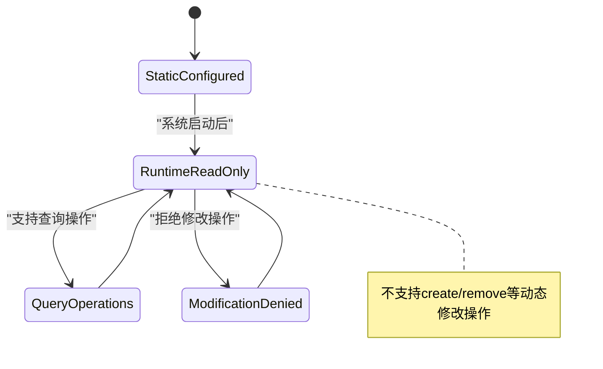
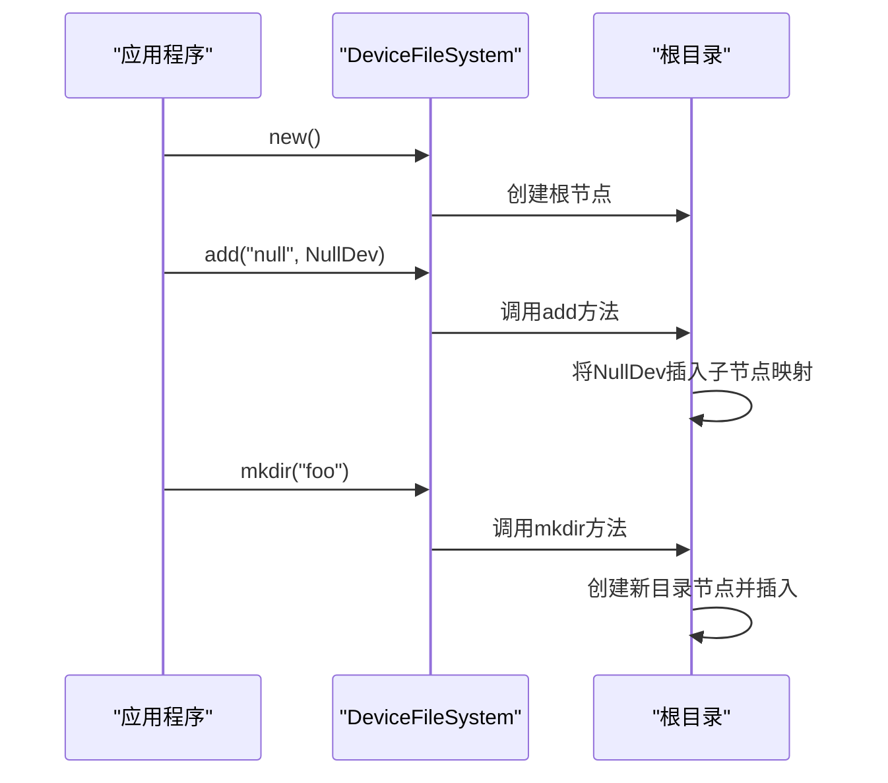

# DeviceFileSystem初始化与挂载

<cite>
**Referenced Files in This Document**   
- [lib.rs](file://axfs_devfs/src/lib.rs)
- [dir.rs](file://axfs_devfs/src/dir.rs)
- [lib.rs](file://axfs_vfs/src/lib.rs)
</cite>

## 目录
1. [引言](#引言)
2. [DeviceFileSystem结构体设计](#devicefilesystem结构体设计)
3. [初始化过程分析](#初始化过程分析)
4. [挂载机制详解](#挂载机制详解)
5. [核心操作接口](#核心操作接口)
6. [线程安全实现](#线程安全实现)
7. [只读静态特性](#只读静态特性)
8. [设备节点注册](#设备节点注册)
9. [应用场景](#应用场景)

## 引言
`DeviceFileSystem`是ArceOS操作系统中用于管理设备文件的核心组件，它实现了虚拟文件系统（VFS）接口，为设备驱动提供统一的文件系统视图。该文件系统专为嵌入式和操作系统启动阶段设计，具有轻量、高效和静态配置的特点。

## DeviceFileSystem结构体设计

`DeviceFileSystem`结构体作为设备文件系统的容器，包含两个核心字段：`parent`和`root`。其中`parent`使用`Once<VfsNodeRef>`类型确保父节点引用仅被设置一次，而`root`则持有根目录节点的强引用。

**Diagram sources**
- [lib.rs](file://axfs_devfs/src/lib.rs#L20-L24)
- [dir.rs](file://axfs_devfs/src/dir.rs#L10-L15)

**Section sources**
- [lib.rs](file://axfs_devfs/src/lib.rs#L20-L24)
- [dir.rs](file://axfs_devfs/src/dir.rs#L10-L15)

## 初始化过程分析

`DeviceFileSystem`的初始化通过`new()`函数完成，该函数创建一个新的实例并初始化其内部状态。在初始化过程中，系统会调用`DirNode::new(None)`来创建根目录节点，并将父引用设置为`None`，表示这是文件系统的根。

**Diagram sources**
- [lib.rs](file://axfs_devfs/src/lib.rs#L26-L33)
- [dir.rs](file://axfs_devfs/src/dir.rs#L17-L22)

**Section sources**
- [lib.rs](file://axfs_devfs/src/lib.rs#L26-L33)

## 挂载机制详解

`mount`方法实现了`VfsOps` trait中的挂载语义，负责将文件系统连接到指定的挂载点。当文件系统被挂载时，该方法会检查挂载点的父节点是否存在，并相应地设置根目录的父引用。

**Diagram sources**
- [lib.rs](file://axfs_devfs/src/lib.rs#L50-L58)

**Section sources**
- [lib.rs](file://axfs_devfs/src/lib.rs#L50-L58)

## 核心操作接口

`DeviceFileSystem`实现了`VfsOps` trait定义的核心操作接口，包括`root_dir`、`mount`和`umount`等方法。其中`root_dir`方法直接返回根目录节点的克隆引用，为文件系统提供访问起点。

**Diagram sources**
- [lib.rs](file://axfs_devfs/src/lib.rs#L50-L60)
- [lib.rs](file://axfs_vfs/src/lib.rs#L80-L90)

**Section sources**
- [lib.rs](file://axfs_devfs/src/lib.rs#L50-L60)

## 线程安全实现

为了支持多线程环境下的安全访问，`DeviceFileSystem`采用`Arc<RwLock<T>>`模式进行封装。根目录节点使用`Arc`实现引用计数共享，而内部数据结构则通过`RwLock`保证读写安全。

**Diagram sources**
- [dir.rs](file://axfs_devfs/src/dir.rs#L10-L15)
- [dir.rs](file://axfs_devfs/src/dir.rs#L17-L22)

**Section sources**
- [dir.rs](file://axfs_devfs/src/dir.rs#L10-L15)

## 只读静态特性

`DeviceFileSystem`被设计为只读、静态配置的文件系统，这意味着在运行时不能动态创建或删除节点。这种设计选择使其非常适合操作系统启动阶段的设备管理需求。

**Diagram sources**
- [dir.rs](file://axfs_devfs/src/dir.rs#L90-L137)

**Section sources**
- [dir.rs](file://axfs_devfs/src/dir.rs#L90-L137)

## 设备节点注册

尽管`DeviceFileSystem`本身不支持运行时动态创建节点，但提供了`add`和`mkdir`方法用于在系统初始化阶段向根目录注册预定义的设备节点。

**Diagram sources**
- [lib.rs](file://axfs_devfs/src/lib.rs#L35-L47)
- [dir.rs](file://axfs_devfs/src/dir.rs#L24-L37)

**Section sources**
- [lib.rs](file://axfs_devfs/src/lib.rs#L35-L47)

## 应用场景

`DeviceFileSystem`主要应用于操作系统启动阶段的设备管理，为各种设备驱动提供统一的文件系统接口。其静态配置特性确保了系统启动过程的可预测性和可靠性。

**Diagram sources**
- [lib.rs](file://axfs_devfs/src/lib.rs#L26-L60)
- [tests.rs](file://axfs_devfs/src/tests.rs#L74-L114)

**Section sources**
- [tests.rs](file://axfs_devfs/src/tests.rs#L74-L114)