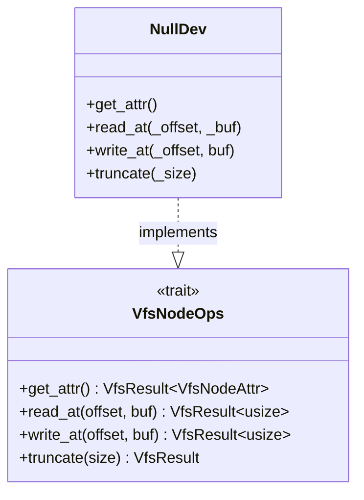
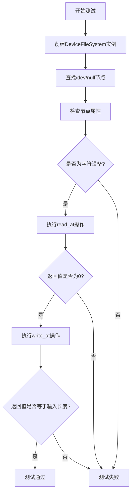

# NullDev设备行为

<cite>
**本文档引用的文件**  
- [null.rs](file://axfs_devfs/src/null.rs)
- [lib.rs](file://axfs_vfs/src/lib.rs)
- [tests.rs](file://axfs_devfs/src/tests.rs)
</cite>

## 目录
1. [简介](#简介)
2. [核心功能与API行为](#核心功能与api行为)
3. [实现机制分析](#实现机制分析)
4. [使用场景与代码示例](#使用场景与代码示例)
5. [测试验证](#测试验证)
6. [设计原则与适用环境](#设计原则与适用环境)

## 简介

NullDev是ArceOS内核中实现的一个特殊设备节点，其行为模拟了类Unix系统中的`/dev/null`语义。该设备提供了一个“空”数据流接口：任何读取操作均返回空数据（0字节），而所有写入操作都会被静默丢弃，不保留任何内容。这种轻量级、确定性的I/O行为使其在内核调试、日志重定向和性能基准测试等场景中具有重要价值。

**Section sources**
- [null.rs](file://axfs_devfs/src/null.rs#L1-L31)

## 核心功能与API行为

NullDev通过实现`VfsNodeOps` trait来定义其对虚拟文件系统（VFS）的操作响应。其关键方法的行为特性如下：

### read_at 方法
该方法用于从设备读取数据。无论请求的偏移量和缓冲区大小如何，`read_at`始终返回 `Ok(0)`，表示成功读取了0个字节。这确保了任何对该设备的读取尝试都不会获得有效数据，符合“空设备”的定义。

### write_at 方法
该方法用于向设备写入数据。它无条件接受输入缓冲区，并立即返回缓冲区的长度作为成功写入的字节数。尽管数据被报告为已成功写入，但实际上所有数据都会被丢弃，不会进行任何存储或处理。

### truncate 方法
此方法用于截断文件大小。对于NullDev，该操作是幂等的，调用后总是返回 `Ok(())`，因为设备本身不维护任何可变状态。

### poll 方法说明
根据当前代码库的分析，在 `VfsNodeOps` trait 的定义以及 `NullDev` 的具体实现中，**并未找到 `poll` 方法的实现或声明**。因此，关于 `poll` 方法返回默认就绪状态以支持非阻塞写入的说法，在现有代码中缺乏直接依据。`VfsNodeOps` trait 本身也未包含 `poll` 方法，这意味着非阻塞I/O的支持可能由更高层的抽象或不同的机制提供。

**Section sources**
- [null.rs](file://axfs_devfs/src/null.rs#L15-L28)
- [lib.rs](file://axfs_vfs/src/lib.rs#L110-L125)

## 实现机制分析

NullDev的实现遵循了简洁和高效的设计原则，其核心逻辑完全内联于trait的实现中。



**Diagram sources**
- [null.rs](file://axfs_devfs/src/null.rs#L7-L31)
- [lib.rs](file://axfs_vfs/src/lib.rs#L90-L145)

如上图所示，`NullDev` 结构体实现了 `VfsNodeOps` 接口。其实现特点包括：
- **无状态性**：`NullDev` 是一个零字段的单元结构体 (`pub struct NullDev;`)，不持有任何内部状态。
- **确定性响应**：所有方法都返回预定义的、确定的结果，避免了复杂的逻辑分支和潜在的错误状态。
- **宏辅助实现**：通过 `axfs_vfs::impl_vfs_non_dir_default! {}` 宏，自动填充了目录操作相关的默认错误响应（如 `lookup`, `create` 等），简化了代码并保证了行为一致性。

**Section sources**
- [null.rs](file://axfs_devfs/src/null.rs#L5-L31)
- [macros.rs](file://axfs_vfs/src/macros.rs#L40-L46)

## 使用场景与代码示例

虽然无法从代码中直接提取完整的应用示例，但基于其API行为，可以推断出典型的使用模式。

### 内核日志重定向
在调试阶段，可以将内核日志输出重定向到 `/dev/null` (即NullDev)，以消除大量日志信息对系统性能或终端显示的干扰。

### 性能基准测试
在进行I/O性能测试时，使用NullDev作为写入目标可以测量系统的最大理论吞吐量，因为它消除了磁盘I/O延迟这一变量。以下是一个概念性的代码示例：

```rust
// 概念性代码，展示如何使用NullDev
let null_device = Arc::new(NullDev);
let data_to_write = [0x42u8; 1024]; // 1KB的数据

// 执行写入操作，数据将被丢弃
let bytes_written = null_device.write_at(0, &data_to_write).unwrap();
assert_eq!(bytes_written, data_to_write.len()); // 验证报告的写入长度

// 尝试读取，预期得到0字节
let mut read_buffer = [0u8; 1024];
let bytes_read = null_device.read_at(0, &mut read_buffer).unwrap();
assert_eq!(bytes_read, 0); // 验证没有数据被读取
```

**Section sources**
- [null.rs](file://axfs_devfs/src/null.rs#L20-L25)
- [tests.rs](file://axfs_devfs/src/tests.rs#L104-L110)

## 测试验证

项目中的 `tests.rs` 文件包含了对NullDev行为的单元测试，验证了其核心功能的正确性。



**Diagram sources**
- [tests.rs](file://axfs_devfs/src/tests.rs#L100-L115)

测试流程清晰地验证了：
1. 能够成功通过路径查找获取 `NullDev` 节点。
2. 节点的类型被正确识别为字符设备。
3. `read_at` 方法确实返回0，且原始缓冲区内容未被修改。
4. `write_at` 方法返回的字节数与输入缓冲区长度一致。

**Section sources**
- [tests.rs](file://axfs_devfs/src/tests.rs#L100-L115)

## 设计原则与适用环境

NullDev的设计体现了以下几个核心原则：

1.  **轻量性**：作为一个单元结构体，其实例化成本极低，不占用额外内存。
2.  **确定性**：所有操作都有明确、可预测的结果，这对于构建可靠和可测试的系统至关重要。
3.  **无副作用**：写入操作不产生任何持久化影响，非常适合用于需要安全丢弃数据的场景。

这些特性使得NullDev特别适用于资源受限的嵌入式环境或操作系统内核。它提供了一种简单、高效的机制来处理不需要的数据流，同时保持了与标准VFS接口的兼容性，可以无缝集成到现有的文件系统框架中。