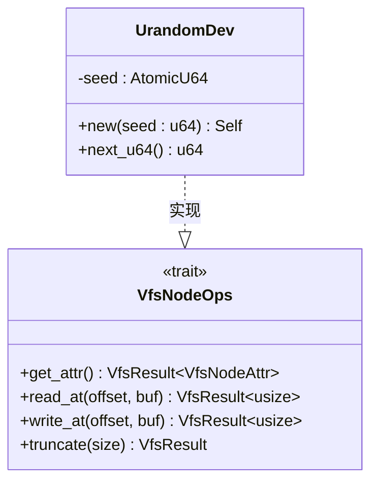
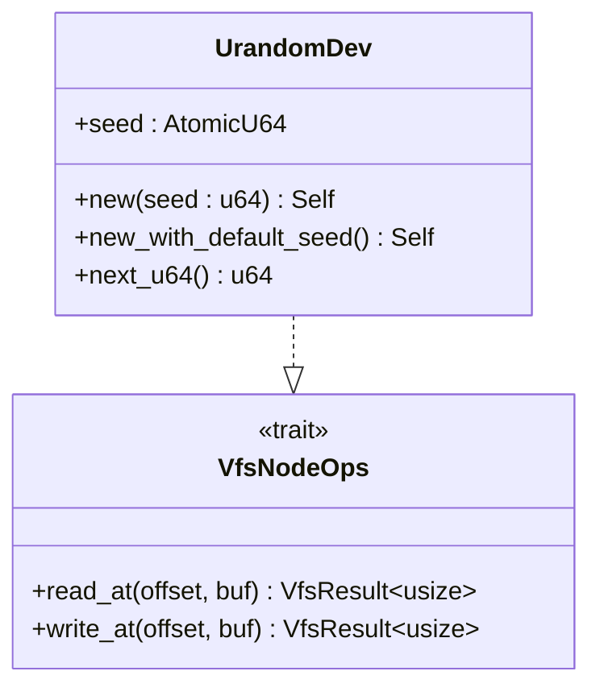
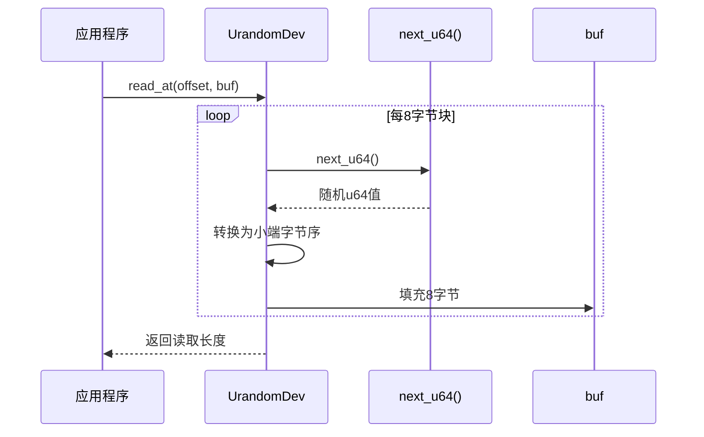
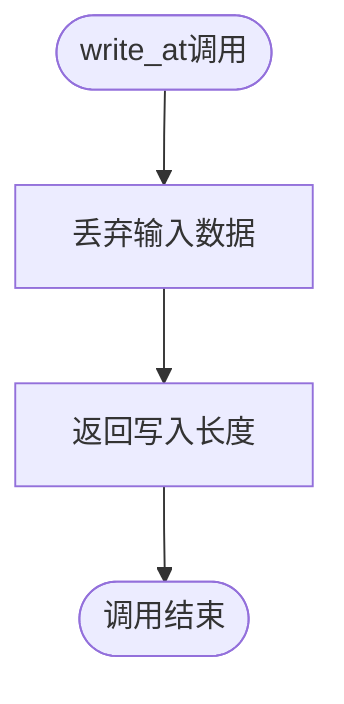
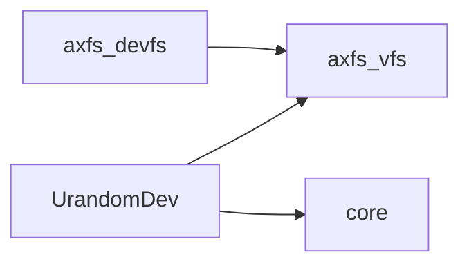

# UrandomDev设备行为

<cite>
**本文档引用的文件**  
- [urandom.rs](file://axfs_devfs/src/urandom.rs)
- [lib.rs](file://axfs_vfs/src/lib.rs)
</cite>

## 目录
1. [简介](#简介)
2. [项目结构](#项目结构)
3. [核心组件](#核心组件)
4. [架构概述](#架构概述)
5. [详细组件分析](#详细组件分析)
6. [依赖分析](#依赖分析)
7. [性能考虑](#性能考虑)
8. [故障排除指南](#故障排除指南)
9. [结论](#结论)

## 简介
UrandomDev 是一个模拟类 Unix 系统中 `/dev/urandom` 行为的伪随机数生成设备，旨在提供加密强度的随机字节流。该设备适用于密钥生成、salt 初始化等安全敏感场景。其 `read_at` 方法通过底层线性同余生成器（LCG）填充缓冲区，确保每次读取返回不可预测的数据序列；而 `write_at` 方法为无操作。由于在无标准库环境下依赖外部熵源，其实现存在熵池质量限制，建议配合硬件随机数生成器使用。

## 项目结构
本项目包含多个文件系统相关 crate，其中 `axfs_devfs` 提供设备文件系统支持，`axfs_vfs` 定义虚拟文件系统接口，`axfs_ramfs` 实现基于内存的文件系统。UrandomDev 的实现位于 `axfs_devfs/src/urandom.rs`，依赖 `axfs_vfs` 提供的通用 VFS 接口。

```mermaid
graph TB
subgraph "axfs_devfs"
Urandom[urandom.rs]
Null[null.rs]
Zero[zero.rs]
end
subgraph "axfs_vfs"
Lib[lib.rs]
end
Urandom --> Lib : "依赖VFS接口"
```

**图示来源**
- [urandom.rs](file://axfs_devfs/src/urandom.rs#L1-L74)
- [lib.rs](file://axfs_vfs/src/lib.rs#L1-L177)

**本节来源**
- [urandom.rs](file://axfs_devfs/src/urandom.rs#L1-L74)
- [lib.rs](file://axfs_vfs/src/lib.rs#L1-L177)

## 核心组件
UrandomDev 的核心是基于 LCG（线性同余生成器）的伪随机数生成逻辑，通过原子操作维护种子状态，确保多线程环境下的安全性。其行为符合 `/dev/urandom` 的语义：可无限读取随机字节，写入操作被忽略。

**本节来源**
- [urandom.rs](file://axfs_devfs/src/urandom.rs#L1-L74)

## 架构概述
UrandomDev 实现了 `VfsNodeOps` 接口，作为字符设备挂载到虚拟文件系统中。其主要方法包括 `read_at` 和 `write_at`，分别用于读取随机数据和丢弃写入数据。整体架构依赖于 `axfs_vfs` 提供的抽象层，实现了与操作系统内核的解耦。



**图示来源**
- [urandom.rs](file://axfs_devfs/src/urandom.rs#L1-L74)
- [lib.rs](file://axfs_vfs/src/lib.rs#L1-L177)

## 详细组件分析

### UrandomDev 分析
UrandomDev 使用 LCG 算法生成伪随机数，参数为乘数 `6364136223846793005` 和增量 `1`，初始种子为 `0xa2ce_a2ce`。每次调用 `next_u64()` 时更新内部种子并返回新值。`read_at` 方法将缓冲区分块为 8 字节，依次填入生成的随机数的字节表示。

#### 对象模型


**图示来源**
- [urandom.rs](file://axfs_devfs/src/urandom.rs#L1-L74)

#### 数据读取流程


**图示来源**
- [urandom.rs](file://axfs_devfs/src/urandom.rs#L50-L65)

#### 写入处理流程


**图示来源**
- [urandom.rs](file://axfs_devfs/src/urandom.rs#L67-L70)

**本节来源**
- [urandom.rs](file://axfs_devfs/src/urandom.rs#L1-L74)

## 依赖分析
UrandomDev 依赖 `axfs_vfs` 提供的 `VfsNodeOps` 接口，以及 Rust 标准库中的 `core::sync::atomic::AtomicU64` 进行线程安全的种子管理。整个 `axfs_crates` 工作区通过 Cargo workspace 统一管理版本和依赖。



**图示来源**
- [urandom.rs](file://axfs_devfs/src/urandom.rs#L1-L74)
- [Cargo.toml](file://axfs_devfs/Cargo.toml#L1-L17)

**本节来源**
- [urandom.rs](file://axfs_devfs/src/urandom.rs#L1-L74)
- [Cargo.toml](file://axfs_devfs/Cargo.toml#L1-L17)

## 性能考虑
由于使用原子操作和简单的算术运算，UrandomDev 的性能较高，适合频繁读取场景。但 LCG 算法的周期性和统计特性可能不满足高强度密码学需求，建议在高安全要求场景下结合硬件 RNG 使用。

## 故障排除指南
若发现随机性不足或重复模式，请检查初始种子是否被正确设置，并评估熵池质量。在真随机性要求极高的场景中，应考虑替换为基于物理熵源的实现。

**本节来源**
- [urandom.rs](file://axfs_devfs/src/urandom.rs#L23-L31)

## 结论
UrandomDev 提供了一个轻量级、高效的伪随机数生成设备，适用于大多数安全应用场景。其设计简洁，易于集成到嵌入式或无标准库环境中。然而，用户应在高安全要求场景中谨慎评估其熵源质量，并考虑与硬件随机数生成器结合使用以增强安全性。