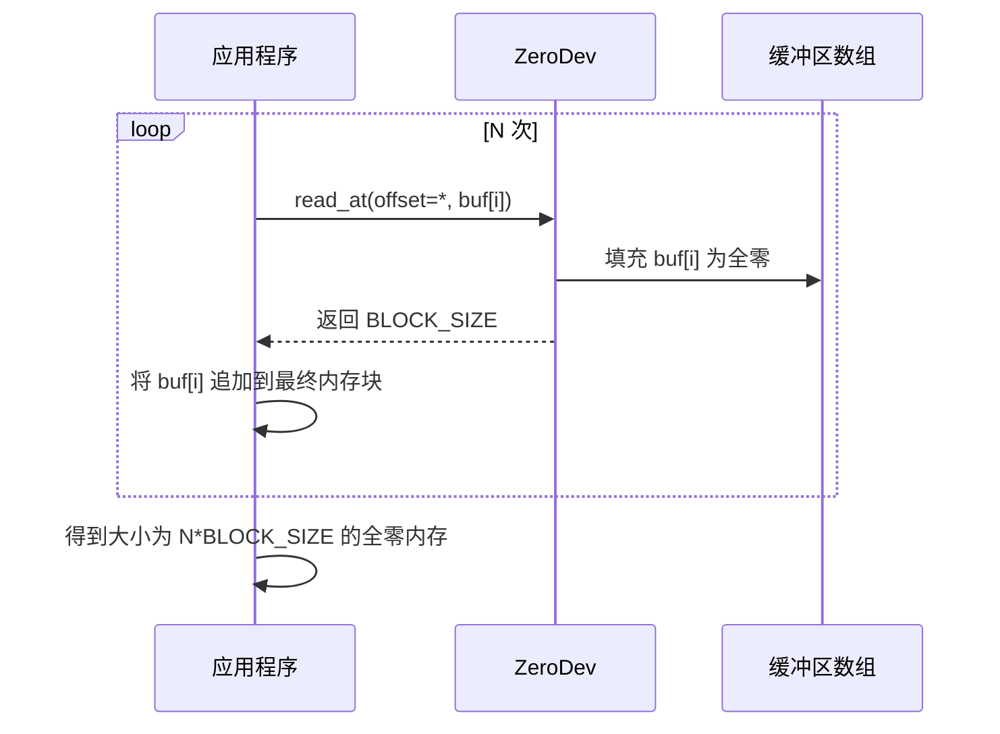
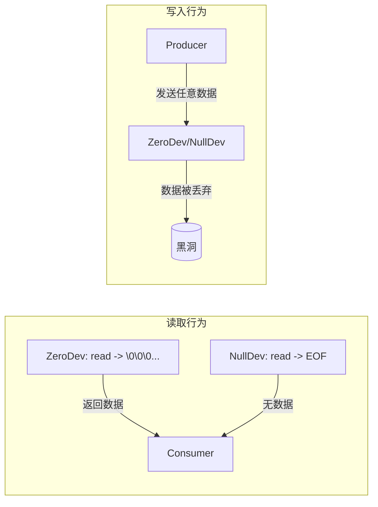

# ZeroDev设备行为

<cite>
**Referenced Files in This Document **   
- [zero.rs](file://axfs_devfs/src/zero.rs)
- [null.rs](file://axfs_devfs/src/null.rs)
- [lib.rs](file://axfs_vfs/src/lib.rs)
</cite>

## 目录
1. [引言](#引言)
2. [ZeroDev核心功能](#zerodev核心功能)
3. [read_at与write_at方法详解](#read_at与write_at方法详解)
4. [POSIX标准兼容性](#posix标准兼容性)
5. [mmap-like语义模拟示例](#mmap-like语义模拟示例)
6. [no-std环境下的实现考量](#no-std环境下的实现考量)
7. [NullDev与ZeroDev对比分析](#nulldev与zerodev对比分析)
8. [应用场景建议](#应用场景建议)

## 引言

在嵌入式与操作系统开发中，特殊设备节点为系统提供了基础的I/O抽象能力。`ZeroDev`作为一类特殊的字符设备，其设计目标是提供无限的零字节流，满足内存初始化、稀疏文件构造等关键场景需求。本文档深入剖析`ZeroDev`在ArceOS项目中的具体实现机制，阐明其行为规范，并与类似设备`NullDev`进行对比，帮助开发者准确理解并合理使用。

## ZeroDev核心功能

`ZeroDev`设备的核心定位是模拟类Unix系统中的`/dev/zero`行为。它被实现为一个遵循虚拟文件系统（VFS）接口的特殊节点，其主要特征如下：

- **读取操作**：无论请求的偏移量如何，每次读取操作都会向提供的缓冲区填充全`\0`（空字符）字节。
- **写入操作**：所有写入的数据均被静默丢弃，写入操作总是成功返回写入的字节数。
- **属性获取**：通过`get_attr`方法报告自身为默认权限的字符设备。
- **截断操作**：`truncate`调用无实际效果，立即返回成功。

该设备的实现简洁而高效，完全符合预期的“零生成器”语义。

**Section sources**
- [zero.rs](file://axfs_devfs/src/zero.rs#L5-L32)

## read_at与write_at方法详解

### read_at方法

`read_at`方法是`ZeroDev`功能的核心。其签名定义于`VfsNodeOps` trait中，接收一个偏移量（`_offset`）和一个可变字节切片引用（`buf`）作为参数。

该方法的实现逻辑非常直接：
1.  它完全忽略传入的`_offset`参数，因为`/dev/zero`的行为不依赖于位置。
2.  调用`buf.fill(0)`方法，将整个缓冲区的所有字节设置为零值。
3.  返回缓冲区的长度，表示成功读取了这么多字节的零数据。

这种设计确保了任何对`ZeroDev`的读取请求都能获得所需数量的零字节，非常适合用于初始化内存块。

**Section sources**
- [zero.rs](file://axfs_devfs/src/zero.rs#L19-L23)

### write_at方法

`write_at`方法的实现与`NullDev`保持一致，体现了“黑洞”式设备的通用处理模式。

其实现逻辑为：
1.  同样忽略`_offset`参数。
2.  不对输入缓冲区`buf`做任何处理，即所有数据被丢弃。
3.  直接返回`buf.len()`，表示所有写入的数据都被“成功”处理。

这保证了向`ZeroDev`写入数据不会产生任何副作用，也不会消耗存储空间。

**Section sources**
- [zero.rs](file://axfs_devfs/src/zero.rs#L25-L29)
- [null.rs](file://axfs_devfs/src/null.rs#L24-L28)

## POSIX标准兼容性

`ZeroDev`的设计严格遵循POSIX标准中对`/dev/zero`设备的规范要求。其行为与主流Unix/Linux系统中的`/dev/zero`完全一致：

- **无限零流**：能够提供任意长度的零字节序列，没有大小限制。
- **无状态读取**：读取操作与文件指针或偏移量无关，每次调用都从“头”开始提供零字节。
- **安全写入**：允许写入任何数据，但数据不会被存储，系统调用成功返回。

这一兼容性使得基于`ZeroDev`构建的应用程序具有良好的可移植性，开发者可以将其视为标准`/dev/zero`的替代品。

```mermaid
flowchart TD
A[应用程序发起读取] --> B{ZeroDev.read_at()}
B --> C["忽略 offset"]
C --> D["执行 buf.fill(0)"]
D --> E["返回 buf.len()"]
E --> F[应用程序获得全零缓冲区]
```

**Diagram sources **
- [zero.rs](file://axfs_devfs/src/zero.rs#L19-L23)

## mmap-like语义模拟示例

虽然`ZeroDev`本身未直接实现内存映射（mmap）接口，但其`read_at`方法的特性使其能够轻松模拟mmap-like的语义。以下是一个典型的使用模式：

假设需要创建一块大小为`N * BLOCK_SIZE`的内存区域，全部初始化为零。

1.  **分块读取**：应用程序可以循环调用`read_at`方法，每次请求一个固定大小的缓冲区（例如4KB）。
2.  **连续填充**：尽管`read_at`忽略了偏移量，但应用程序可以通过管理自身的缓冲区索引来拼接这些零块。
3.  **结果合成**：经过`N`次调用后，即可得到一个由`N`个零块组成的、连续的、全零的内存区域。

此过程有效地模拟了将`/dev/zero`映射到内存并访问大片零页的行为，常用于动态分配和初始化大块内存。



**Diagram sources **
- [zero.rs](file://axfs_devfs/src/zero.rs#L19-L23)

## no-std环境下的实现考量

`ZeroDev`的实现在Rust的`no-std`环境下表现出色，尤其在安全性与效率方面有显著优势。

### 安全性

- **栈分配**：`read_at`方法直接操作调用者提供的`buf`切片。这意味着生成零字节所使用的临时缓冲区实际上是由调用方在栈上或堆上分配的。`ZeroDev`本身不进行任何堆分配，避免了`alloc`错误和内存泄漏的风险。
- **无副作用**：`fill(0)`是安全的内存操作，且写入操作完全丢弃数据，不会引入外部状态污染。

### 效率

- **零拷贝潜力**：由于`buf`是直接传递的，`fill`操作可以在原地完成，避免了不必要的数据复制。
- **内联优化**：`buf.fill(0)`是一个简单的循环，极易被编译器优化为高效的汇编指令（如`memset`）。
- **最小开销**：整个实现几乎没有额外的计算或系统调用开销，性能极高。

这种设计充分利用了Rust的所有权和借用系统，在资源受限的环境中实现了既安全又高效的零字节生成。

**Section sources**
- [zero.rs](file://axfs_devfs/src/zero.rs#L19-L23)
- [lib.rs](file://axfs_vfs/src/lib.rs#L100-L105)

## NullDev与ZeroDev对比分析

尽管`ZeroDev`和`NullDev`在写入行为上相似（均丢弃数据），但它们的读取语义有本质区别，服务于不同的目的。

| 特性 | ZeroDev | NullDev |
| :--- | :--- | :--- |
| **读取行为** | 返回指定数量的 `\0` 字节 | 总是返回 `0` 字节（EOF） |
| **写入行为** | 丢弃所有数据，返回写入长度 | 丢弃所有数据，返回写入长度 |
| **核心用途** | 提供零字节流以**初始化**内存或文件 | 作为数据的**回收站**或输出重定向目标 |
| **类比设备** | `/dev/zero` | `/dev/null` |



**Diagram sources **
- [zero.rs](file://axfs_devfs/src/zero.rs#L19-L23)
- [null.rs](file://axfs_devfs/src/null.rs#L21-L24)

## 应用场景建议

根据上述分析，开发者应依据具体需求选择合适的设备：

- **选择 `ZeroDev` 当**：
    - 需要快速初始化一片内存区域为零。
    - 构造稀疏文件，其中大部分内容为零。
    - 需要一个无限的零字节源用于测试或算法填充。
    - 模拟内存映射`/dev/zero`的行为。

- **选择 `NullDev` 当**：
    - 需要静默丢弃程序的输出日志或调试信息。
    - 作为管道的终点，防止数据流向不需要的地方。
    - 测试代码的写入路径，而不关心实际数据内容。

正确区分两者能有效避免逻辑错误，例如误用`NullDev`来初始化内存会导致程序因读不到数据而失败。