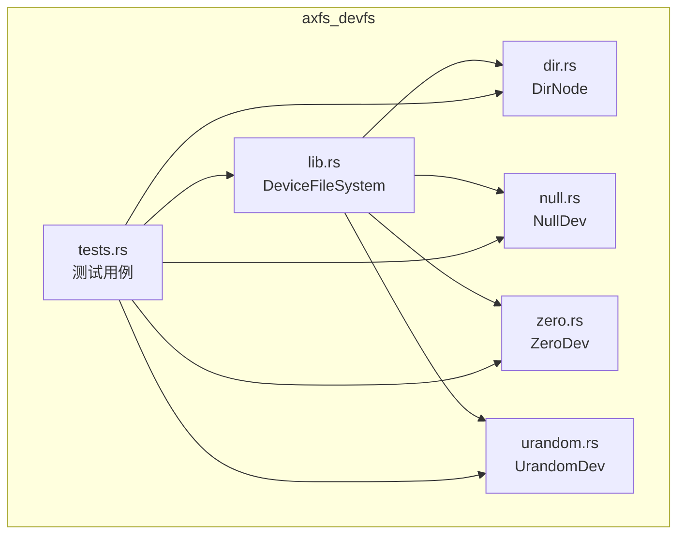
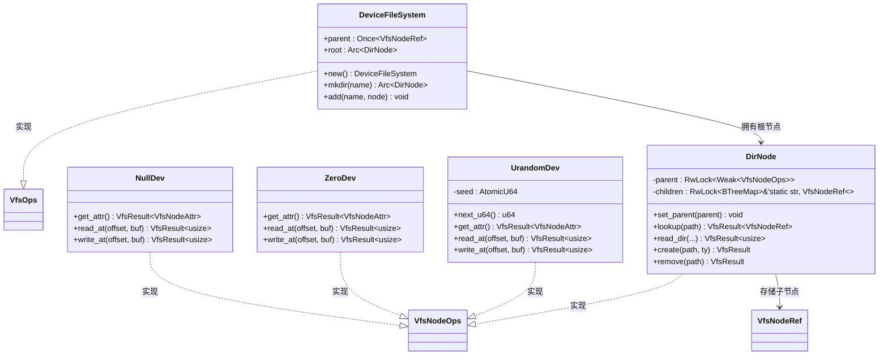
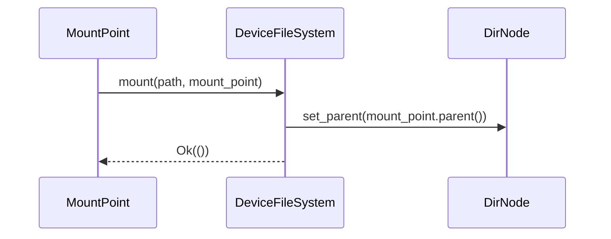
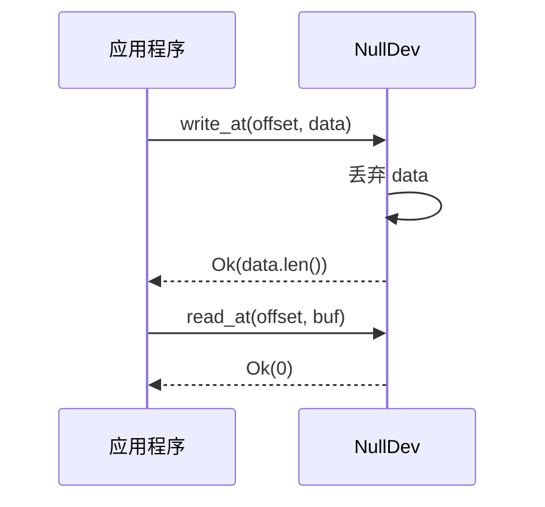

# 设备文件系统（axfs_devfs）

<cite>
**本文档引用的文件**   
- [lib.rs](file://axfs_devfs/src/lib.rs)
- [dir.rs](file://axfs_devfs/src/dir.rs)
- [null.rs](file://axfs_devfs/src/null.rs)
- [zero.rs](file://axfs_devfs/src/zero.rs)
- [urandom.rs](file://axfs_devfs/src/urandom.rs)
- [tests.rs](file://axfs_devfs/src/tests.rs)
</cite>

## 目录
1. [简介](#简介)
2. [项目结构](#项目结构)
3. [核心组件](#核心组件)
4. [架构概述](#架构概述)
5. [详细组件分析](#详细组件分析)
6. [依赖分析](#依赖分析)
7. [性能考虑](#性能考虑)
8. [故障排除指南](#故障排除指南)
9. [结论](#结论)

## 简介
`axfs_devfs` 是一个为操作系统环境设计的只读设备文件系统，用于模拟标准设备节点如 `/dev/null`、`/dev/zero` 和 `/dev/urandom`。该文件系统基于 ArceOS 的虚拟文件系统接口 `axfs_vfs` 实现，提供轻量级、安全且高效的设备抽象机制。其主要用途是在嵌入式或内核环境中提供基本设备语义支持，而无需实际硬件驱动。

本技术文档全面解析 `DeviceFileSystem` 的实现机制，深入探讨三种特殊设备节点的行为语义，并说明目录结构管理与查找逻辑。同时，文档还将分析测试用例所验证的功能边界，阐明其只读设计的原因与价值。

## 项目结构
`axfs_devfs` 模块采用清晰的模块化设计，各源文件职责分明：

```
axfs_devfs/
├── src/
│   ├── lib.rs            # 主模块入口，定义 DeviceFileSystem 及 VfsOps 实现
│   ├── dir.rs            # DirNode：通用目录节点实现
│   ├── null.rs           # NullDev：空设备实现
│   ├── zero.rs           # ZeroDev：零字节设备实现
│   ├── urandom.rs        # UrandomDev：伪随机数生成设备实现
│   └── tests.rs          # 单元测试，验证文件系统行为
└── Cargo.toml
```

这种组织方式使得每个设备类型独立封装，便于维护和扩展。



**图示来源**
- [lib.rs](file://axfs_devfs/src/lib.rs#L1-L73)
- [dir.rs](file://axfs_devfs/src/dir.rs#L1-L138)
- [null.rs](file://axfs_devfs/src/null.rs#L1-L31)
- [zero.rs](file://axfs_devfs/src/zero.rs#L1-L32)
- [urandom.rs](file://axfs_devfs/src/urandom.rs#L1-L74)
- [tests.rs](file://axfs_devfs/src/tests.rs#L1-L115)

**本节来源**
- [lib.rs](file://axfs_devfs/src/lib.rs#L1-L73)
- [project_structure](file://README.md#L1-L10)

## 核心组件
`axfs_devfs` 的核心由 `DeviceFileSystem` 结构体构成，它实现了 `VfsOps` trait，作为整个文件系统的挂载点和根目录管理者。通过 `root: Arc<DirNode>` 字段持有根目录节点，所有设备节点均注册于此或其子目录中。`parent: Once<VfsNodeRef>` 字段确保文件系统在挂载时正确设置父节点引用。

该文件系统支持通过 `mkdir` 创建子目录，并通过 `add` 方法将设备节点（如 `NullDev`、`ZeroDev`）添加至指定路径。其默认实现允许通过 `Default` trait 快速初始化。

**本节来源**
- [lib.rs](file://axfs_devfs/src/lib.rs#L25-L73)

## 架构概述
`axfs_devfs` 遵循典型的虚拟文件系统分层架构，以 `VfsOps` 为核心接口，连接具体文件系统实现与上层调用者。`DeviceFileSystem` 作为顶层容器，管理唯一的根目录 `DirNode`，后者负责维护子节点树并处理路径查找。

设备节点统一实现 `VfsNodeOps` 接口，提供属性查询、读写操作等基础功能。整个系统通过 `Arc` 实现线程安全的共享所有权，结合 `RwLock` 和 `BTreeMap` 保证并发访问下的数据一致性。



**图示来源**
- [lib.rs](file://axfs_devfs/src/lib.rs#L25-L73)
- [dir.rs](file://axfs_devfs/src/dir.rs#L6-L12)
- [null.rs](file://axfs_devfs/src/null.rs#L2-L5)
- [zero.rs](file://axfs_devfs/src/zero.rs#L2-L5)
- [urandom.rs](file://axfs_devfs/src/urandom.rs#L3-L8)

## 详细组件分析

### DeviceFileSystem 分析
`DeviceFileSystem` 是整个设备文件系统的入口点，其实现了 `VfsOps` trait，使其能够被挂载到更大的文件系统树中。`mount` 方法在挂载时设置根目录的父节点引用，`root_dir` 返回根目录的克隆引用。



**图示来源**
- [lib.rs](file://axfs_devfs/src/lib.rs#L50-L65)

**本节来源**
- [lib.rs](file://axfs_devfs/src/lib.rs#L25-L73)

### DirNode 实现机制
`DirNode` 是通用目录节点的核心实现，使用 `RwLock<BTreeMap<&'static str, VfsNodeRef>>` 存储子节点，保证多线程读取高效，写入安全。`parent` 字段使用 `Weak` 引用避免循环引用。

`lookup` 方法递归解析路径：首先调用 `split_path` 分离第一段名称与剩余部分，对 `.`, `..`, `""` 进行特殊处理，然后在 `children` 中查找对应节点。若存在剩余路径，则递归调用目标节点的 `lookup`。

值得注意的是，`create` 和 `remove` 方法始终返回 `PermissionDenied` 错误，明确表明该文件系统不支持动态增删节点，符合其只读设计定位。

```mermaid
flowchart TD
Start([开始 lookup]) --> Split["split_path(path)"]
Split --> Name{"name 是?"}
Name --> |"" 或 "."| ReturnSelf["返回自身"]
Name --> |".."| CheckParent["检查 parent 是否存在"]
CheckParent --> ParentExists{"存在?"}
ParentExists --> |否| Error["Err(NotFound)"]
ParentExists --> |是| ReturnParent["返回 parent"]
Name --> |其他| SearchChildren["在 children 中查找 name"]
SearchChildren --> Found{"找到?"}
Found --> |否| NotFound["Err(NotFound)"]
Found --> |是| HasRest{"rest 存在?"}
HasRest --> |否| ReturnNode["返回节点"]
HasRest --> |是| Recursive["node.lookup(rest)"]
Recursive --> ReturnResult["返回结果"]
ReturnSelf --> End([结束])
ReturnParent --> End
ReturnNode --> End
ReturnResult --> End
Error --> End
NotFound --> End
```

**图示来源**
- [dir.rs](file://axfs_devfs/src/dir.rs#L6-L138)

**本节来源**
- [dir.rs](file://axfs_devfs/src/dir.rs#L6-L138)

### 特殊设备节点行为语义

#### NullDev 行为分析
`NullDev` 模拟 `/dev/null` 设备，其行为语义如下：
- **读取**：`read_at` 始终返回 `Ok(0)`，表示读取零字节，缓冲区内容不变。
- **写入**：`write_at` 接收任意数据并立即丢弃，返回写入长度，表示操作成功。
- **属性**：报告为字符设备，大小为 0。

此设计适用于需要丢弃输出流的场景，例如日志重定向或调试静默。



**图示来源**
- [null.rs](file://axfs_devfs/src/null