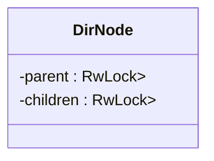
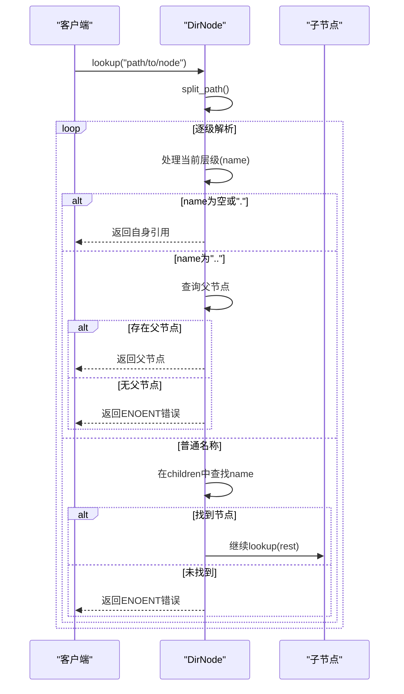
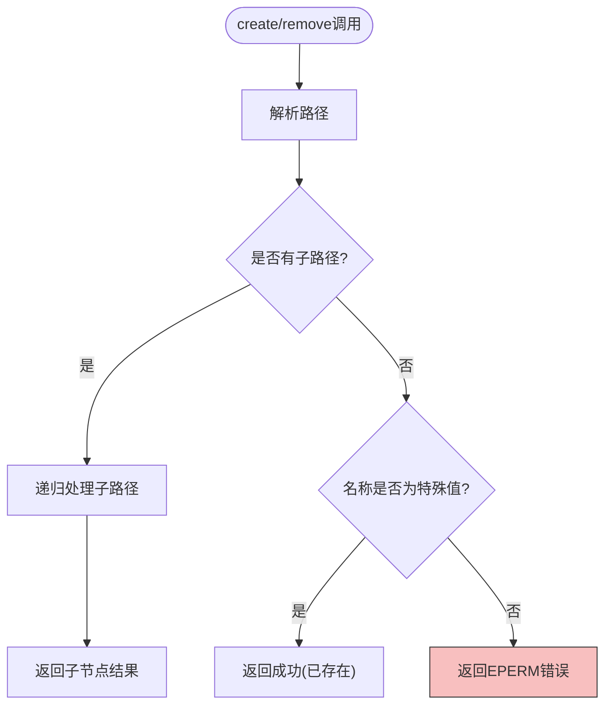

# 通用目录节点实现

<cite>
**本文档引用的文件**
- [dir.rs](file://axfs_devfs/src/dir.rs)
- [dir.rs](file://axfs_ramfs/src/dir.rs)
- [lib.rs](file://axfs_devfs/src/lib.rs)
- [null.rs](file://axfs_devfs/src/null.rs)
- [zero.rs](file://axfs_devfs/src/zero.rs)
- [urandom.rs](file://axfs_devfs/src/urandom.rs)
- [structs.rs](file://axfs_vfs/src/structs.rs)
</cite>

## 目录
1. [简介](#简介)
2. [核心数据结构分析](#核心数据结构分析)
3. [路径解析机制](#路径解析机制)
4. [只读设计约束](#只读设计约束)
5. [目录遍历与元数据获取](#目录遍历与元数据获取)
6. [树形结构图示](#树形结构图示)
7. [模块化复用设计](#模块化复用设计)

## 简介
`DirNode` 是设备文件系统中的核心容器类型，作为唯一支持子节点管理的目录节点实现。该结构体在 `axfs_devfs` 中被定义为只读文件系统的目录节点，通过 `BTreeMap` 维护有序的子节点映射关系，并实现了完整的虚拟文件系统操作接口（`VfsNodeOps`）。其设计体现了高效查找、有序遍历和只读约束等关键特性。

## 核心数据结构分析
`DirNode` 结构体采用线程安全的设计模式，包含父节点弱引用和子节点有序映射两个核心字段：



**结构说明：**
- **parent**: 使用 `RwLock<Weak<dyn VfsNodeOps>>` 存储父节点的弱引用，避免循环引用导致的内存泄漏
- **children**: 使用 `RwLock<BTreeMap<&'static str, VfsNodeRef>>` 存储子节点映射，保证按键名有序排列

内部使用 `BTreeMap` 而非哈希表的主要优势在于：
1. **有序性保证**：自然维持字典序排列，确保目录遍历时结果的一致性和可预测性
2. **高效范围查询**：支持高效的区间遍历操作，适合文件系统场景
3. **确定性行为**：避免哈希碰撞带来的不确定性，提高系统可靠性

**Section sources**
- [dir.rs](file://axfs_devfs/src/dir.rs#L10-L18)

## 路径解析机制
`lookup` 方法实现了逐级路径解析的核心逻辑，通过递归下降方式定位目标节点：



具体实现流程如下：
1. 调用 `split_path` 函数分割路径为首段名称和剩余部分
2. 对首段名称进行特殊处理：
   - 空字符串或 "."：返回当前节点自身
   - ".."：尝试获取父节点，失败则返回 `ENOENT` 错误
   - 其他名称：在 `children` 映射中查找对应节点
3. 若存在剩余路径，则递归调用目标节点的 `lookup` 方法继续解析
4. 最终返回目标节点引用或适当的错误码

**Section sources**
- [dir.rs](file://axfs_devfs/src/dir.rs#L50-L69)

## 只读设计约束
尽管实现了 `create` 和 `remove` 接口，但 `DirNode` 实际上是只读的，所有修改操作均会返回 `EPERM`（权限拒绝）错误：



具体行为规则：
- **创建操作** (`create`)：
  - 当路径为空、"." 或 ".." 时返回成功（视为已存在）
  - 其他情况一律返回 `VfsError::PermissionDenied`
- **删除操作** (`remove`)：
  - 任何终端路径的删除请求都返回 `VfsError::PermissionDenied`

这种设计确保了设备文件系统的静态性和安全性，防止运行时意外修改关键设备节点。

**Section sources**
- [dir.rs](file://axfs_devfs/src/dir.rs#L89-L137)

## 目录遍历与元数据获取
### 目录遍历实现
`read_dir` 方法实现了目录迭代器功能，支持分页式目录读取：

```mermaid
flowchart LR
A[开始索引start_idx] --> B{start_idx < 2?}
B --> |是| C[跳过前(2-start_idx)个子节点]
B --> |否| D[跳过前(start_idx-2)个子节点]
D --> E[填充dirents数组]
C --> E
E --> F{还有更多条目?}
F --> |是| G[设置条目内容]
G --> H[继续下一个]
F --> |否| I[返回实际数量]
style G fill:#bbf0db,stroke:#333
```

遍历顺序遵循特定规则：
1. 索引 0：`.` 条目（当前目录）
2. 索引 1：`..` 条目（父目录）
3. 索引 ≥2：按字典序排列的子节点

### 元数据获取规则
`get_attr` 方法返回固定的目录属性：
- 文件类型：`VfsNodeType::Dir`
- 大小：固定为 4096 字节
- 块数：0
- 权限：默认目录权限

这些属性通过 `VfsNodeAttr::new_dir(4096, 0)` 工厂方法创建，符合标准文件系统规范。

**Section sources**
- [dir.rs](file://axfs_devfs/src/dir.rs#L71-L87)
- [structs.rs](file://axfs_vfs/src/structs.rs#L220-L274)

## 树形结构图示
以下是根目录下包含 null、zero、urandom 子节点的典型树形结构：

```mermaid
graph TD
ROOT[/] --> NULL[null<br/>CharDevice]
ROOT --> ZERO[zero<br/>CharDevice]
ROOT --> URANDOM[urandom<br/>CharDevice]
classDef device fill:#e1f5fe,stroke:#1976d2;
class NULL,ZERO,URANDOM device
style ROOT fill:#c8e6c9,stroke:#388e3c
```

该结构通过以下代码构建：
```rust
let devfs = DeviceFileSystem::new();
devfs.add("null", Arc::new(NullDev));
devfs.add("zero", Arc::new(ZeroDev));
devfs.add("urandom", Arc::new(UrandomDev::default()));
```

每个设备节点都实现了相应的字符设备行为：
- **null**: 读取返回空，写入丢弃所有数据
- **zero**: 读取返回全零字节，写入丢弃所有数据
- **urandom**: 读取返回伪随机字节流

**Diagram sources**
- [dir.rs](file://axfs_devfs/src/dir.rs#L20-L35)
- [null.rs](file://axfs_devfs/src/null.rs#L7-L10)
- [zero.rs](file://axfs_devfs/src/zero.rs#L7-L10)
- [urandom.rs](file://axfs_devfs/src/urandom.rs#L7-L10)

## 模块化复用设计
`DirNode` 的实现被 `axfs_ramfs` 成功复用，体现了良好的模块化设计思想：

```mermaid
graph BT
    VFS[axfs_vfs] --> COMMON[公共接口]
    COMMON --> DEVFS[axfs_devfs::DirNode]
    COMMON --> RAMFS[axfs_ramfs::Dir