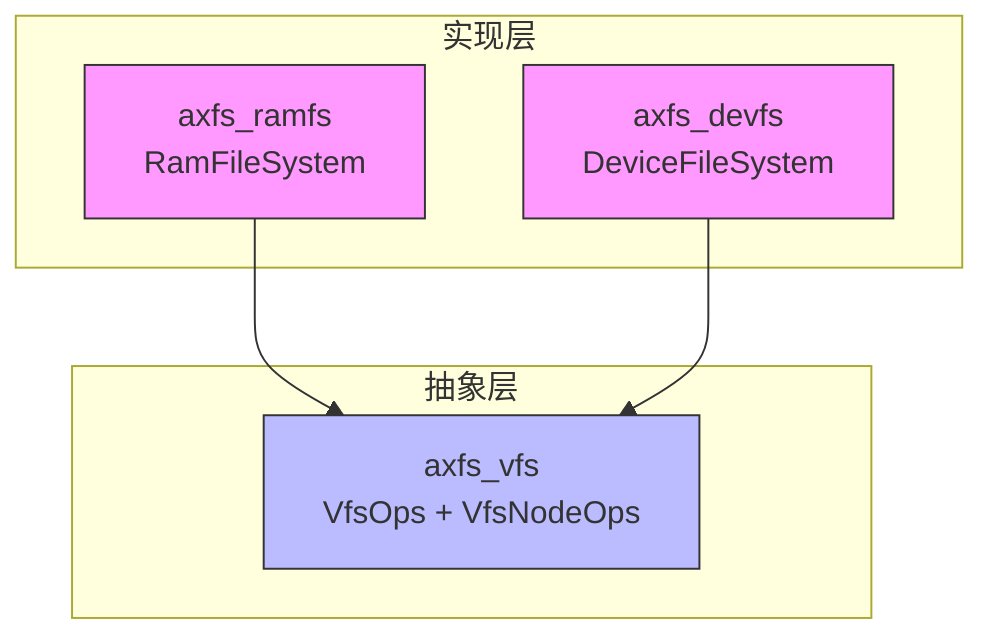
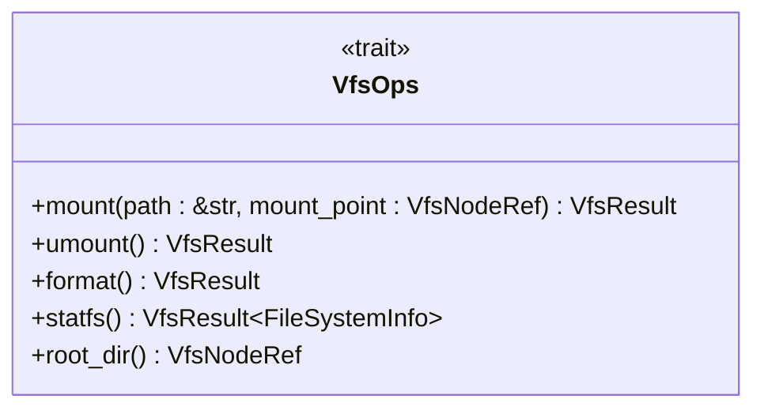
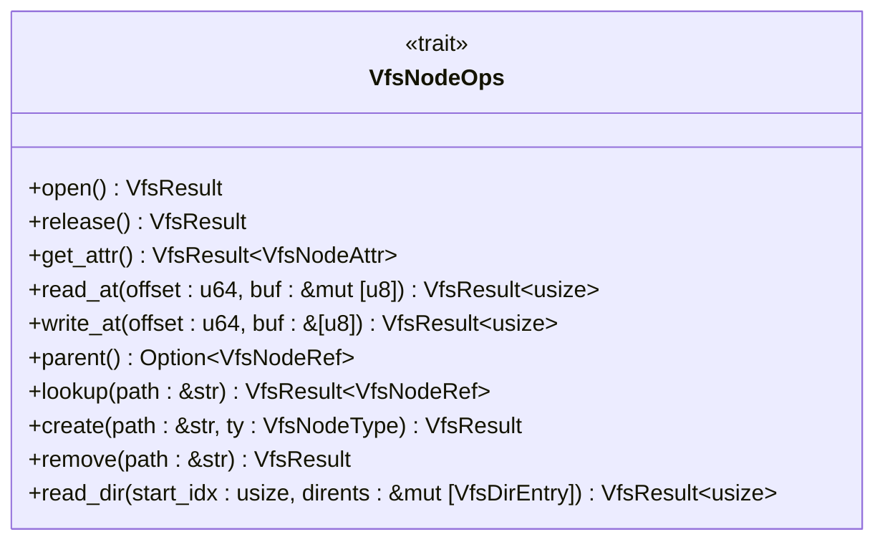
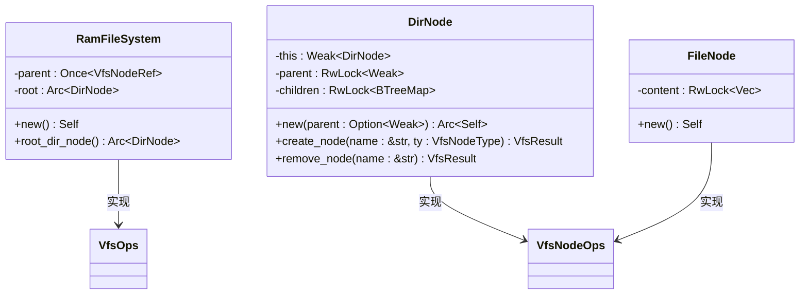
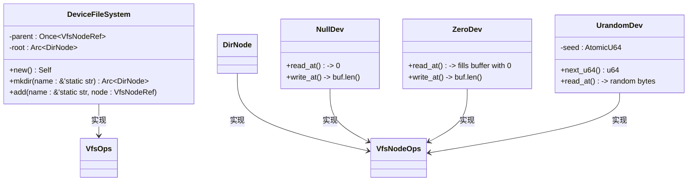

# 项目概述

<cite>
**本文档引用的文件**
- [README.md](file://README.md)
- [axfs_vfs/src/lib.rs](file://axfs_vfs/src/lib.rs)
- [axfs_ramfs/src/lib.rs](file://axfs_ramfs/src/lib.rs)
- [axfs_devfs/src/lib.rs](file://axfs_devfs/src/lib.rs)
- [axfs_ramfs/src/file.rs](file://axfs_ramfs/src/file.rs)
- [axfs_ramfs/src/dir.rs](file://axfs_ramfs/src/dir.rs)
- [axfs_devfs/src/dir.rs](file://axfs_devfs/src/dir.rs)
- [axfs_devfs/src/null.rs](file://axfs_devfs/src/null.rs)
- [axfs_devfs/src/zero.rs](file://axfs_devfs/src/zero.rs)
- [axfs_devfs/src/urandom.rs](file://axfs_devfs/src/urandom.rs)
</cite>

## 目录
1. [简介](#简介)
2. [项目结构](#项目结构)
3. [核心组件](#核心组件)
4. [架构概览](#架构概览)
5. [详细组件分析](#详细组件分析)
6. [依赖关系分析](#依赖关系分析)
7. [快速入门示例](#快速入门示例)
8. [no-std环境下的价值与扩展性](#no-std环境下的价值与扩展性)
9. [结论](#结论)

## 简介
`axfs_crates` 是一个为 ArceOS 操作系统设计的模块化文件系统框架集合，采用 Rust 编写，专为嵌入式和操作系统开发场景优化。该项目提供了一套轻量级、可组合的虚拟文件系统（VFS）抽象及其实现，支持在 `no-std` 环境下运行。其核心目标是为操作系统内核提供统一的文件系统接口，并通过具体实现如 `devfs` 和 `ramfs` 支持设备文件和内存文件系统的功能。

该框架强调类型安全、内存安全和零成本抽象，利用 Rust 的 trait 系统定义了清晰的文件系统操作契约，包括 `VfsOps` 和 `VfsNodeOps`，分别用于管理整个文件系统实例和单个节点（文件或目录）。这种设计使得开发者可以轻松地集成、扩展或替换不同的文件系统后端。

**Section sources**
- [README.md](file://README.md#L1-L9)
- [axfs_vfs/src/lib.rs](file://axfs_vfs/src/lib.rs#L1-L20)

## 项目结构
`axfs_crates` 项目采用 Cargo 工作区模式组织，包含三个主要 crate：`axfs_vfs`、`axfs_devfs` 和 `axfs_ramfs`，以及顶层的 `Cargo.toml` 配置文件。每个 crate 各司其职，形成清晰的分层架构：

- **axfs_vfs**：提供虚拟文件系统的通用接口定义，是整个框架的基础。
- **axfs_ramfs**：基于 `axfs_vfs` 实现的 RAM 文件系统，数据存储于内存中，适用于临时文件存储。
- **axfs_devfs**：设备文件系统实现，模拟类 Unix 系统中的 `/dev` 目录，提供对特殊设备文件（如 `/dev/null`, `/dev/zero`, `/dev/urandom`）的支持。

所有 crate 均配置为 `no-std`，仅依赖 `alloc` 和基础同步原语，确保其可在资源受限的环境中使用。

```mermaid
graph TD
subgraph "Crate 层级"
VFS[axfs_vfs: 虚拟文件系统接口]
RAMFS[axfs_ramfs: RAM 文件系统]
DEVFS[axfs_devfs: 设备文件系统]
end
RAMFS --> VFS : 依赖
DEVFS --> VFS : 依赖
```

**Diagram sources**
- [Cargo.toml](file://Cargo.toml#L1-L21)
- [axfs_vfs/src/lib.rs](file://axfs_vfs/src/lib.rs#L1-L10)

**Section sources**
- [Cargo.toml](file://Cargo.toml#L1-L21)
- [axfs_vfs/src/lib.rs](file://axfs_vfs/src/lib.rs#L1-L20)

## 核心组件
本项目的核心由三大 crate 构成，它们共同实现了模块化、可扩展的文件系统框架：

- **axfs_vfs** 定义了 `VfsOps` 和 `VfsNodeOps` 两个核心 trait，前者用于管理文件系统的挂载、卸载、格式化等生命周期操作，后者则定义了文件和目录节点的基本行为，如读写、查找、创建等。
- **axfs_ramfs** 实现了一个完全基于内存的文件系统，支持动态创建文件和目录，适合用作临时存储或测试环境。
- **axfs_devfs** 提供了对虚拟设备文件的支持，包含 `NullDev`、`ZeroDev` 和 `UrandomDev` 三种特殊设备，分别模拟 `/dev/null`、`/dev/zero` 和 `/dev/urandom` 的行为。

这些组件的设计充分体现了 Rust 的抽象能力与安全性保障，在不牺牲性能的前提下提供了高度灵活的接口。

**Section sources**
- [axfs_vfs/src/lib.rs](file://axfs_vfs/src/lib.rs#L59-L170)
- [axfs_ramfs/src/lib.rs](file://axfs_ramfs/src/lib.rs#L21-L25)
- [axfs_devfs/src/lib.rs](file://axfs_devfs/src/lib.rs#L25-L29)

## 架构概览
`axfs_crates` 采用典型的分层架构，以 `axfs_vfs` 作为抽象层，`axfs_ramfs` 和 `axfs_devfs` 作为具体实现层。这种设计实现了关注点分离，允许上层应用通过统一接口访问不同类型的文件系统。



**Diagram sources**
- [axfs_vfs/src/lib.rs](file://axfs_vfs/src/lib.rs#L59-L83)
- [axfs_ramfs/src/lib.rs](file://axfs_ramfs/src/lib.rs#L21-L25)
- [axfs_devfs/src/lib.rs](file://axfs_devfs/src/lib.rs#L25-L29)

## 详细组件分析

### axfs_vfs 抽象层分析
`axfs_vfs` 是整个框架的核心，它通过两个关键 trait 定义了文件系统的公共接口。

#### VfsOps 接口
该 trait 表示文件系统级别的操作，任何具体的文件系统实现都必须实现此 trait。其主要方法包括：
- `mount`: 在挂载时设置父节点引用
- `umount`: 卸载时清理资源
- `root_dir`: 返回根目录节点引用



**Diagram sources**
- [axfs_vfs/src/lib.rs](file://axfs_vfs/src/lib.rs#L59-L83)

#### VfsNodeOps 接口
该 trait 定义了文件或目录节点的操作，是文件系统中最基本的行为单元。

| 方法 | 描述 | 适用对象 |
|------|------|---------|
| `open()` / `release()` | 打开/关闭节点 | 文件/目录 |
| `get_attr()` | 获取节点属性 | 文件/目录 |
| `read_at()` / `write_at()` | 从指定偏移读写数据 | 文件 |
| `lookup()` / `create()` / `remove()` | 查找/创建/删除子节点 | 目录 |
| `read_dir()` | 读取目录条目 | 目录 |



**Diagram sources**
- [axfs_vfs/src/lib.rs](file://axfs_vfs/src/lib.rs#L85-L170)

**Section sources**
- [axfs_vfs/src/lib.rs](file://axfs_vfs/src/lib.rs#L59-L170)

### axfs_ramfs 内存文件系统分析
`axfs_ramfs` 实现了一个基于内存的文件系统，所有数据均保存在 `Vec<u8>` 中，适合需要高速读写的临时存储场景。

#### DirNode 与 FileNode 结构
- `DirNode` 使用 `BTreeMap<String, VfsNodeRef>` 存储子节点，保证有序性。
- `FileNode` 使用 `RwLock<Vec<u8>>` 存储文件内容，支持并发读写。



**Diagram sources**
- [axfs_ramfs/src/lib.rs](file://axfs_ramfs/src/lib.rs#L21-L25)
- [axfs_ramfs/src/dir.rs](file://axfs_ramfs/src/dir.rs#L1-L20)
- [axfs_ramfs/src/file.rs](file://axfs_ramfs/src/file.rs#L4-L9)

**Section sources**
- [axfs_ramfs/src/lib.rs](file://axfs_ramfs/src/lib.rs#L21-L62)
- [axfs_ramfs/src/dir.rs](file://axfs_ramfs/src/dir.rs#L1-L176)
- [axfs_ramfs/src/file.rs](file://axfs_ramfs/src/file.rs#L1-L56)

### axfs_devfs 设备文件系统分析
`axfs_devfs` 实现了一个静态设备文件系统，用于模拟常见的设备文件。

#### 特殊设备实现
- `NullDev`：写入的数据被丢弃，读取返回空。
- `ZeroDev`：读取时返回全零字节，写入被忽略。
- `UrandomDev`：使用 LCG 算法生成伪随机数供读取。



**Diagram sources**
- [axfs_devfs/src/lib.rs](file://axfs_devfs/src/lib.rs#L25-L29)
- [axfs_devfs/src/null.rs](file://axfs_devfs/src/null.rs#L1-L31)
- [axfs_devfs/src/zero.rs](file://axfs_devfs/src/zero.rs#L1-L32)
- [axfs_devfs/src/urandom.rs](file://axfs_devfs/src/urandom.rs#L1-L74)

**Section sources**
- [axfs_devfs/src/lib.rs](file://axfs_devfs/src/lib.rs#L25-L73)
- [axfs_devfs/src/null.rs](file://axfs_devfs/src/null.rs#L1-L31)
- [axfs_devfs/src/zero.rs](file://axfs_devfs/src/zero.rs#L1-L32)
- [axfs_devfs/src/urandom.rs](file://axfs_devfs/src/urandom.rs#L1-L74)

## 依赖